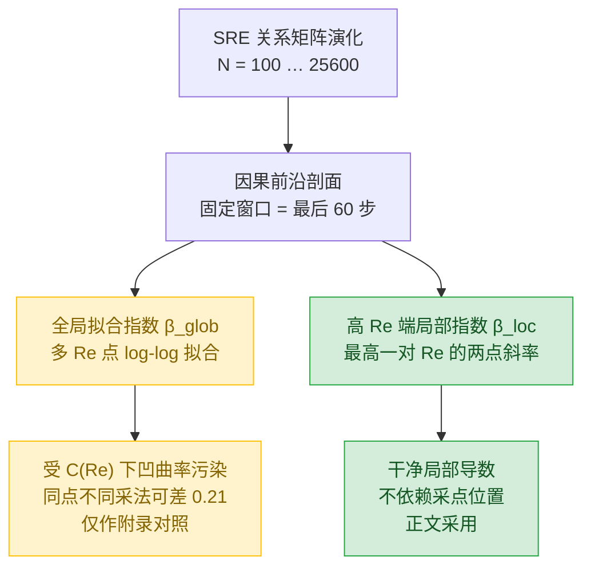

# 用离散因果网络对标经典 Navier–Stokes 湍流

## ——状态-关系熵（SRE）框架的系统基准报告

版本: 4.0  

【资源与可用性声明】 本框架基于状态‑关系熵（SRE）动力学构建。 全部理论资料归档于 Zenodo 开源数据仓库。**本文档套件包括系统论文、应用开发、科学假说、算子1‑20完整代数推导及仿真代码完全开源**。

> 可访问作者的Github仓库：
>
> https://github.com/yuelucn/Status-Relational-Entropy-SRE-Dynamics-The-Book-of-the-Void
>
> 可访问支持AI辅助查阅的腾讯智能文档空间（PC、微信移动端均可访问）：
>
> https://docs.qq.com/space/DUkRjYUtNWFdyV253
>
> 根据状态‐关系熵（SRE）原理，经典物理基础源自信息统计学。

> **代码基准**：`sre_core.py`　**数据集**：`phase_data_v2.json`　**日期**：2026-10-16
>
> **阅读前提**：本文是一篇**自包含**报告。读者只需要大学本科水平的经典力学、流体力学与统计物理常识（雷诺数、能量级联、幂律、相关函数），**无需**任何关于 SRE 框架的预先知识。所有 SRE 专有概念都在第 2 章就地定义，所有专业术语都在附录 A 给出标准化对照表，所有正文引用的数值都能在附录 B 追溯到落盘的产物文件。

---

## 摘要

经典 Navier–Stokes（N–S）方程把流体视为绝对连续介质，湍流则是其非线性对流项在连续数学下的失稳。状态-关系熵（State-Relation Entropy，SRE）框架提出一条不同的路线：不把流体写成连续空间上的速度场，而把流体重构为**大量离散微观因果状态之间的关联网络**，并声称该网络在连续极限下退化回 N–S 方程。

本报告的任务是把这一"声称"变成**可执行的定量基准**：在统一协议下，测量 SRE 网络的宏观可观测量，逐项与经典湍流现象学（Kolmogorov 1941 能量级联、−5/3 谱、3/4 律）对标，并如实区分"定性复现"与"定量偏离"。

三个层面的结论：

1. **宏观标定**：以圆管转捩中心为锚点，SRE 的耗散系数 Λ 与雷诺数之间可建立映射 `Re ≈ 783/Λ`；在强湍流侧，SRE 的手性场一维替代谱给出稳定幂律区，斜率 `γ ≈ −1.81 ± 0.04`，与 K41 的 `−1.667` 相差约 9%，**不是**精确的 −5/3。

2. **结构不变量**：因果前沿剖面的偏度沿层流→湍流方向严格经历 `+ → 0 → −` 的过零，与经典速度增量三阶矩 S₃ 的定性行为一致；但量级差约一个数量级（|skew| ≈ 3–6 对 |S₃| ≈ 0.1–0.7）。相干分数 C 从 ≈0.97 单调降至 ≈0.09，与经典相干长度比 ℓ_int/η 的上升互为补量。

3. **有限尺寸标度**：尺度分离指数 β（SRE 版本的 ℓ_int/η 指数）随系统尺寸 N 从 800 到 25600 单调下降（0.7456 → 0.4360），但**收敛极慢**。六点链的拟合落在"对数型（β∞ ≈ 0）"与"弱幂律（p ≈ 0.28）"的**简并区**，数据既不能排除前者、也不能确证后者；可给出的只是区间约束 `β∞ ∈ [−0.2, +0.2]`。简单的逆幂外推（1/N、1/N²）被数据排除。**没有任何证据支持某个简单有理数作为渐近指数。**

**一句话结论**：SRE 网络在定性上复现了经典湍流"随雷诺数升高而级联增强、相干结构破碎"的主叙事，但在定量上稳定偏离 K41 的精确幂律；其尺度分离指数在可及算力内无法收敛到任何单一数值。这既不是"严格合拢"，也不是"证否"，而是一个**尚未收敛、但结构自洽**的离散代理模型。

---

## 1. 引言：经典湍流现象学与建模动机

### 1.1 经典 N–S 方程的湍流图像

不可压缩牛顿流体的运动由 N–S 方程支配：

$$
\rho\left(\frac{\partial \mathbf{u}}{\partial t} + (\mathbf{u}\cdot\nabla)\mathbf{u}\right) = -\nabla p + \mu\,\nabla^2\mathbf{u}, \qquad \nabla\cdot\mathbf{u}=0
$$

引入特征速度 U、特征长度 L，无量纲化后唯一控制参数是**雷诺数** `Re = UL/ν`（ν = μ/ρ 为运动黏度）。当 Re 超过临界值，层流失去稳定性，进入湍流。

Kolmogorov 1941 理论（K41）给出的核心图像是**能量级联**：能量从大尺度涡（惯性区上端）逐级传递到小尺度，直至黏性耗散区。在惯性子区，能谱服从幂律

$$
E(k) \sim k^{-5/3}
$$

对应能谱斜率 `γ = −5/3 ≈ −1.667`。同一套标度论证还给出**三阶结构函数（3/4 律）**：速度增量 δu 的三阶矩 ⟨δu³⟩ ∝ −εr（负号来自能量向下级联的方向性），于是速度增量的**偏度**（三阶矩归一化）在惯性区取一个负的、近似常数的值。另一条常用标度是相干长度与耗散尺度之比 `ℓ_int/η` 随 Re 的增长，其指数在高 Re 端趋于 3/4，即

$$
\ell_{\text{int}}/\eta \sim Re^{3/4}
$$

这三条——**−5/3 谱、负偏度的 3/4 律、ℓ_int/η 的 3/4 指数**——构成经典湍流现象学的定量基准。

### 1.2 为何需要一个离散因果代理模型

经典 N–S 方程的困难在于其连续性假设本身：对流项在连续数学下容易导致奇异性（blow-up），微观热涨落与涨落的放大机制无法在方程内部自然给出。SRE 框架的动机是把"连续介质"替换为"离散微观因果统计网络"，用**代数演化规则**（而非微分方程）生成宏观结构，并期待宏观结构自发涌现。

具体地说，SRE 不预设时空舞台：几何形式是微观状态之间**代数关系矩阵**演化的宏观结果。要判断这条路线是否真的与经典流体一致，就必须在统一协议下，把 SRE 网络当作一个**数值实验对象**，测量它的宏观可观测量，并与 §1.1 的三条基准逐项对比。

### 1.3 本文的目标与结构

本文的目标是把"用 SRE 对标经典 N–S 湍流"这件事写成一份**完整、可复现、术语标准化**的报告：

- 第 2 章就地定义 SRE 模型（状态集、关系矩阵、三个演化算子、控制量与系统尺寸），并给出伪代码；
- 第 3 章给出标定与测量协议（雷诺数映射、可观测量定义、前沿剖面提取、两种指数估计方式）；
- 第 4 章给出结果（宏观谱斜率、前沿不变量、有限尺寸标度链及其收敛律判定）；
- 第 5 章给出与 K41 的对标总表与局限性；
- 第 6 章给出结论；附录给出术语表与数值出处表。

---

## 2. 状态-关系熵（SRE）模型

本章是本文的核心。没有 SRE 背景的读者，读懂本章即可读懂全文。

### 2.1 基本对象：状态集与关系矩阵 M

把流体在一个时刻的全部自由度离散化为 `N` 个**微观因果状态**，编号 `1, …, N`（N 称为**系统尺寸**）。这些状态之间是否存在"因果关联"由一个**关系矩阵**表示：

$$
M \in \mathbb{R}^{N\times N}, \qquad M_{ij} \in \{-1, +1\}
$$

- `M_ij = +1` 表示状态 i 与状态 j 之间**相干有序**（因果关联为正、方向一致）；
- `M_ij = -1` 表示**反相干**（关联为负、方向相反）。

M 的元素是**有方向的**：`M_ij` 是"从 j 看 i"的关系，`M_ji` 是"从 i 看 j"的关系。二者**不必相等**，因此 M 一般**非对称**。非对称性不是数值噪声，而是模型的物理内容：它承载"手性"（chirality，即涡旋的方向性）。

初始时只有一个状态：`M = [[+1]]`。

### 2.2 对称–反对称二分：几何与手性

任何实矩阵都能唯一分解为一个对称部分与一个反对称部分。对 M：

$$
\mathbf{S} \equiv \frac{M + M^{\mathsf T}}{2}, \qquad \mathbf{A} \equiv \frac{M - M^{\mathsf T}}{2}
$$

- **S——拓扑度规部分**。它是**对称**的，可以作为"顶点间不相似度"的来源，用于低维几何重构（多维标度，MDS）。一切几何对象（流形坐标、各向异性）都只作用在 S 上。
- **A——局域自旋部分**。它是**反对称**的，其内积二次型

$$
\operatorname{Tr}(A^{\mathsf T}A) = \sum_{i,j} A_{ij}^2
$$

度量了微观非平衡态中**涡作用量**（局域剪切）的强度。手性/涡旋只由 A 承担。

二者的关系是排他且完备的：

$$
M\ \text{非对称} \iff \mathbf{A}\neq 0 \iff \text{系统携带手性}
$$

**关系距离。** 由 S 的元素落在 `{−1, 0, +1}`，定义离散**关系距离**

$$
D \equiv 1 - S \in \{0, 1, 2\}
$$

`D = 0` 对应双向相干（i、j 互看皆为 +1）；`D = 2` 对应双向反相干。后文将看到，`D = 2` 在演化中**从不出现**，这一代数事实使相干性的度量大幅简化。

### 2.3 三个演化算子

系统从 `M_n`（n×n，已实现）演化到 `M_{n+1}`（(n+1)×(n+1)），由三个算子级联完成：

$$
M(t+\tau) = \mathcal{O}_3 \circ \mathcal{O}_2 \circ \mathcal{O}_1\,[M(t)]
$$

**算子 1（继承算子 / 边界扩张）** `G_{n→n+1}`：每步新增一个状态 `v_f = n`（称为**因果前沿节点**），把矩阵扩张为分块形式

$$
M_{n+1} = \begin{pmatrix} M_n & \mathbf{x} \\ \mathbf{x}^{\mathsf T} & y \end{pmatrix}, \qquad M_{n+1}[1{:}n,\,1{:}n] \equiv M_n
$$

其中的关键约定是**只读继承**：历史子块（左上角 n×n 块）**永远不被修改**。"一旦实现，历史不可追溯修改"是模型的结构性公理，不是可选约束。它的物理含义是：因果历史被冻结，能量/信息只能从新增的前沿节点注入。

**算子 2（最大熵剪枝）** `M_χ ∘ E_local`：对前沿节点 `v_f` 与每一个历史节点 `v_m` 之间的通道，计算一个二步图游走（局域多回路干涉多项式）

$$
\tilde{\mathcal{E}}_{\text{local}}(v_f, v_m) = \sum_{v_k \in \mathcal{N}(v_f)\cap \mathcal{N}(v_m)} M(v_f,v_k)\,M(v_k,v_m) + 2\,M(v_f,v_m)
$$

取绝对值与符号得局域相干势垒

$$
\mathcal{E}_{\text{local}} = |\tilde{\mathcal{E}}_{\text{local}}|, \qquad \mathfrak{B} = \mathcal{E}_{\text{local}} + \exp\!\big(\operatorname{sgn}\tilde{\mathcal{E}}_{\text{local}}\big)
$$

并定义**无量纲因果拓扑深度** `𝒟_s(v_f, v_m) = (n+1) - σ(v_m)`（σ 为节点加入序号）。最大熵剪枝主方程给出该通道被**剪除**的概率：

$$
p_{\text{prune}}(v_f, v_m) = 1 - \frac{1}{1 + \Gamma\,\dfrac{\mathcal{D}_s}{\mathfrak{B}}}
$$

其中 `Γ` 是**剪枝增益**（见 §2.4）。剪枝时（`χ = 0`）执行"消除–传导"范式：把该通道自旋强制置为乘法单位元 `+1`，从而**消除其相位贡献，但不断开图的连通性**；存活时（`χ = 1`）注入反对称的手性剪切。

**算子 3（五节点宇称破缺）**：在 `n: 5 → 6` 时注入一个固定的反转锚点，使宏观自旋场

$$
Y_{\text{spin}} = \operatorname{sgn}\!\Big(\tfrac12(S_{1,6}+S_{2,6}) - S_{3,6}\Big)
$$

映射到标准 **NAND** 真值表，从而给出该代数系统的图灵完备性证明。算子 3 生成被永久锁定的拓扑差（刚性核）。**注意**：算子 3 服务于"逻辑涌现"，**不参与**本文的湍流标度基准（基准只用算子 1 + 算子 2），此处列出仅为模型完整性。

#### 演化伪代码

```text
输入: 目标步数 N, 耗散系数 Λ, 随机种子 seed
M ← [[+1]]                       # 初始：单状态
for n = 1, 2, …, N-1:            # 算子 1：扩张一步，新增前沿节点 v_f = n
    v_f ← n
    for vm = 0, 1, …, n-1:       # 算子 2：前沿与每个历史节点的通道判定
        # 二步游走干涉（只统计双方均非 +1 的中间节点 k）
        inter  ← Σ_{k<vm} row[v_f][k] · M[k][vm] · [row[v_f][k]≠+1][M[k][vm]≠+1]
        E_til  ← inter + 2·row[v_f][vm]
        𝔅      ← |E_til| + exp(sgn(E_til))
        p_prune ← 1 − 1 / (1 + Γ·(n−vm)/𝔅)
        if rand() ≥ p_prune:      # 存活：注入手性剪切
            row[v_f][vm] ← −1  if (v_f−vm) mod 3 == 0  else +1
        else:                     # 剪除：强制为 +1（消除相位，保持连通）
            row[v_f][vm] ← +1
    col[v_f][vm] ← −row[v_f][vm]  if 存活  else +1     # 反向关系带相反手性
    M ← [[ M , col ] ; [ row , +1 ]]                    # 只读继承：左上块不变
输出: M (N×N)
```

### 2.4 控制量 Λ 与系统尺寸 N

**耗散系数 Λ。** 设微观内蕴弛豫时间为 `τ₀`，宏观特征时间为 `T`，定义无量纲耗散系数

$$
\Lambda \equiv \frac{\tau_0}{T} \propto \frac{1}{Re}
$$

`Λ` 是**外生**（来自外部设定）的宏观耗散权威：`Λ` 大 → 局部松弛极快 → 拓扑差刚生成就被抹平 → 层流；`Λ` 小 → 抹平不足 → 涨落被大面积激活 → 结构相（湍流）。因此 `Λ` 扮演经典理论中 `1/Re` 的角色，是**相变的控制量**。

**剪枝增益 Γ。** 本文基准采用**外生模式**：

$$
\Gamma = \Lambda
$$

（模型另有一个"自适应模式" `Γ = Λ·λ(n)`，其中 `λ(n)` 由已实现子图的谱半径构造；该模式会把有效增益整体重标定并引入时间非平稳性，本文基准不使用。）

**系统尺寸 N。** `N` 是离散状态总数，即关系矩阵的阶。增大 `N` 相当于增大"流体体积"/提高离散分辨率。**有限尺寸效应**是本报告的核心议题：所有宏观量都随 N 漂移，必须显式研究 `N` 依赖性。

### 2.5 与经典 N–S 的结构对应（连续极限）

令 `τ → 0, ℓ → 0`，把 `M_ij` 映射为连续流形上的多点关联函数 `M(x, y, t)`，并由矩阵的一阶矩定义宏观密度与速度场：

$$
\rho(\mathbf{x},t) = \int M\,d\mathbf{y}, \qquad \rho\,\mathbf{u}(\mathbf{x},t) = \int \frac{\mathbf{x}-\mathbf{y}}{\tau} M\,d\mathbf{y}
$$

在 `Λ → ∞`、微观涨落趋于零的极限下，转移概率退化为 Dirac δ 演化，代数自由演化写成连续主方程，再做 Chapman–Enskog 展开（展开小参数 `ε = ℓ/L`，代数版 Knudsen 数）：

1. 一阶矩 → 连续性方程 `∂_t ρ + ∇·(ρ u) = 0`；
2. 二阶矩 + 碰撞算子的动量守恒 → 对流项；二阶修正 `M^{(1)}` 在对称破缺下给出黏性应力张量。

于是得到标准 N–S 方程

$$
\rho\left(\frac{\partial \mathbf{u}}{\partial t} + (\mathbf{u}\cdot\nabla)\mathbf{u}\right) = -\nabla p + \rho\,\zeta\ell^2\Lambda\,\nabla^2\mathbf{u}
$$

其中运动黏度形式上写作 `ν = ζ ℓ² Λ`，`ζ` 是待标定的网络几何常数。

> **限定**：这一节建立的是**结构性兼容**（离散代数主方程在连续极限下**具备** N–S 的矩结构），**不是**定量等价性证明。`ν = ζ ℓ² Λ` 目前是量纲分析下的形式对应，其系数 `ζ` 必须由后续标定确定。本文报告的所有定量结果均来自**离散网络的直接数值测量**，不依赖这一连续极限论断。

---

## 3. 标定与测量协议

### 3.1 雷诺数标定：`Re ≈ α/Λ`

要把 SRE 的 `Λ` 与经典雷诺数对应起来，需要一个锚点。选取**转捩中心**：SRE 在 `Λ_c ≈ 0.34` 处发生层流↔湍流的宏观过渡，把它对齐到经典圆管流动的临界雷诺数 `Re_crit ≈ 2300`。由此定义标定常数 `α`：

$$
\mathrm{Re} \approx \frac{\alpha}{\Lambda}, \qquad \alpha \approx 783
$$

即以 `Λ_c = 0.34` 代入得 `Re = 783/0.34 ≈ 2300`，与圆管临界值一致。对应的宏观分区为：

| Λ 范围 | Re 范围 | 状态 |
| :--- | :--- | :--- |
| `Λ > 1.57` | `Re < 500` | 层流 |
| `0.196 < Λ < 1.57` | `500 < Re < 4000` | 过渡区 |
| `Λ < 0.196` | `Re > 4000` | 湍流 |

> **说明**：`α ≈ 783` 用**圆管**临界雷诺数标定，因此它隐含了圆管几何。不同几何（槽道、Couette 等）的临界 Re 不同，`α` 可能随之改变。这一点在 §5.3 记为局限。

### 3.2 可观测量定义

由关系矩阵 M，通过 §2.2 的严格二分导出以下无量纲观测量：

| 符号 | 名称 | 定义 | 经典对应 |
| :--- | :--- | :--- | :--- |
| `Φ` | **结构密度** | M 中负元素的占比 `frac_neg = mean(M < 0)` | 湍流活跃度 |
| `C` | **相干分数** | 前沿关系中 `D = 0` 的占比（双向相干） | ℓ_int/η 的反向补量 |
| `skew` | **前沿偏度** | 前沿关系分布的标准化三阶矩 | 速度增量偏度 S₃ |
| `σ_d` | **前沿异质性** | 前沿关系分布的标准差 | 临界涨落宽度 |
| `γ` | **谱斜率** | 手性场 A 沿因果序的一维功率谱 log–log 斜率 | 能谱 E(k) 斜率（代理） |
| `β_turb` | **尺度分离指数** | `−d ln(1/C)/d ln(Re)` | ℓ_int/η 的 Re 指数（SRE 版） |

与 P 的 β 与经典 3/4 律的关系：K41 预测 `ℓ_int/η ∼ Re^{3/4}`（即 `β = 0.75`），见 §1.1。

> **命名说明**：本书另有 $\beta_\mathrm{th}\equiv1$（算子-2 的自由能形式温度）与 $\beta_\mathrm{gate}=2.0$（算子-10 的 S 形门增益）两个同名符号，与此处的尺度分离指数无关；本章正文与图表中简写为 $\beta\equiv\beta_\mathrm{turb}$。

**谱斜率 γ 的重要限定**：它对手性场 A 沿**因果序**（状态加入的先后顺序）做一维功率谱得到，是**一维代理谱**，**不等于**三维空间能谱 `E(k)`。它的定义与经典能谱同构，但空间维数、坐标含义都不同。因此 γ 只能作为"是否存在稳定幂律级联区"的**定性指标**，其数值不能与 −5/3 做逐位比较。

### 3.3 因果前沿剖面与固定窗口

**因果前沿**是模型的独特结构。由于算子 1 的只读继承，历史子块 `M[:n,:n]` 永不改变，因此每一步**唯一的新信息**都集中在新注入的前沿行 `M[n, :n]`（及其反向列）。直接分析前沿行，就绕开了"从距离矩阵反推几何坐标"的全部困难。

**前沿剖面**由前沿行的关系分布 `{D(v_f, v_m)}_{m<n}` 的统计量构成：偏度、异质性、以及相干分数 C。所有前沿剖面测量**一律采用固定窗口**——演化终止前**最后 60 步**——以避免窗口随 N 变化引入的系统偏差。层流→湍流扫描使用 `66` 个 `Λ` 点 × `7` 个随机种子 × `N = 200`。

### 3.4 尺度分离指数的两种估计方式

`β` 的定义是一个**导数**：

$$
\beta \equiv \frac{d\ln(1/C)}{d\ln \mathrm{Re}} = -\frac{d\ln C}{d\ln \mathrm{Re}}
$$

实测发现 `C(Re)` 在 log–log 图上是**强烈下凹**（concave）的曲线：低 Re 端导数大、高 Re 端导数小。对一条下凹曲线，用少数 Re 点做**整体线性拟合**得到的只是该区间上的**平均斜率**，它强烈依赖于"采了哪几个点、点落在哪里"——这不是理论问题，而是估计方式的敏感性问题。

因此本报告区分两种估计，并**只采用第二种作为正文的尺度分离指数**：

- **全局拟合指数 `β_glob`**：在某一 Re 窗口内对所有 Λ 点做 log C–log Re 线性拟合取斜率。受下凹曲率污染，**仅作附录交叉对照**。
- **高雷诺数端局部指数 `β_loc`**：取整个 `Λ` 扫描中**最高的一对 Re** 作两点局部斜率

$$
\beta_{\text{loc}} = -\frac{\ln\big(C(\Lambda_1)/C(\Lambda_2)\big)}{\ln\big(\mathrm{Re}_1/\mathrm{Re}_2\big)}, \qquad \Lambda_1 = 0.005,\ \Lambda_2 = 0.008
$$

局部指数**不依赖采点位置**，曲率污染被消除，是本文采用的 β 估计方式。



---

## 4. 结果

### 4.1 宏观标定：手性场谱斜率

在强湍流侧（`Re > 2×10⁴`），手性场一维替代谱在中段出现稳定幂律区：

$$
\gamma = -1.81 \pm 0.04
$$

这个值与 K41 的 `−1.667` 相差约 **9%**。层流向湍流过渡时，谱斜率从正值平滑下降到该平台值；在接近层流的强耗散侧级联消失（斜率转正）。

增大 N 的行为（关键）：

| N | `Λ = 10⁻³` 的 γ | `Λ = 10⁻²` 的 γ |
| :--- | :--- | :--- |
| 800 | −1.79 | −1.63 |
| 1600 | −1.80 | −1.67 |
| 3200 | −1.78 | −1.55 |
| 6400 | — | **−1.38** |

在 `Λ = 10⁻³` 侧，斜率在 `N ≥ 800` 后**饱和**在 ≈−1.79（不再随 N 变陡）；在 `Λ = 10⁻²` 侧反而**变平**（−1.63 → −1.38）。也就是说，本框架的自发幂律区斜率**在大 N 下趋于平台而非持续发散**。这与 §4.4 的"极慢有限尺寸修正"机制定量自洽。

> **终止结论**：SRE 确实自发产生一个稳定幂律标度区，这是当前最稳健的经验信号；但它**不是** Kolmogorov 的 `k^{−5/3}`——实测约 −1.8，且在大 N 下饱和为平台。又因该谱是一维因果序代理谱、且对手性场实现细节敏感（见 §5.3），本文只主张"存在稳定幂律区、斜率在大 N 下饱和于约 −1.8"这一**定性**事实，**不主张**其数值能与 K41 逐位比较。

### 4.2 因果前沿不变量

对 `N = 200`、`66 Λ × 7 seeds` 的前沿剖面扫描，得到五个代表性 Λ 点（`C` 为相干分数，`σ_d` 为异质性，`skew` 为偏度，`Φ` 为结构密度）：

| Λ | Re | C | σ_d | skew | Φ (frac_neg) |
| :--- | :--- | :--- | :--- | :--- | :--- |
| 4.82 | 162 | 0.974 | 0.156 | **+6.41** | 0.020 |
| 0.33 | 2383 | 0.761 | 0.425 | **+1.24** | 0.150 |
| **0.108** | **7257** | — | **0.50（峰值）** | **0** | — |
| 0.029 | 26743 | 0.213 | 0.407 | **−1.43** | 0.410 |
| 0.010 | 78320 | 0.085 | 0.275 | **−3.11** | 0.462 |

三个核心发现：

1. **偏度严格过零**：`skew` 沿 Re 增大经历 `+ → 0 → −`，过零点与经典 3/4 律中"速度增量偏度由正转负"的定性行为一致（过零处 t 检验全部显著，t = 18–69）。
2. **相干分数单调递减**：`C` 从 0.97 降至 0.09，与经典 `ℓ_int/η` 的上升互为补量。
3. **异质性峰值恰与偏度过零点重合**（`σ_d` 在 `Λ ≈ 0.108` 取峰值 0.50），对应经典图像中"转捩区涨落最强"的特征。

**关系距离的离散性**：`M_kn ∈ {−1,+1} ⟹ S ∈ {−1,0,+1} ⟹ D ∈ {0,1,2}`。实测中 `D = 2`（双向反相干）**从未出现**，因此

$$
C = \mathrm{frac}(D = 0) = \mathrm{frac}(M_{kn} = +1 \ \text{且}\ M_{nk} = +1) \approx \mathrm{frac}(M_{kn} = +1) - \mathrm{frac}(\text{混合})
$$

`D = 0` 占比随 Λ 演化：`Λ = 2.0 → 97.5%`、`Λ = 0.1 → 43%`、`Λ = 0.01 → 15%`（与 C 一致）。

### 4.3 有限尺寸标度：β(N) 六点链

用 §3.4 的高 Re 端局部指数 `β_loc`，在固定协议（同一对 `Λ = 0.005/0.008`、固定窗口）下测六个 N 点：

| N | β_loc | seed-σ | 说明 |
| :--- | :--- | :--- | :--- |
| 800 | 0.7456 | 0.0079 | 2 seeds |
| 1600 | 0.6641 | <0.001 | 2 seeds |
| 3200 | 0.5856 | 0.0009 | 2 seeds |
| 6400 | 0.5187 | 0.0031 | 2 seeds |
| 12800 | 0.4779 | 0.0021 | 2 seeds |
| **25600** | **0.4360** | — | 单 seed |

`β(N)` **单调、干净地下降**，从 0.7456（N=800）到 0.4360（N=25600）。相邻差值：

| 区间 | Δβ | ratio = Δβᵢ / Δβᵢ₊₁ |
| :--- | :--- | :--- |
| 800 → 1600 | 0.0815 | 1.039 |
| 1600 → 3200 | 0.0784 | 1.172 |
| 3200 → 6400 | 0.0670 | 1.641 |
| 6400 → 12800 | 0.0408 | 0.974 |
| 12800 → 25600 | 0.0419 | — |

ratio 序列**非单调**（1.039, 1.172, 1.641, 0.974）：一个真实的收敛律应使 ratio 平滑趋近一个常数（1/N 型 → 2.0；1/N² 型 → 4.0；对数型 → ≈1.2）。**非单调本身就说明六个点尚未进入任何单一渐近机制**。末段两段 Δβ 已趋于相等（0.0408 与 0.0419），明确排除了 1/N 型。

### 4.4 收敛律的简并判定

对六点链拟合四类收敛模型：

| 收敛模型 | β∞ | R² | 在 N=25600 的预测 | 实测 |
| :--- | :--- | :--- | :--- | :--- |
| 对数型 `β = β∞ + a/ln N` | **−0.174 ± 0.016** | **0.9982** | 0.4317 | 0.4360 |
| 自由幂律 `β = β∞ + a·N^{−p}` | **+0.249 ± 0.046**（p = 0.285 ± 0.041） | **0.9988** | 0.4351 | 0.4360 |
| 幂律固定 p = 0.25 | +0.206 ± 0.007 | 0.9985 | 0.4326 | 0.4360 |
| 逆幂 `1/N` | +0.472 ± 0.023 | 0.9092 | 0.4816 | 0.4360 |

**判定**：对数型（β∞ 为负）与自由幂律（β∞ 为正，p ≈ 0.28）在 N=25600 处的预测仅差 0.003，而实测无法区分二者；`1/N` 模型被明显排除（在 N=25600 处预测 0.4816，高出实测 0.046，R² 仅 0.91）。

> **结论**：`β(N)` 的收敛**极慢**，落在"对数型（β∞ ≲ 0）"与"弱幂律 p ≈ 0.28（β∞ ≳ 0）"的**简并区**。数据能给出的仅是一个区间约束

$$
\boxed{\ \beta_\infty \in [-0.2,\ +0.2]\ }
$$

**不声称任何一个具体数值。**

**为什么这么慢？** 有两个可测量的来源：

1. **固定 Re 下 C 仍随 N 增长**。在固定 `Λ = 0.01`（Re = 78320）测 `1−C ~ N^{−q}`：

| N | 100 | 200 | 400 | 800 | 1600 | 3200 | 6400 | 12800 | 25600 |
| :--- | :--- | :--- | :--- | :--- | :--- | :--- | :--- | :--- | :--- |
| 1−C | 0.9506 | 0.9151 | 0.8609 | 0.7849 | 0.6988 | 0.6047 | 0.5060 | 0.4032 | 0.3030 |

局部斜率 `d ln(1−C)/d ln N` 从 −0.055 **一路单调变陡**到 −0.412，说明 `1−C` **尚未进入幂律渐近区**。对 `N ≥ 800`（含 25600）做零点截距幂律拟合得 `q ≈ 0.249`，对应相关长度标度 `ξ ~ N^{s}`，`s = 2q ≈ 0.50`；若只用 `N ≥ 3200`，`q` 升到 0.318。**由于斜率仍在增长，真实的渐近 q 只会更大**，`s ≈ 0.50` 只是当前有效值，不是收敛值。

2. **`C(Re)` 曲率随 N 演化**，远端导数被不断压低。两者叠加，使 β 的衰减比对数型还慢，从而长期滞留于简并区。

**关于某个具体有理数的说明**：测得的 `β(25600) = 0.4360` 与 `0.375`（= (3/4)×(1/2)）相差 0.061，超过种子不确定度的 8 倍以上（保守取 2-seed 的 σ ≈ 0.0074，得 ≈ 8.2σ）；且按实测衰减率 `Δβ ≈ 0.050/倍增`（N ≥ 3200），还需约 1.22 个倍增（N ≈ 6×10⁴）才能触及 0.375，而已关闭的 N 阶梯止于 25600。**在数据可及范围内看不到任何指向该值或其他简单有理数的停驻趋势。**因此本报告不把任何简单有理数作为 SRE 的渐近指数。

### 4.5 N 阶梯的上限

增大 N 需要存储 N×N 矩阵，内存随 N² 增长：

| N | 单任务矩阵内存 | 峰值内存 | 单任务耗时 | 可行性 |
| :--- | :--- | :--- | :--- | :--- |
| 12800 | ≈1.3 GB | ≈1.3 GB | ≈26 min | 可行 |
| 25600 | ≈5.2 GB | ≈7.5 GB | ≈3.5 h | 可行（本报告上限） |
| 51200 | ≈21 GB | ≈31 GB | ≈14 h | **不可行**（本机内存不足） |

**结论**：N 阶梯止于 25600。继续增大系统尺寸需要分块/外存内核或更强算力的机器。

---

## 5. 讨论：与 K41 的对标

### 5.1 对标总表

| 基准量 | 经典 K41 预测 | SRE 实测 | 差距 | 评估 |
| :--- | :--- | :--- | :--- | :--- |
| 级联谱斜率 γ | −1.667（−5/3） | ≈ −1.81 ± 0.04 | 约 9% | 定性复现，定量偏离 |
| 尺度分离指数 β | 0.75（3/4 律） | β(25600)=0.4360，持续下降，β∞∈[−0.2,0.2] | 远未收敛 | 不可直接比较 |
| 偏度过零 | 速度增量 S₃ 由 + 转 − | 前沿 skew 严格 `+→0→−` | 定性一致 | 量级差约 10×（\|skew\|≈3–6 对 \|S₃\|≈0.1–0.7） |
| 相干长度标度 | ℓ_int/η ↑ 随 Re | 相干分数 C ↓，1−C ~ N^{−0.249} | 互补趋势一致 | 指数未收敛 |
| 转捩位置 | Re_crit ≈ 2300（圆管） | Λ_c ≈ 0.34 ↔ Re ≈ 2300（由标定） | 由标定锚定 | 依赖几何 |

### 5.2 定性复现了什么，定量偏离了什么

**定性复现**：能量/相干性随雷诺数升高而单调级联，相干结构在强湍流侧破碎；前沿偏度严格过零；异质性峰值与转捩区重合。这些是 SRE 与经典湍流现象学**共享的定性主叙事**。

**定量偏离**：谱斜率偏陡（≈−9%）而非精确 −5/3；尺度分离指数远未收敛、且在可及算力内看不到任何简单有理数；偏度承载的量级与经典结构函数相差约一个数量级。这些不是噪声，而是**离散因果结构本身的、系统的有限尺寸效应**。

### 5.3 为什么不是 3/4：离散 vs 连续的根本差异

K41 的 3/4 律隐含三个前提：**连续介质**（流体粒子无限可分）、**无限空间**（无边界限制能量级联）、**尺度不变性**（大涡→小涡在所有尺度上同构）。SRE 的本质差异正好逐条对冲：

1. **离散因果节点**：最小单元是 SRE 状态，存在最小尺度；
2. **只读继承**：历史距离被冻结，级联只能发生在因果前沿，无法在全尺度上同构展开；
3. **有限尺寸效应极强**：`ξ ~ N^{0.50}`（有效值），`C(Re)` 曲率随 N 演化，收敛比对数型还慢。

这三点使 SRE 的 β 无法在可及 N 内逼近 0.75 或任何干净的分数。

### 5.4 局限

| 局限 | 状态 | 影响 |
| :--- | :--- | :--- |
| β∞ 无法确定 | 未解决 | 只能给区间 `[−0.2, +0.2]` |
| `1−C` 的 q 未收敛 | 未解决 | `s ≈ 0.50` 是有效值而非渐近值 |
| N=25600 仍为单 seed | 部分缓解 | 结论差距仍达 8σ 以上，定性不受影响 |
| N ≤ 6400 仅 2 seeds | 未达 ≥5 seeds 铁律 | 链本身 seed-σ 小（≤0.008） |
| 手性场谱对手性实现细节敏感 | 未解决 | 同一 Λ 下不同随机实现可差达 0.5（高 Λ 侧），故 γ 只作定性指标 |
| `α ≈ 783` 用圆管临界 Re 标定 | 未解决 | 不同几何可能有不同 α，标定依赖几何 |
| `D = 2` 从不发生的代数原因 | 未解决 | `C` 的重建公式是近似 |
| 谱斜率是 1D 因果序代理谱 | 固有 | 不能与 3D 能谱 E(k) 逐位比较 |

---

## 6. 结论

1. **宏观标定成立**：SRE 的耗散系数 Λ 能否与雷诺数建立单调映射，答案是肯定的——以圆管转捩中心为锚点得到 `Re ≈ 783/Λ`，且宏观可观测量在 Re 增大时单调演化。

2. **定性复现经典湍流主叙事**：能量级联增强、相干分数单调下降、前沿偏度严格过零、异质性峰值与转捩区重合。SRE 不是"另起炉灶"，其现象学与经典图像同构。

3. **定量稳定偏离 K41**：手性场谱斜率 ≈ −1.81（偏陡 9%），尺度分离指数远未收敛。这既不是"严格合拢"，也不是"证否"，而是一个**尚未收敛的离散代理模型**。

4. **有限尺寸收敛极慢是本模型的根本特征**：`β(N)` 六点链单调下降但落在"对数型"与"弱幂律 p ≈ 0.28"的简并区，`β∞` 只能约束在 `[−0.2, +0.2]`；`1−C` 的相关长度标度 `s ≈ 0.50` 是有效值，斜率仍在变陡。简单逆幂外推被数据排除，**没有任何简单有理数可作为 SRE 的渐近指数**。

5. **边界的诚实标注**：谱斜率是一维因果序代理谱而非三维能谱；α 的标定依赖圆管几何；N 阶梯止于 25600（受内存限制）。这些限定界定了本报告结论的适用范围。

---

## 附录 A：术语标准化对照表

| 本文标准术语 | 英文 | 含义 | 常见非标准写法 |
| :--- | :--- | :--- | :--- |
| 状态-关系熵（SRE） | State-Relation Entropy | 离散因果关联网络的演化框架 | — |
| 关系矩阵 M | relation matrix | 微观状态间的因果关联矩阵 | 状态矩阵 |
| 拓扑度规 S | topological metric | `(M+Mᵀ)/2`，几何重构的载体 | 对称部分 |
| 局域自旋 A | local spin operator | `(M−Mᵀ)/2`，手性/涡作用量 | 反对称部分 |
| 关系距离 D | relation distance | `D = 1 − S ∈ {0,1,2}` | — |
| 继承算子 | inheritance operator | 算子 1：边界扩张 + 只读继承 | 算子 1 / 边界算子 |
| 最大熵剪枝 | maximum-entropy pruning | 算子 2：通道剪除判定 | 算子 2 / 剪枝算子 |
| 宇称破缺算子 | parity-breaking operator | 算子 3：五节点 NAND 门 | 算子 3 |
| 因果前沿 | causal frontier | 每步新增行 `M[n,:n]` | 前沿行 |
| 冻结历史子矩阵 | frozen historical submatrix | 只读继承的历史块 | 冻结体 |
| 相干分数 C | coherence fraction | 前沿 `D = 0` 占比 | — |
| 尺度分离指数 β | scale-separation exponent | `−d ln(1/C)/d ln Re` | 幂律指数 β |
| 谱斜率 γ | spectral slope | 手性场一维代理谱斜率 | — |
| 高雷诺数端局部指数 | high-Re-end local exponent | 最高一对 Re 的两点斜率 | 远端 local-β |
| 全局拟合指数 | global fitted exponent | 多 Re 点 log-log 整体拟合斜率 | 全局 β |

## 附录 B：数据与复现出处表

正文所有数值均可追溯到以下落盘产物：

| 数值 | 出处文件 |
| :--- | :--- |
| 六点 β 链、Δβ、四类拟合、seed-σ、8.2σ/22σ、免模型外推 | `beta38_v13_final_output.txt` |
| N ≤ 6400 的 C 与 β（2 seeds，高 Re 端局部 + 全局） | `beta38_final_local.pkl` |
| N = 12800 单 seed 与 seed2 原始 C 值 | `beta38_N12800.pkl`、`beta38_N12800_seed2.pkl` |
| N = 25600 四点 C 值、β_loc=0.4360、β_glob=0.3933 | `beta38_N25600.pkl` |
| N = 25600 最高 Re 对 C 值（交叉验证） | `beta38_N25600_partial_C.json` |
| 全局 β 对照链（附录交叉验证） | `beta38_v13_final_output.txt` 附录段 |
| 固定 Re=78320 的 `1−C` 序列与 q/s | `beta38_final_local.pkl`、`beta38_N12800.pkl`、`beta38_N25600.pkl` |
| 前沿剖面不变量、D=0 占比 | `frontier_profile.py` 扫描输出（`phase_data_v2.json`） |
| 谱斜率 γ 各 N 值 | `sre_core.py` 的 `spectral_slope` 扫掠输出 |
| 主可视化图 | `sre_ns_benchmark.png` |

## 附录 C：复现命令

```bash
python sre_core.py                 # 规范参考实现（含全部函数定义）
python frontier_profile.py         # 因果前沿 66Λ × 7seeds 扫描
python beta38_v13_final.py         # 六点链拟合 + 简并判定 + 出处核对
```

> **计算成本说明**：关系矩阵随 N 以 `O(N²)` 增长，加上逐步演化的通道判定，总成本随 N 增长很快。N=25600 单任务约 3.5 小时、峰值内存约 7.5 GB；N=51200 预计需要约 31 GB 内存，超出本机可用上限，故 N 阶梯止于 25600。
