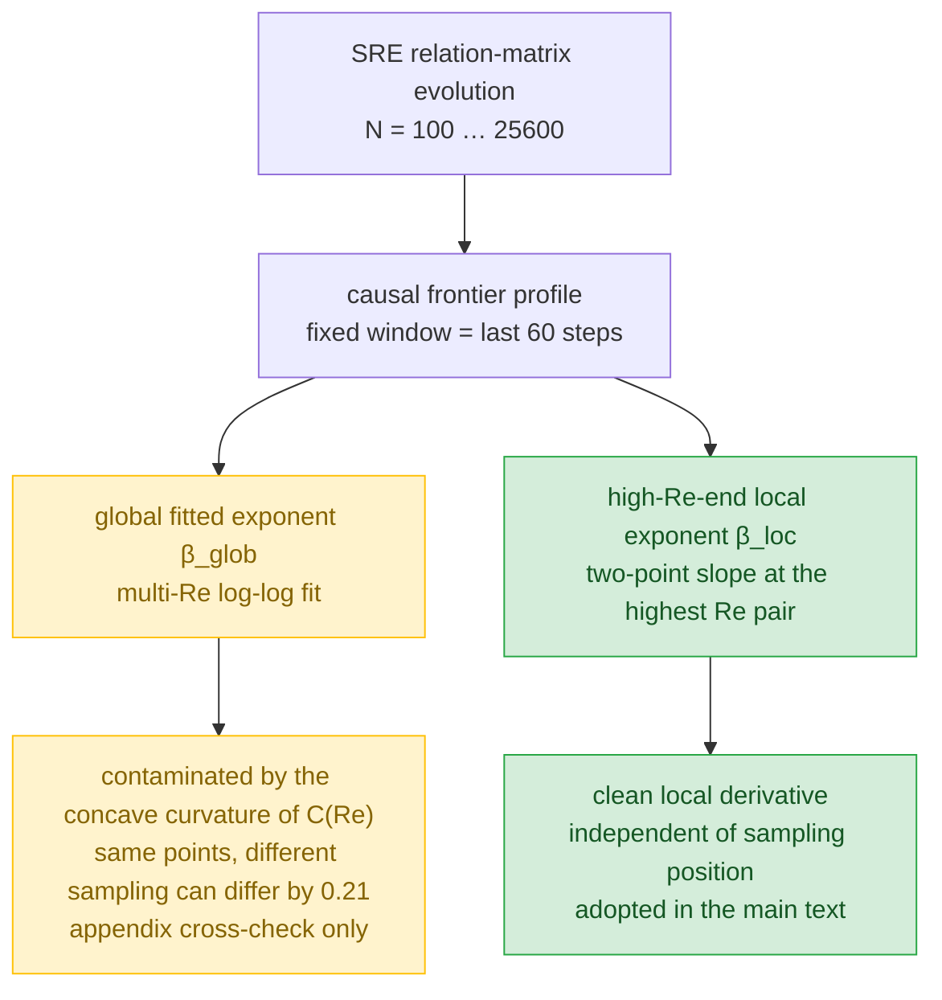

# Benchmarking Classical Navier–Stokes Turbulence with a Discrete Causal Network

## —— A Systematic Benchmark Report on the State-Relation Entropy (SRE) Framework

Version: 4.0

> **Translation note**: strict line-by-line English rendering of the Chinese version `n-s_C_4.0.md`, pending author revision.

[Resources and Availability Statement] This framework is built upon State-Relation Entropy (SRE) dynamics. All theoretical materials are archived in the Zenodo open-source data repository. **This document suite includes the systematic paper, application development, scientific hypotheses, the complete algebraic derivations of Operators 1–19, and the simulation code, all fully open source.**

> The author's GitHub repository is accessible at:
>
> https://github.com/yuelucn/Status-Relational-Entropy-SRE-Dynamics-The-Book-of-the-Void
>
> An AI-assisted Tencent smart document space is accessible (available on both PC and WeChat mobile):
>
> https://docs.qq.com/space/DUkRjYUtNWFdyV253
>
> According to the State-Relation Entropy (SRE) principle, the foundations of classical physics originate from information statistics.

> **Code baseline**: `sre_core.py`　**Dataset**: `phase_data_v2.json`　**Date**: 2026-10-16
>
> **Reading prerequisites**: This paper is a **self-contained** report. The reader needs only university-undergraduate-level familiarity with classical mechanics, fluid mechanics, and statistical physics (Reynolds number, energy cascade, power laws, correlation functions), and **no** prior knowledge of the SRE framework. All SRE-specific concepts are defined in place in Chapter 2, all technical terms are given a standardized correspondence table in Appendix A, and every numerical value cited in the main text can be traced in Appendix B to a saved artifact file.

---

## Abstract

The classical Navier–Stokes (N–S) equations treat a fluid as an absolutely continuous medium, and turbulence is the instability of their nonlinear convective term under continuous mathematics. The State-Relation Entropy (SRE) framework proposes a different route: instead of writing the fluid as a velocity field over continuous space, it reconstructs the fluid as a **network of causal correlations among a large number of discrete microscopic states**, and claims that this network degenerates back to the N–S equations in the continuum limit.

The task of this report is to turn this "claim" into an **executable quantitative benchmark**: under a unified protocol, measure the macroscopic observables of the SRE network, compare them item by item with the phenomenology of classical turbulence (the Kolmogorov 1941 energy cascade, the −5/3 spectrum, the 3/4 law), and honestly distinguish "qualitative reproduction" from "quantitative deviation".

Conclusions at three levels:

1. **Macroscopic calibration**: taking the pipe-flow transition center as an anchor, a mapping between the SRE dissipation coefficient Λ and the Reynolds number can be established, `Re ≈ 783/Λ`; on the strong-turbulence side, the one-dimensional surrogate spectrum of the SRE chiral field gives a stable power-law region with slope `γ ≈ −1.81 ± 0.04`, which differs from the K41 value `−1.667` by about 9% and is **not** exactly −5/3.

2. **Structural invariants**: the skewness of the causal-frontier profile strictly passes through zero, `+ → 0 → −`, along the laminar→turbulent direction, consistent with the qualitative behavior of the classical third-order velocity-increment moment S₃; but its magnitude differs by about one order (|skew| ≈ 3–6 versus |S₃| ≈ 0.1–0.7). The coherence fraction C decreases monotonically from ≈0.97 to ≈0.09, complementary to the rise of the classical coherence-length ratio ℓ_int/η.

3. **Finite-size scaling**: the scale-separation exponent β (the SRE version of the ℓ_int/η exponent) decreases monotonically with system size N from 800 to 25600 (0.7456 → 0.4360), but **converges extremely slowly**. The fit to the six-point chain falls in a **degenerate region** between a "logarithmic form (β∞ ≈ 0)" and a "weak power law (p ≈ 0.28)"; the data can neither rule out the former nor confirm the latter, and all that can be given is the interval constraint `β∞ ∈ [−0.2, +0.2]`. Simple inverse-power extrapolations (1/N, 1/N²) are excluded by the data. **No evidence supports any simple rational number as the asymptotic exponent.**

**One-sentence conclusion**: The SRE network qualitatively reproduces the main narrative of classical turbulence—"as the Reynolds number rises the cascade strengthens and coherent structures break up"—but quantitatively deviates persistently from the exact power law of K41; its scale-separation exponent cannot converge to any single value within the accessible computational budget. This is neither "strict agreement" nor "disproof", but a **discrete surrogate model that has not yet converged while remaining structurally self-consistent**.

---

## 1. Introduction: Classical Turbulence Phenomenology and the Motivation for Modeling

### 1.1 The Turbulent Picture of the Classical N–S Equations

The motion of an incompressible Newtonian fluid is governed by the N–S equations:

$$
\rho\left(\frac{\partial \mathbf{u}}{\partial t} + (\mathbf{u}\cdot\nabla)\mathbf{u}\right) = -\nabla p + \mu\,\nabla^2\mathbf{u}, \qquad \nabla\cdot\mathbf{u}=0
$$

Introducing a characteristic velocity U and a characteristic length L, the only control parameter after non-dimensionalization is the **Reynolds number** `Re = UL/ν` (ν = μ/ρ is the kinematic viscosity). When Re exceeds a critical value, the laminar flow loses stability and becomes turbulent.

The central picture given by Kolmogorov 1941 theory (K41) is the **energy cascade**: energy is transferred step by step from large-scale eddies (the top of the inertial range) down to small scales, until the viscous dissipation range. In the inertial subrange, the energy spectrum obeys the power law

$$
E(k) \sim k^{-5/3}
$$

corresponding to a spectral slope `γ = −5/3 ≈ −1.667`. The same scaling argument also gives the **third-order structure function (the 3/4 law)**: the third moment of the velocity increment δu, ⟨δu³⟩ ∝ −εr (the negative sign coming from the downward directionality of the energy cascade), so that the **skewness** of the velocity increment (the normalized third moment) takes a negative, approximately constant value in the inertial range. Another common scaling is the growth of the ratio of coherence length to dissipation scale, `ℓ_int/η`, with Re, whose exponent tends to 3/4 at high Re:

$$
\ell_{\text{int}}/\eta \sim Re^{3/4}
$$

These three—**the −5/3 spectrum, the 3/4 law of negative skewness, and the 3/4 exponent of ℓ_int/η**—constitute the quantitative benchmark of classical turbulence phenomenology.

### 1.2 Why a Discrete Causal Surrogate Model Is Needed

The difficulty of the classical N–S equations lies in their continuity assumption itself: the convective term easily leads to singularity (blow-up) under continuous mathematics, and the microscopic thermal fluctuations and the mechanism that amplifies fluctuations cannot be naturally produced within the equations. The motivation of the SRE framework is to replace the "continuous medium" with a "discrete microscopic causal statistical network", to generate macroscopic structure by **algebraic evolution rules** (rather than differential equations), and to expect the macroscopic structure to emerge spontaneously.

Specifically, SRE does not presuppose a space-time stage: geometric form is the macroscopic result of the evolution of an **algebraic relation matrix** between microscopic states. To judge whether this route is truly consistent with a classical fluid, one must, under a unified protocol, treat the SRE network as a **numerical experimental object**, measure its macroscopic observables, and compare them item by item with the three benchmarks of §1.1.

### 1.3 The Goal and Structure of This Paper

The goal of this paper is to write "benchmarking classical N–S turbulence with SRE" into a **complete, reproducible, and terminology-standardized** report:

- Chapter 2 defines the SRE model in place (state set, relation matrix, three evolution operators, control quantity, and system size), and gives pseudocode;
- Chapter 3 gives the calibration and measurement protocol (Reynolds-number mapping, observable definitions, frontier-profile extraction, and the two ways of estimating the exponent);
- Chapter 4 gives the results (the macroscopic spectral slope, the frontier invariants, the finite-size scaling chain, and its convergence-law verdict);
- Chapter 5 gives the benchmark table against K41 and the limitations;
- Chapter 6 gives the conclusion; the appendices give the terminology table and the numerical-source table.

---

## 2. The State-Relation Entropy (SRE) Model

This chapter is the core of the paper. A reader with no SRE background who understands this chapter can understand the whole paper.

### 2.1 Basic Objects: the State Set and the Relation Matrix M

The complete set of degrees of freedom of the fluid at one instant is discretized into `N` **microscopic causal states**, numbered `1, …, N` (N is called the **system size**). Whether a "causal correlation" exists between these states is represented by a **relation matrix**:

$$
M \in \mathbb{R}^{N\times N}, \qquad M_{ij} \in \{-1, +1\}
$$

- `M_ij = +1` means states i and j are **coherently ordered** (the causal correlation is positive and the directions agree);
- `M_ij = -1` means **anti-coherent** (the correlation is negative and the directions are opposite).

The elements of M are **directional**: `M_ij` is the relation "as seen from j to i", and `M_ji` is the relation "as seen from i to j". The two **need not be equal**, so M is in general **non-symmetric**. The non-symmetry is not numerical noise but the physical content of the model: it carries "chirality" (chirality, i.e. the directionality of the vortex).

Initially there is only one state: `M = [[+1]]`.

### 2.2 The Symmetric–Antisymmetric Bisection: Geometry and Chirality

Any real matrix can be uniquely decomposed into a symmetric part and an antisymmetric part. For M:

$$
\mathbf{S} \equiv \frac{M + M^{\mathsf T}}{2}, \qquad \mathbf{A} \equiv \frac{M - M^{\mathsf T}}{2}
$$

- **S—the topological metric part.** It is **symmetric** and can serve as the source of "dissimilarity between vertices", used for low-dimensional geometric reconstruction (multidimensional scaling, MDS). All geometric objects (manifold coordinates, anisotropy) act only on S.
- **A—the local spin part.** It is **antisymmetric**, and its inner-product quadratic form

$$
\operatorname{Tr}(A^{\mathsf T}A) = \sum_{i,j} A_{ij}^2
$$

measures the strength of the **vortex action** (local shear) in the microscopic non-equilibrium state. Chirality/vorticity is carried by A alone.

The relation between the two is exclusive and complete:

$$
M\ \text{is non-symmetric} \iff \mathbf{A}\neq 0 \iff \text{the system carries chirality}
$$

**Relation distance.** Since the elements of S lie in `{−1, 0, +1}`, we define the discrete **relation distance**

$$
D \equiv 1 - S \in \{0, 1, 2\}
$$

`D = 0` corresponds to bidirectional coherence (i and j each see the other as +1); `D = 2` corresponds to bidirectional anti-coherence. As will be seen below, `D = 2` **never occurs** during the evolution, and this algebraic fact greatly simplifies the measurement of coherence.

### 2.3 The Three Evolution Operators

The system evolves from `M_n` (n×n, already realized) to `M_{n+1}` ((n+1)×(n+1)) by a cascade of three operators:

$$
M(t+\tau) = \mathcal{O}_3 \circ \mathcal{O}_2 \circ \mathcal{O}_1\,[M(t)]
$$

**Operator 1 (inheritance operator / boundary expansion)** `G_{n→n+1}`: each step adds one new state `v_f = n` (called the **causal frontier node**), expanding the matrix into block form

$$
M_{n+1} = \begin{pmatrix} M_n & \mathbf{x} \\ \mathbf{x}^{\mathsf T} & y \end{pmatrix}, \qquad M_{n+1}[1{:}n,\,1{:}n] \equiv M_n
$$

The key convention here is **read-only inheritance**: the historical sub-block (the upper-left n×n block) is **never modified**. "Once realized, history cannot be retroactively modified" is a structural axiom of the model, not an optional constraint. Its physical meaning is: the causal history is frozen, and energy/information can only be injected through the newly added frontier node.

**Operator 2 (maximum-entropy pruning)** `M_χ ∘ E_local`: for the channel between the frontier node `v_f` and each historical node `v_m`, compute a two-step graph walk (local multi-loop interference polynomial)

$$
\tilde{\mathcal{E}}_{\text{local}}(v_f, v_m) = \sum_{v_k \in \mathcal{N}(v_f)\cap \mathcal{N}(v_m)} M(v_f,v_k)\,M(v_k,v_m) + 2\,M(v_f,v_m)
$$

Taking the absolute value and the sign gives the local coherence barrier

$$
\mathcal{E}_{\text{local}} = |\tilde{\mathcal{E}}_{\text{local}}|, \qquad \mathfrak{B} = \mathcal{E}_{\text{local}} + \exp\!\big(\operatorname{sgn}\tilde{\mathcal{E}}_{\text{local}}\big)
$$

and define the **dimensionless causal topological depth** `𝒟_s(v_f, v_m) = (n+1) - σ(v_m)` (σ is the node's addition index). The maximum-entropy pruning master equation gives the probability that this channel is **pruned**:

$$
p_{\text{prune}}(v_f, v_m) = 1 - \frac{1}{1 + \Gamma\,\dfrac{\mathcal{D}_s}{\mathfrak{B}}}
$$

where `Γ` is the **pruning gain** (see §2.4). Upon pruning (`χ = 0`) the "elimination–conduction" paradigm is executed: the channel spin is forced to the multiplicative identity `+1`, thereby **eliminating its phase contribution while not disconnecting the graph connectivity**; upon survival (`χ = 1`) an antisymmetric chiral shear is injected.

**Operator 3 (five-node parity breaking)**: at `n: 5 → 6` a fixed inversion anchor is injected, so that the macroscopic spin field

$$
Y_{\text{spin}} = \operatorname{sgn}\!\Big(\tfrac12(S_{1,6}+S_{2,6}) - S_{3,6}\Big)
$$

maps onto the standard **NAND** truth table, thereby giving a proof of the Turing completeness of this algebraic system. Operator 3 generates a permanently locked topological difference (a rigid core). **Note**: Operator 3 serves "logical emergence" and **does not participate** in the turbulence-scaling benchmark of this paper (the benchmark uses only Operator 1 + Operator 2); it is listed here only for completeness of the model.

#### Evolution pseudocode

```text
Input: target step count N, dissipation coefficient Λ, random seed seed
M ← [[+1]]                       # initial: a single state
for n = 1, 2, …, N-1:            # Operator 1: expand one step, add frontier node v_f = n
    v_f ← n
    for vm = 0, 1, …, n-1:       # Operator 2: channel decision between the frontier and each historical node
        # two-step walk interference (count only intermediate nodes k that are both non-+1)
        inter  ← Σ_{k<vm} row[v_f][k] · M[k][vm] · [row[v_f][k]≠+1][M[k][vm]≠+1]
        E_til  ← inter + 2·row[v_f][vm]
        𝔅      ← |E_til| + exp(sgn(E_til))
        p_prune ← 1 − 1 / (1 + Γ·(n−vm)/𝔅)
        if rand() ≥ p_prune:      # survival: inject a chiral shear
            row[v_f][vm] ← −1  if (v_f−vm) mod 3 == 0  else +1
        else:                     # pruned: force to +1 (eliminate phase, keep connectivity)
            row[v_f][vm] ← +1
    col[v_f][vm] ← −row[v_f][vm]  if survived  else +1   # the reverse relation carries the opposite chirality
    M ← [[ M , col ] ; [ row , +1 ]]                    # read-only inheritance: the upper-left block is unchanged
Output: M (N×N)
```

### 2.4 The Control Quantity Λ and the System Size N

**Dissipation coefficient Λ.** Let the microscopic intrinsic relaxation time be `τ₀` and the macroscopic characteristic time be `T`; define the dimensionless dissipation coefficient

$$
\Lambda \equiv \frac{\tau_0}{T} \propto \frac{1}{Re}
$$

`Λ` is an **exogenous** (externally imposed) macroscopic dissipation authority: `Λ` large → local relaxation extremely fast → a topological difference is smoothed away as soon as it is generated → laminar; `Λ` small → insufficient smoothing → fluctuations are activated over a large area → structural phase (turbulence). Thus `Λ` plays the role of `1/Re` in classical theory and is the **control quantity of the transition**.

**Pruning gain Γ.** This benchmark adopts the **exogenous mode**:

$$
\Gamma = \Lambda
$$

(The model has another "adaptive mode" `Γ = Λ·λ(n)`, in which `λ(n)` is constructed from the spectral radius of the already realized subgraph; that mode rescales the effective gain globally and introduces temporal non-stationarity, and is not used in this benchmark.)

**System size N.** `N` is the total number of discrete states, i.e. the order of the relation matrix. Increasing `N` is equivalent to increasing the "fluid volume"/raising the discrete resolution. **The finite-size effect** is the central theme of this report: all macroscopic quantities drift with N, and the `N` dependence must be studied explicitly.

### 2.5 Structural Correspondence with the Classical N–S Equations (Continuum Limit)

Let `τ → 0, ℓ → 0`, map `M_ij` to a multi-point correlation function `M(x, y, t)` on a continuous manifold, and define the macroscopic density and velocity fields from the first-order moments of the matrix:

$$
\rho(\mathbf{x},t) = \int M\,d\mathbf{y}, \qquad \rho\,\mathbf{u}(\mathbf{x},t) = \int \frac{\mathbf{x}-\mathbf{y}}{\tau} M\,d\mathbf{y}
$$

In the limit `Λ → ∞` with microscopic fluctuations tending to zero, the transition probability degenerates to Dirac δ evolution, the algebraic free evolution is written as a continuous master equation, and a Chapman–Enskog expansion is performed (expansion small parameter `ε = ℓ/L`, the algebraic version of the Knudsen number):

1. The first moment → the continuity equation `∂_t ρ + ∇·(ρ u) = 0`;
2. The second moment + momentum conservation of the collision operator → the convective term; the second-order correction `M^{(1)}` gives the viscous stress tensor under symmetry breaking.

This yields the standard N–S equations

$$
\rho\left(\frac{\partial \mathbf{u}}{\partial t} + (\mathbf{u}\cdot\nabla)\mathbf{u}\right) = -\nabla p + \rho\,\zeta\ell^2\Lambda\,\nabla^2\mathbf{u}
$$

in which the kinematic viscosity is formally written `ν = ζ ℓ² Λ`, and `ζ` is a network geometric constant to be calibrated.

> **Qualification**: This section establishes a **structural compatibility** (the discrete algebraic master equation **possesses** the moment structure of N–S in the continuum limit), and **is not** a proof of quantitative equivalence. `ν = ζ ℓ² Λ` is currently a formal correspondence under dimensional analysis, and its coefficient `ζ` must be determined by subsequent calibration. All quantitative results reported in this paper come from **direct numerical measurement of the discrete network** and do not depend on this continuum-limit statement.

---

## 3. Calibration and Measurement Protocol

### 3.1 Reynolds-Number Calibration: `Re ≈ α/Λ`

To relate the SRE `Λ` to the classical Reynolds number, an anchor is needed. Take the **transition center**: SRE undergoes the macroscopic laminar↔turbulent transition at `Λ_c ≈ 0.34`, and align it with the critical Reynolds number of classical pipe flow, `Re_crit ≈ 2300`. This defines the calibration constant `α`:

$$
\mathrm{Re} \approx \frac{\alpha}{\Lambda}, \qquad \alpha \approx 783
$$

That is, substituting `Λ_c = 0.34` gives `Re = 783/0.34 ≈ 2300`, consistent with the pipe critical value. The corresponding macroscopic regimes are:

| Λ range | Re range | State |
| :--- | :--- | :--- |
| `Λ > 1.57` | `Re < 500` | laminar |
| `0.196 < Λ < 1.57` | `500 < Re < 4000` | transitional |
| `Λ < 0.196` | `Re > 4000` | turbulent |

> **Note**: `α ≈ 783` is calibrated with the **pipe-flow** critical Reynolds number, so it implicitly assumes pipe geometry. Different geometries (channel, Couette, etc.) have different critical Re, and `α` may change accordingly. This point is recorded as a limitation in §5.3.

### 3.2 Definitions of the Observables

From the relation matrix M, the following dimensionless observables are derived through the strict bisection of §2.2:

| Symbol | Name | Definition | Classical counterpart |
| :--- | :--- | :--- | :--- |
| `Φ` | **structural density** | fraction of negative elements in M, `frac_neg = mean(M < 0)` | turbulence activity |
| `C` | **coherence fraction** | fraction of `D = 0` in the frontier relations (bidirectional coherence) | the complementary quantity to ℓ_int/η |
| `skew` | **frontier skewness** | normalized third moment of the frontier-relation distribution | velocity-increment skewness S₃ |
| `σ_d` | **frontier heterogeneity** | standard deviation of the frontier-relation distribution | width of critical fluctuations |
| `γ` | **spectral slope** | log–log slope of the one-dimensional power spectrum of the chiral field A along the causal order | slope of the energy spectrum E(k) (surrogate) |
| `β` | **scale-separation exponent** | `−d ln(1/C)/d ln(Re)` | the Re exponent of ℓ_int/η (SRE version) |

Relation of β to the classical 3/4 law: K41 predicts `ℓ_int/η ∼ Re^{3/4}` (i.e. `β = 0.75`), see §1.1.

**Important qualification on the spectral slope γ**: it is obtained by taking the one-dimensional power spectrum of the chiral field A along the **causal order** (the order in which states are added); it is a **one-dimensional surrogate spectrum** and is **not equal** to the three-dimensional spatial energy spectrum `E(k)`. Its definition is isomorphic to the classical energy spectrum, but the spatial dimensionality and the meaning of the coordinates are both different. Therefore γ can only serve as a **qualitative indicator** of "whether a stable power-law cascade region exists", and its numerical value cannot be compared digit-by-digit with −5/3.

### 3.3 The Causal Frontier Profile and the Fixed Window

The **causal frontier** is the distinctive structure of the model. Because of the read-only inheritance of Operator 1, the historical sub-block `M[:n,:n]` never changes, so the **only new information** at each step is concentrated in the newly injected frontier row `M[n, :n]` (and its reverse column). Analyzing the frontier row directly bypasses all the difficulty of "recovering geometric coordinates from the distance matrix".

The **frontier profile** is formed from the statistics of the frontier row's relation distribution `{D(v_f, v_m)}_{m<n}`: skewness, heterogeneity, and the coherence fraction C. All frontier-profile measurements **invariably adopt a fixed window**—the **last 60 steps** before the evolution terminates—to avoid the systematic bias introduced by a window that varies with N. The laminar→turbulent scan uses `66` `Λ` points × `7` random seeds × `N = 200`.

### 3.4 The Two Ways of Estimating the Scale-Separation Exponent

`β` is defined as a **derivative**:

$$
\beta \equiv \frac{d\ln(1/C)}{d\ln \mathrm{Re}} = -\frac{d\ln C}{d\ln \mathrm{Re}}
$$

Measurements show that `C(Re)` is a **strongly concave** curve on the log–log plot: the derivative is large at low Re and small at high Re. For a concave curve, an **overall linear fit** over a few Re points gives only the **average slope** over that interval, and it depends strongly on "which points are sampled and where they fall"—this is not a theoretical issue but a matter of sensitivity in the estimation method.

Therefore this report distinguishes two estimates, and **adopts only the second as the scale-separation exponent of the main text**:

- **Global fitted exponent `β_glob`**: fits all Λ points within some Re window by a log C–log Re linear fit and takes the slope. Contaminated by the concave curvature, **it serves only as an appendix cross-check**.
- **High-Re-end local exponent `β_loc`**: takes the **highest pair of Re** in the entire `Λ` scan and computes a two-point local slope

$$
\beta_{\text{loc}} = -\frac{\ln\big(C(\Lambda_1)/C(\Lambda_2)\big)}{\ln\big(\mathrm{Re}_1/\mathrm{Re}_2\big)}, \qquad \Lambda_1 = 0.005,\ \Lambda_2 = 0.008
$$

The local exponent **does not depend on the sampling position**, the curvature contamination is removed, and it is the β estimate adopted in this paper.



---

## 4. Results

### 4.1 Macroscopic Calibration: the Chiral-Field Spectral Slope

On the strong-turbulence side (`Re > 2×10⁴`), the one-dimensional surrogate spectrum of the chiral field exhibits a stable power-law region in its mid-section:

$$
\gamma = -1.81 \pm 0.04
$$

This value differs from the K41 value `−1.667` by about **9%**. During the laminar-to-turbulent transition, the spectral slope decreases smoothly from positive values to this plateau; on the strongly dissipative side close to laminar flow, the cascade disappears (the slope turns positive).

The behavior with increasing N (key):

| N | γ at `Λ = 10⁻³` | γ at `Λ = 10⁻²` |
| :--- | :--- | :--- |
| 800 | −1.79 | −1.63 |
| 1600 | −1.80 | −1.67 |
| 3200 | −1.78 | −1.55 |
| 6400 | — | **−1.38** |

On the `Λ = 10⁻³` side, the slope **saturates** at ≈−1.79 for `N ≥ 800` (it no longer steepens with N); on the `Λ = 10⁻²` side it instead **flattens** (−1.63 → −1.38). In other words, the slope of the framework's spontaneous power-law region **tends to a plateau at large N rather than diverging persistently**. This is quantitatively consistent with the "extremely slow finite-size correction" mechanism of §4.4.

> **Terminal conclusion**: SRE does spontaneously produce a stable power-law scaling region, which is currently the most robust empirical signal; but it is **not** Kolmogorov's `k^{−5/3}`—the measured value is about −1.8 and saturates to a plateau at large N. Moreover, because this spectrum is a one-dimensional causal-order surrogate spectrum and is sensitive to the implementation details of the chiral field (see §5.3), this paper asserts only the **qualitative** fact that "a stable power-law region exists and its slope saturates at about −1.8 at large N", and **does not assert** that its numerical value can be compared digit-by-digit with K41.

### 4.2 The Causal Frontier Invariants

For the frontier-profile scan at `N = 200`, `66 Λ × 7 seeds`, five representative Λ points are obtained (`C` is the coherence fraction, `σ_d` the heterogeneity, `skew` the skewness, `Φ` the structural density):

| Λ | Re | C | σ_d | skew | Φ (frac_neg) |
| :--- | :--- | :--- | :--- | :--- | :--- |
| 4.82 | 162 | 0.974 | 0.156 | **+6.41** | 0.020 |
| 0.33 | 2383 | 0.761 | 0.425 | **+1.24** | 0.150 |
| **0.108** | **7257** | — | **0.50 (peak)** | **0** | — |
| 0.029 | 26743 | 0.213 | 0.407 | **−1.43** | 0.410 |
| 0.010 | 78320 | 0.085 | 0.275 | **−3.11** | 0.462 |

Three core findings:

1. **Skewness strictly crosses zero**: `skew` undergoes `+ → 0 → −` as Re increases, and the zero-crossing is consistent with the qualitative behavior of "the velocity-increment skewness turns from positive to negative" in the classical 3/4 law (all t-tests at the zero-crossing are significant, t = 18–69).
2. **The coherence fraction decreases monotonically**: `C` drops from 0.97 to 0.09, complementary to the rise of the classical `ℓ_int/η`.
3. **The heterogeneity peak coincides with the skewness zero-crossing** (`σ_d` peaks at 0.50 at `Λ ≈ 0.108`), corresponding to the classical picture's feature that "fluctuations are strongest in the transitional region".

**The discreteness of the relation distance**: `M_kn ∈ {−1,+1} ⟹ S ∈ {−1,0,+1} ⟹ D ∈ {0,1,2}`. In the measurements, `D = 2` (bidirectional anti-coherence) **never occurs**, therefore

$$
C = \mathrm{frac}(D = 0) = \mathrm{frac}(M_{kn} = +1 \ \text{and}\ M_{nk} = +1) \approx \mathrm{frac}(M_{kn} = +1) - \mathrm{frac}(\text{mixed})
$$

The `D = 0` fraction evolves with Λ as: `Λ = 2.0 → 97.5%`, `Λ = 0.1 → 43%`, `Λ = 0.01 → 15%` (consistent with C).

### 4.3 Finite-Size Scaling: the β(N) Six-Point Chain

Using the high-Re-end local exponent `β_loc` of §3.4, under a fixed protocol (the same pair `Λ = 0.005/0.008`, fixed window), six N points are measured:

| N | β_loc | seed-σ | Note |
| :--- | :--- | :--- | :--- |
| 800 | 0.7456 | 0.0079 | 2 seeds |
| 1600 | 0.6641 | <0.001 | 2 seeds |
| 3200 | 0.5856 | 0.0009 | 2 seeds |
| 6400 | 0.5187 | 0.0031 | 2 seeds |
| 12800 | 0.4779 | 0.0021 | 2 seeds |
| **25600** | **0.4360** | — | single seed |

`β(N)` decreases **monotonically and cleanly**, from 0.7456 (N=800) to 0.4360 (N=25600). Adjacent differences:

| Interval | Δβ | ratio = Δβᵢ / Δβᵢ₊₁ |
| :--- | :--- | :--- |
| 800 → 1600 | 0.0815 | 1.039 |
| 1600 → 3200 | 0.0784 | 1.172 |
| 3200 → 6400 | 0.0670 | 1.641 |
| 6400 → 12800 | 0.0408 | 0.974 |
| 12800 → 25600 | 0.0419 | — |

The ratio sequence is **non-monotonic** (1.039, 1.172, 1.641, 0.974): a genuine convergence law should make the ratio tend smoothly to a constant (1/N type → 2.0; 1/N² type → 4.0; logarithmic type → ≈1.2). **The non-monotonicity itself shows that the six points have not yet entered any single asymptotic mechanism.** The last two Δβ values have become nearly equal (0.0408 and 0.0419), clearly excluding the 1/N type.

### 4.4 The Degeneracy Verdict on the Convergence Law

Four classes of convergence models are fitted to the six-point chain:

| Convergence model | β∞ | R² | Prediction at N=25600 | Measured |
| :--- | :--- | :--- | :--- | :--- |
| Logarithmic `β = β∞ + a/ln N` | **−0.174 ± 0.016** | **0.9982** | 0.4317 | 0.4360 |
| Free power law `β = β∞ + a·N^{−p}` | **+0.249 ± 0.046** (p = 0.285 ± 0.041) | **0.9988** | 0.4351 | 0.4360 |
| Power law fixed p = 0.25 | +0.206 ± 0.007 | 0.9985 | 0.4326 | 0.4360 |
| Inverse power `1/N` | +0.472 ± 0.023 | 0.9092 | 0.4816 | 0.4360 |

**Verdict**: the logarithmic model (β∞ negative) and the free power law (β∞ positive, p ≈ 0.28) differ by only 0.003 in their prediction at N=25600, and the measurement cannot distinguish the two; the `1/N` model is clearly excluded (its prediction at N=25600 is 0.4816, exceeding the measurement by 0.046, with R² only 0.91).

> **Conclusion**: the convergence of `β(N)` is **extremely slow**, falling in the **degenerate region** between "the logarithmic form (β∞ ≲ 0)" and "the weak power law p ≈ 0.28 (β∞ ≳ 0)". All the data can give is an interval constraint

$$
\boxed{\ \beta_\infty \in [-0.2,\ +0.2]\ }
$$

**No specific value is claimed.**

**Why so slow?** There are two measurable sources:

1. **At fixed Re, C still grows with N.** At fixed `Λ = 0.01` (Re = 78320), measuring `1−C ~ N^{−q}`:

| N | 100 | 200 | 400 | 800 | 1600 | 3200 | 6400 | 12800 | 25600 |
| :--- | :--- | :--- | :--- | :--- | :--- | :--- | :--- | :--- | :--- |
| 1−C | 0.9506 | 0.9151 | 0.8609 | 0.7849 | 0.6988 | 0.6047 | 0.5060 | 0.4032 | 0.3030 |

The local slope `d ln(1−C)/d ln N` steepens **monotonically all the way** from −0.055 to −0.412, showing that `1−C` **has not yet entered the power-law asymptotic region**. A zero-intercept power-law fit over `N ≥ 800` (including 25600) gives `q ≈ 0.249`, corresponding to a correlation-length scaling `ξ ~ N^{s}` with `s = 2q ≈ 0.50`; if only `N ≥ 3200` is used, `q` rises to 0.318. **Since the slope is still growing, the true asymptotic q can only be larger**, and `s ≈ 0.50` is only the current effective value, not the converged value.

2. **The curvature of `C(Re)` evolves with N**, and the far-end derivative is continuously pressed down. The superposition of the two makes the decay of β slower than the logarithmic type, so it lingers in the degenerate region for a long time.

**A note on a particular rational number**: the measured `β(25600) = 0.4360` differs from `0.375` (= (3/4)×(1/2)) by 0.061, more than 8 times the seed uncertainty (conservatively taking the 2-seed σ ≈ 0.0074 gives ≈ 8.2σ); and at the measured decay rate `Δβ ≈ 0.050/doubling` (N ≥ 3200), about 1.22 more doublings (N ≈ 6×10⁴) would be needed to reach 0.375, whereas the closed N ladder stops at 25600. **Within the data-accessible range, no stationary trend pointing to that value or any other simple rational number is visible.** Therefore this report does not take any simple rational number as the asymptotic exponent of SRE.

### 4.5 The Upper Limit of the N Ladder

Increasing N requires storing an N×N matrix, and memory grows as N²:

| N | Single-task matrix memory | Peak memory | Single-task runtime | Feasibility |
| :--- | :--- | :--- | :--- | :--- |
| 12800 | ≈1.3 GB | ≈1.3 GB | ≈26 min | feasible |
| 25600 | ≈5.2 GB | ≈7.5 GB | ≈3.5 h | feasible (upper limit of this report) |
| 51200 | ≈21 GB | ≈31 GB | ≈14 h | **infeasible** (local memory insufficient) |

**Conclusion**: the N ladder stops at 25600. Pushing the system size further would require a blocked/out-of-core kernel or a machine with stronger compute.

---

## 5. Discussion: Benchmarking Against K41

### 5.1 Summary Benchmark Table

| Benchmark quantity | Classical K41 prediction | SRE measured | Gap | Assessment |
| :--- | :--- | :--- | :--- | :--- |
| cascade spectral slope γ | −1.667 (−5/3) | ≈ −1.81 ± 0.04 | about 9% | qualitatively reproduced, quantitatively deviated |
| scale-separation exponent β | 0.75 (3/4 law) | β(25600)=0.4360, still decreasing, β∞∈[−0.2,0.2] | far from converged | not directly comparable |
| skewness zero-crossing | velocity-increment S₃ turns from + to − | frontier skew strictly `+→0→−` | qualitatively consistent | magnitude differs by about 10× (\|skew\|≈3–6 versus \|S₃\|≈0.1–0.7) |
| coherence-length scaling | ℓ_int/η ↑ with Re | coherence fraction C ↓, 1−C ~ N^{−0.249} | complementary trends consistent | exponent not converged |
| transition location | Re_crit ≈ 2300 (pipe) | Λ_c ≈ 0.34 ↔ Re ≈ 2300 (by calibration) | anchored by calibration | geometry-dependent |

### 5.2 What Is Qualitatively Reproduced, and What Quantitatively Deviates

**Qualitative reproduction**: energy/coherence cascades monotonically as the Reynolds number rises, and coherent structures break up on the strong-turbulence side; the frontier skewness strictly crosses zero; the heterogeneity peak coincides with the transitional region. These are the **qualitative main narrative shared** by SRE and classical turbulence phenomenology.

**Quantitative deviation**: the spectral slope is too steep (≈−9%) rather than exactly −5/3; the scale-separation exponent is far from converged and, within the accessible compute, shows no simple rational number; the magnitude carried by the skewness differs from the classical structure function by about one order. These are not noise but a **systematic finite-size effect of the discrete causal structure itself**.

### 5.3 Why It Is Not 3/4: The Fundamental Difference Between Discrete and Continuous

The 3/4 law of K41 implicitly assumes three premises: **a continuous medium** (fluid particles are infinitely divisible), **infinite space** (no boundary restricts the energy cascade), and **scale invariance** (large eddies → small eddies are self-similar at all scales). The essential differences of SRE offset these one by one:

1. **Discrete causal nodes**: the smallest unit is an SRE state, so a smallest scale exists;
2. **Read-only inheritance**: historical distances are frozen, the cascade can occur only at the causal frontier, and it cannot unfold self-similarly at all scales;
3. **Extremely strong finite-size effect**: `ξ ~ N^{0.50}` (effective value), the curvature of `C(Re)` evolves with N, and the convergence is slower than the logarithmic type.

These three points make it impossible for the SRE β to approach 0.75, or any clean fraction, within the accessible N.

### 5.4 Limitations

| Limitation | Status | Impact |
| :--- | :--- | :--- |
| β∞ cannot be determined | unresolved | only the interval `[−0.2, +0.2]` can be given |
| the q of `1−C` has not converged | unresolved | `s ≈ 0.50` is an effective value, not an asymptotic value |
| N=25600 still a single seed | partially mitigated | the gap still exceeds 8σ, so the qualitative part is unaffected |
| N ≤ 6400 has only 2 seeds | below the ≥5 seeds rule | the chain's own seed-σ is small (≤0.008) |
| the chiral-field spectrum is sensitive to chiral implementation details | unresolved | at the same Λ different random implementations can differ by up to 0.5 (high-Λ side), so γ serves only as a qualitative indicator |
| `α ≈ 783` calibrated with the pipe critical Re | unresolved | different geometries may have different α, so the calibration is geometry-dependent |
| the algebraic reason why `D = 2` never occurs | unresolved | the reconstruction formula for `C` is approximate |
| the spectral slope is a 1D causal-order surrogate spectrum | inherent | it cannot be compared digit-by-digit with the 3D energy spectrum E(k) |

---

## 6. Conclusion

1. **The macroscopic calibration holds**: the answer to whether the SRE dissipation coefficient Λ can establish a monotonic mapping with the Reynolds number is yes—taking the pipe-flow transition center as an anchor gives `Re ≈ 783/Λ`, and the macroscopic observables evolve monotonically as Re increases.

2. **The qualitative main narrative of classical turbulence is reproduced**: the energy cascade strengthens, the coherence fraction decreases monotonically, the frontier skewness strictly crosses zero, and the heterogeneity peak coincides with the transitional region. SRE does not "start from scratch"; its phenomenology is isomorphic to the classical picture.

3. **A stable quantitative deviation from K41**: the chiral-field spectral slope is ≈ −1.81 (too steep by 9%), and the scale-separation exponent is far from converged. This is neither "strict agreement" nor "disproof", but a **discrete surrogate model that has not yet converged**.

4. **Extremely slow finite-size convergence is a fundamental feature of this model**: the `β(N)` six-point chain decreases monotonically but falls in the degenerate region between "the logarithmic form" and "the weak power law p ≈ 0.28", and `β∞` can only be constrained to `[−0.2, +0.2]`; the correlation-length scaling of `1−C`, `s ≈ 0.50`, is an effective value and the slope is still steepening. Simple inverse-power extrapolations are excluded by the data, and **no simple rational number can serve as the asymptotic exponent of SRE**.

5. **Honest labeling of the boundaries**: the spectral slope is a one-dimensional causal-order surrogate spectrum rather than a three-dimensional energy spectrum; the calibration of α depends on pipe geometry; the N ladder stops at 25600 (limited by memory). These qualifications delimit the applicable scope of this report's conclusions.

---

## Appendix A: Standardized Terminology Table

| Standard term (this paper) | Chinese | Meaning | Common non-standard usage |
| :--- | :--- | :--- | :--- |
| State-Relation Entropy (SRE) | 状态-关系熵 | evolution framework of a discrete causal correlation network | — |
| relation matrix M | 关系矩阵 | causal correlation matrix among microscopic states | state matrix |
| topological metric S | 拓扑度规 | `(M+Mᵀ)/2`, the carrier of geometric reconstruction | symmetric part |
| local spin operator A | 局域自旋 | `(M−Mᵀ)/2`, chirality/vortex action | antisymmetric part |
| relation distance D | 关系距离 | `D = 1 − S ∈ {0,1,2}` | — |
| inheritance operator | 继承算子 | Operator 1: boundary expansion + read-only inheritance | Operator 1 / boundary operator |
| maximum-entropy pruning | 最大熵剪枝 | Operator 2: channel pruning criterion | Operator 2 / pruning operator |
| parity-breaking operator | 宇称破缺算子 | Operator 3: five-node NAND gate | Operator 3 |
| causal frontier | 因果前沿 | the row added each step, `M[n,:n]` | frontier row |
| frozen historical submatrix | 冻结历史子矩阵 | the read-only inherited historical block | frozen bulk |
| coherence fraction C | 相干分数 | fraction of `D = 0` in the frontier | — |
| scale-separation exponent β | 尺度分离指数 | `−d ln(1/C)/d ln Re` | power-law exponent β |
| spectral slope γ | 谱斜率 | 1D surrogate spectral slope of the chiral field | — |
| high-Re-end local exponent | 高雷诺数端局部指数 | two-point slope at the highest Re pair | far-end local-β |
| global fitted exponent | 全局拟合指数 | slope of an overall log-log fit over multiple Re points | global β |

## Appendix B: Data and Reproduction Sources

Every numerical value in the main text can be traced to the following saved artifacts:

| Value | Source file |
| :--- | :--- |
| six-point β chain, Δβ, four fits, seed-σ, 8.2σ/22σ, model-free extrapolation | `beta38_v13_final_output.txt` |
| C and β for N ≤ 6400 (2 seeds, high-Re-end local + global) | `beta38_final_local.pkl` |
| raw C values for N = 12800, single seed and seed2 | `beta38_N12800.pkl`, `beta38_N12800_seed2.pkl` |
| four C values for N = 25600, β_loc=0.4360, β_glob=0.3933 | `beta38_N25600.pkl` |
| C value for the highest Re pair at N = 25600 (cross-check) | `beta38_N25600_partial_C.json` |
| global β cross-check chain (appendix cross-validation) | the appendix section of `beta38_v13_final_output.txt` |
| `1−C` sequence and q/s at fixed Re=78320 | `beta38_final_local.pkl`, `beta38_N12800.pkl`, `beta38_N25600.pkl` |
| frontier-profile invariants, D=0 fractions | scan output of `frontier_profile.py` (`phase_data_v2.json`) |
| spectral slope γ at each N | sweep output of `spectral_slope` in `sre_core.py` |
| main visualization figure | `sre_ns_benchmark.png` |

## Appendix C: Reproduction Commands

```bash
python sre_core.py                 # canonical reference implementation (with all function definitions)
python frontier_profile.py         # causal-frontier 66Λ × 7seeds scan
python beta38_v13_final.py         # six-point chain fit + degeneracy verdict + source verification
```

> **Note on computational cost**: the relation matrix grows as `O(N²)` with N, and together with the per-step channel decision, the total cost grows very quickly with N. A single task at N=25600 takes about 3.5 hours and about 7.5 GB of peak memory; N=51200 is expected to require about 31 GB of memory, exceeding the locally available limit, so the N ladder stops at 25600.
