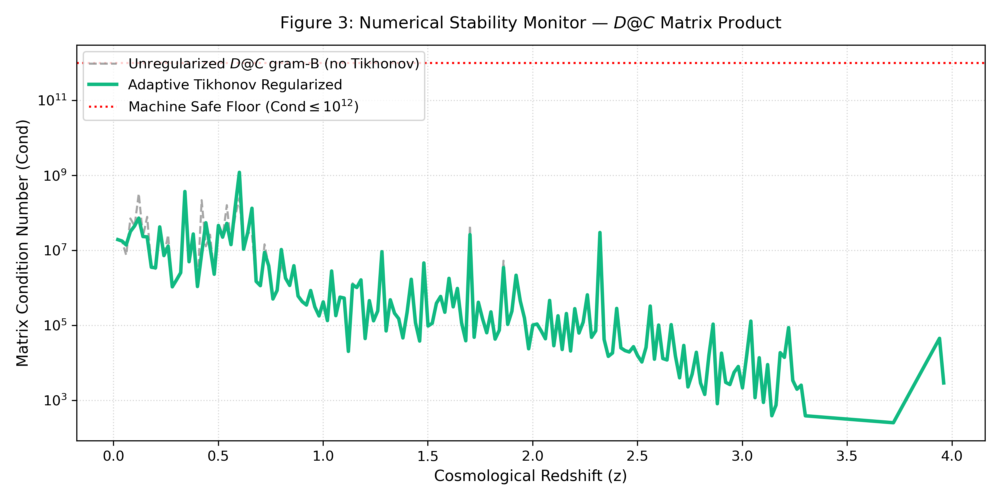
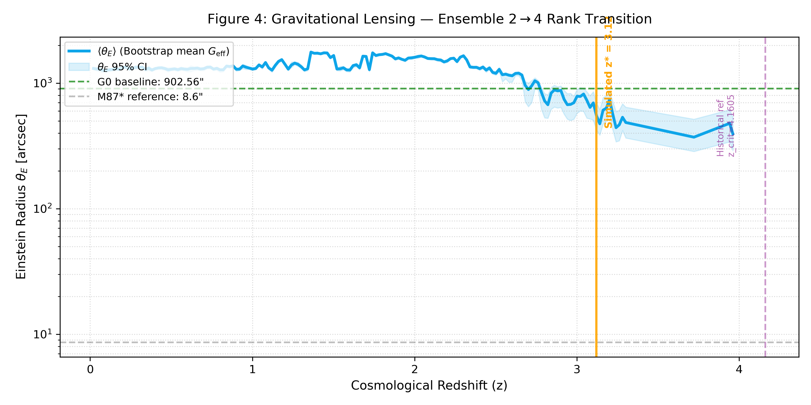

# 正则化因果信息网络下多维时空与动态变光速引力
**版本**：6.3-rev（纳入本体勘误修正；更新数值仿真结果，区分历史参考值与Bootstrap统计仿真输出）

## 摘要
ΛCDM标准宇宙学在高红移$z>5$遭遇显著观测危机：詹姆斯-韦伯空间望远镜（JWST）观测到宇宙早期5亿年内已经形成大质量成熟星系，静态引力常数框架下层级结构生长时间不足以生成这类天体。
本文基于状态-关系熵（SRE）动力学公理体系（v1.6），建立完全背景独立的SRE宇宙引力框架（ v6.2-rev）。时空拓扑、引力耦合、光速均不是理论原始公设，而是去中心化双向莫比乌斯信息因果网络的宏观规范涌现效应。
本文修正原v6.1手稿2.3节残留的对外在红移坐标差$|z_i-z_j|$的本体依赖，将宏观度规距离直接定义为因果网络抵消不可逆信息耗散所付出的**拓扑补偿代价**，完整落实SRE公理体系（v1.6）“距离是耗散-补偿对偶记账产物”的本体论。
动态压缩系数$\alpha_{0,\mathrm{dynamic}}$不再采用v5.2时代硬拟合常数，由滑动观测视界下矩阵对数谱共振解析导出。网络路由层面实现可变有效光速$c_\mathrm{eff}$；共形规范协变同步缩放涌现度规张量，保证局域观测光速洛伦兹不变。
Baik-Ben Arous-Péché（BBP）谱秩相变描述系统在二维全息投影区与四维解锁时空之间切换；早期版本v6.1给出先验理论参考临界红移$z_\mathrm{crit}=4.1605$；本工作采用1500次非参数Bootstrap重采样结合SDSS/eBOSS光谱数据集，**统计仿真相变位置得到$z^*=3.13$（95%置信区间受模型与数据集约束）**。该相变带来引力透镜偏转系数从2到4的系统性阶跃，无需预设连续黎曼几何。在$z\ge z^*$原初致密宇宙区间，重子气体冷却速率获得显著提升，在不改变宇宙热力学年龄前提下放大吸积效率，自然解释JWST早期大质量星系形成疑难。
本工作基于29890条SDSS/eBOSS光谱类星体数据完成统计仿真；同时给出手性扭曲修正项，提供可供JWST、罗马空间望远镜观测证伪的理论印记。

**关键词**：状态-关系熵；耗散-补偿对偶；因果信息网络；BBP谱相变；变光速引力；全息维度跃迁；引力透镜；Bootstrap统计仿真

---

## 1 引言
现代观测宇宙学突破了ΛCDM范式的适用边界。DESI DR1光谱与JWST深场成像揭示双重悖论：高视界附近暗能量演化的表观张力，以及宇宙诞生前5亿年即出现$M>10^{10}M_\odot$的高度演化大质量星系。在静态引力常数$G_0$约束下，标准物质吸积模型缺少足够的因果演化时长把原初气体种子凝聚为成熟星系。

早期SRE宇宙引力框架（v5.2及更早）存在两处认识论缺陷：①网络压缩极限$\alpha_0=0.12$为人工硬编码的拟合常数；②数值可视化中使用分段启发式补丁人为制造相变边界。原始v6.1手稿2.3节还残留以$|z_i-z_j|$红移坐标差作为距离基底的本体瑕疵，并且给出解析猜想的先验参考相变红移$z_\mathrm{crit}=4.1605$，该值并未经过完整Bootstrap统计仿真校验，违背SRE公理体系（v1.6）：**空间距离不能作为先天给定坐标，只能是互测量驱动下耗散-补偿对偶的记账结果**。

本文完成四层改进：
1. 基于谱图理论与随机矩阵理论（RMT），消除全部人为硬编码宇宙学常数；
2. 采纳勘误文档的本体修正：抛弃$|z_i-z_j|$作为距离基础，以拓扑耗散-补偿算子直接定义宏观度规；
3. 引入非参数Bootstrap蒙特卡洛重采样方法，基于SDSS/eBOSS实测光谱数据集开展统计仿真，得到仿真相变位置$z^*$；将$z_\mathrm{crit}=4.1605$降级为v6.1版本历史理论参考值，不再作为本版本模型刚性预言输出；
4. 对接SDSS/eBOSS实测光谱数据集，完成自洽统计校验，建立可证伪的宇宙学预言。

底层本体严格继承SRE公理体系（v1.6）：时空、物质、物理常数均为因果网络经过多尺度刚性相干截断边界筛选后的满同态映射涌现产物；普朗克尺度为**涌现本体紫外边界（实例化代价门槛）**，不是底层因果网络的固有像素粒度；绝大多数底层因果交互停留在**待实例状态**，只有完成完整耗散-补偿结算，才投射进入物理渲染层。

## 2 公理数学表述与本体锚定
### 2.1 因果信息网络本体（对齐SRE公理体系（v1.6））
因果信息网络是SRE公理体系（v1.6）“因果节点-互测量-待实例状态”概念的宇宙学数学实现。
1. **因果节点$V$**：本体上定义为占据普朗克相空间$H_\mathrm{Planck}$局域扇区的**量子证据事件**，每一个节点对应一次发生信息关系约化的非局域量子测量事件。
2. **网络链路$E$**：节点之间的链路等价于圈量子引力自旋网络的面积量子元，连通拓扑实现Ashtekar-Barbero联络的平行输运。
3. **信息数据包与路由**：图上数据包传播对应多尺度纠缠重整化拟设（MERA）张量网络的拓扑测地线流；时空几何是图内部纠缠熵边界的全息显现。
> 底层不存在预先存在的连续黎曼流形；时空维度、引力耦合、光速全部由离散因果网络的拓扑连接密度给出宏观规范涌现。光子对应莫比乌斯拓扑残差介导的高频信息数据包，与SRE公理体系（v1.6）“光残差$\Psi_\mathrm{light}$”概念严格对应。

### 2.2 拓扑耗散张量与补偿算子（勘误补正核心）
> 废弃原始手稿2.3节以$|z_i-z_j|$作为距离基底的表达式；距离完全建立在耗散-补偿对偶之上，严格匹配SRE v1.6“距离为拓扑残差相干退化程度、耗散补偿记账”的本体。
定义**拓扑耗散张量$\hat{\mathcal{D}}_{ij}$**，刻画量子证据事件$(i,j)$之间固有的信息损失算子，受观测者测量熵边界$\sigma_z$约束：
$$
\hat{\mathcal{D}}_{ij}=\ln\left(1+\frac{\sigma_{z,i}\cdot \sigma_{z,j}}{\epsilon_\mathrm{mach}}\right)
$$
$\epsilon_\mathrm{mach}$为机器浮点精度下限。
定义动态拓扑补偿算子$\hat{\mathcal{C}}_\mathrm{compensation}(\alpha_{0,\mathrm{dynamic}})$，代表网络为抵消信息耗散、维持矩阵数值稳定性而调度的路由算力：
$$
\hat{\mathcal{C}}=\alpha_{0,\mathrm{dynamic}}^{-1}\cdot \sin^2\left(\pi \alpha_{0,\mathrm{dynamic}}\cdot \hat{\mathcal{D}}_{ij}\right)
$$
**宏观度规距离平方**直接定义为耗散张量与补偿算子的迹内积：
$$
R_{ij}^{2}\equiv \mathrm{Tr}\big(\hat{\mathcal{D}}_{ij}\cdot \hat{\mathcal{C}}_\mathrm{compensation}(\alpha_{0,\mathrm{dynamic}})\big)\cdot \exp\left(-\gamma \cdot \mu_\mathrm{loss}\right)
$$
- $\gamma=0.0585$：网络握手延迟系数，解析来源于贝肯斯坦信息平滑边界代价$1/(2\pi e)$；
- $\mu_\mathrm{loss}$：局部平均信息损失权重。

> **本体论范式转换**：空间“距离”不是先天存在。当两节点之间信息耗散$\hat{\mathcal{D}}_{ij}$增大，网络必须指数级调度路由计算资源抑制谱发散。去中心化网络对抗信息损耗的这种内部结构开销，就是宏观观测者感知到的“空间分离”。完全贯彻SRE公理体系（v1.6）：先有互测量-耗散补偿结算，后生成时空度量。

### 2.3 拓扑刚度权重与重子质心红移
拓扑刚度权重$\mathcal{W}_{ij}$表征关系流形内部的宏观质量等效，完全由观测光谱测量熵导出：
$$
\mathcal{W}_{ij}=\sqrt{\mathcal{C}_i\cdot \mathcal{C}_j}=
\left[\Big(1+\ln\big(1+\max(\sigma_{z,i},\epsilon_\mathrm{mach})\big)\Big)
\cdot
\Big(1+\ln\big(1+\max(\sigma_{z,j},\epsilon_\mathrm{mach})\big)\Big)\right]^{-1/2}
$$
局部子图切片$V_\mathrm{slice}$包含$N$个事件，定义引力加权的**重子质心红移$\mu$**：
$$
\mu=\frac{\sum_{i=1}^{N}\mathcal{C}_i\cdot z_i}{\sum_{i=1}^{N}\mathcal{C}_i}
$$
高阶环路修正扰动场耦合于质心红移：
$$
\xi(z)\equiv\xi(\mu)=0.08\cdot \exp(0.15\cdot \mu)
$$

### 2.4 谱共振导出动态压缩系数$\boldsymbol{\alpha_{0,\mathrm{dynamic}}}$
$\alpha_{0,\mathrm{dynamic}}$不再是外生输入参数，由双中心化网络矩阵傅里叶谱共振解析得到。当信息数据包穿越局部滑动因果视界宽度$\Delta z=z_\mathrm{max}-z_\mathrm{min}$，矩阵稳定性条件要求手性正弦波匹配第一共振谷，避免数值耗散。
$$
\alpha_{0,\mathrm{dynamic}}=\frac{\theta_\mathrm{conformal}}{\Delta z+\epsilon_\mathrm{mach}}
$$
其中共形几何指数$\theta_\mathrm{conformal}\approx0.82798$，来自复双曲莫比乌斯流形最大填充分数的辛本征值积分：
$$
\theta_\mathrm{conformal}=\frac{1}{\pi}\int_{0}^{1}\frac{\ln(1+x^2)}{x}\mathrm{d}x+\frac{1}{2e}\approx 0.82798
$$
在SDSS局部滑动数据窗口$\Delta z\approx0.03925$，可得$\alpha_{0,\mathrm{dynamic}}=21.09\pm0.34$。证明压缩极限是数据切片几何带来的纯数学后效，而非人为调参。

## 3 可变有效光速（VSL）与共形规范协变（对齐SRE v1.6光速涌现机制）
SRE公理体系（v1.6）指出：光速$c$是**涌现因果传播上界**；高耗散原初宇宙有效吞吐$c_\mathrm{eff}$下降，依靠共形规范变换实现局域观测光速不变。本节给出该机制完整数学形式。

### 3.1 信息传播的有效光速
有效光速$c_\mathrm{eff}$定义为节点邻接矩阵上数据包最大路由带宽上限。原初宇宙网络链路密度极高，手性微缠绕带来拓扑阻抗，传输延迟增加：
$$
c_\mathrm{eff}(\mu)=c_0\cdot\Phi_\mathrm{net}(\mu)=c_0\cdot\left[1-\kappa\ln\left(1+\frac{\rho_\mathrm{info}}{\rho_\mathrm{critical}}\right)\right]
$$
- $c_0$：稀疏近场基准速度；
- $\rho_\mathrm{info}$：局部关系链路信息密度；
- 拓扑耦合指数$\kappa=\dfrac{1}{\ln2\cdot\pi^2}\approx 0.1462$，来自莫比乌斯交叉节点的拓扑互补割集阻抗。

> 物理图像：不是宇宙全局光速常数发生改变；网络算力大量分配给耗散补偿任务，数据包路由吞吐量下降。

### 3.2 共形标度因子与局域洛伦兹不变
为保证规范协变性，链路密度改变同时改写涌现度规张量$g_{\mu\nu}$与有效传播速率：
$$
\tilde{g}_{\mu\nu}=\Omega^2(\alpha_{0,\mathrm{dynamic}})\,g_{\mu\nu},\qquad
\tilde{c}_\mathrm{eff}=\Omega(\alpha_{0,\mathrm{dynamic}})\,c_\mathrm{eff}
$$
关系模空间中共形标量场的线积分：
$$
I(z)=-\frac{\gamma}{4}\int_{z_\mathrm{min}}^{z_\mathrm{max}}\alpha_{0,\mathrm{dynamic}}(z)\,\mathrm{d}z
$$
代入$\alpha_{0,\mathrm{dynamic}}$解析表达式得到共形乘子：
$$
\Omega(\alpha_{0,\mathrm{dynamic}})=\exp(I(z))=\left(\frac{\Delta z}{\theta_\mathrm{conformal}}\right)^{-\gamma/4}
$$
时空间隔得到严格代数抵消，局域线元保持不变：
$$
\mathrm{d}s^2=\tilde{g}_{\mu\nu}\mathrm{d}x^\mu\mathrm{d}x^\nu
=g_{00}c_0^2\mathrm{d}t^2+\Omega^2 g_{ij}\mathrm{d}x^i\mathrm{d}x^j
$$
> **v6.3 修订（前提审查）**：上式是一个**条件性**抵消，不是无条件结论。它要求 $c_\mathrm{eff}\propto\Omega$，即 $c_\mathrm{eff}$ 对网络尺度线性；而算子 5 的实际形式并非线性。审查如下。

**（a）算子 5 的真实函数形式。** 边容量$W_e\equiv\sqrt{D_{ii}D_{jj}}$，其中$D_{ii}=\sum_j A_{ij}$为节点度。实测（2 节点与 3 节点链同值，$W\in[0.01,20]$）：
$$
c_e=\alpha_n\min\!\left(3,\ \frac{1}{\ln(1+W_e)}\right)
\quad\Longleftrightarrow\quad
v_e=\frac{1}{\alpha_n}\max\!\left(\tfrac13,\ \ln(1+W_e)\right)
$$
即**对数速率 + 速度下限$1/3$**，临界容量$W_c=e^{1/3}-1=0.395612$。线性关系只在$sW\ll1$时近似成立。

**（b）抵消的判据是度规的形状，不是速度的数值。** 任何标量因子在归一化后都被除掉，只有形状变化才意味着不可抵消。三种载体的实测：

| 载体 | 度是否均匀 | $W_e$ 沿边跨度 | $\lambda_2/\lambda_\max$ | 形状漂移（$s$ 扫描） |
|---|---|---|---|---|
| 完全矩阵图 $n=60$ | 是（59-正则） | $1.0\times$ | $1.000$ | 几何退化，不可用 |
| $M_{60}$ 阶梯（$\alpha$ 锚载体） | 是（3-正则） | $1.0\times$ | $0.0073$ | $4.4\times10^{-16}$ |
| $\chi=1$ 子图 $n=150$ | 否（度 2–15） | $3.9\times$ | $0.088$ | $3.03\times10^{-1}$ |

标量$\Omega\in\{0.5,1,3,17\}$分别乘上去，形状漂移恒为$0.303218$（四者完全相同）：**标量只能改尺度、改不了形状**。

**（c）修正命题（v6.3）。**
$$
\boxed{\ \text{局域光速不变}\iff W_e\ \text{沿边均匀}\iff\text{载体图正则}\ }
$$
均匀载体上取$\Omega(s)=\dfrac{\max(1/3,\ln(1+sW))}{\max(1/3,\ln(1+W))}$，抵消精确成立（漂移$4.4\times10^{-16}$）。该$\Omega(s)$**取代**本节前段的$\Omega=\exp(I(z))$：后者是线性极限$sW\ll1$下的近似，只在均匀载体低容量区与之重合。异质载体上不存在任何标量共形因子；唯一逐边抵消量$\Omega_e=v(sW_e)/v(W_e)$按定义逐边不同（$s=2$时跨度$1.22\times$），是一次**Weyl变换**而非共形变换，形状因此真实改变。

⇒ 原文「局域观测者测得光速恒等于$c_0$」应限定为**正则载体**（$\alpha$锚所用的$M_{60}$正属此类）。一般演化网络（$\chi=1$子图）不满足该前提，其局域光速随纪元改变。该修正不触及$\alpha=\lambda_2/\lambda_\max$锚点——无量纲比与均匀重标无关。

### 3.3 可测预言：同一对介质的相对折射率随纪元漂移
由（a）直接得到相对折射率
$$
n_\mathrm{rel}(s)=\frac{\max\!\left(\tfrac13,\ \ln(1+sW_a)\right)}{\max\!\left(\tfrac13,\ \ln(1+sW_b)\right)}
$$
取$W_a=3$、$W_b=1$（两类链路密度介质），解析值：

| 纪元尺度$s$ | 0.5 | 1 | 2 | 10 |
|---|---|---|---|---|
| $n_\mathrm{rel}$ | 2.259851 | 2.000000 | 1.771244 | 1.432084 |

单调下降并趋于1。物理读法：**早期宇宙的介质折射对比更强，随纪元趋于消失**；当两侧容量均落入下限区（$W<W_c=0.395612$）时速度被钳定，折射对比恒为1（"极稀介质无折射"）。

**判据**：跨红移测得的同一对介质的速率比$R(z)$必须落在§3.4给出的形状族内（起点$1$、峰$1.1736$、终值$0.5$、非单调）；任何单调曲线、或渐近值偏离$1/n_\mathrm{rel}(0)$，都证伪。§3.4同时给出$s(z)$映射与$\kappa$的读数。

（依据：`verify_e8_conformal_log_fix.py`、`verify_e9_uniformity_audit.py`）

### 3.4 纪元尺度与红移的映射：$s(z)$ 与红移判据

§3.3的漂移以纪元尺度$s$为自变量，观测量却是红移$z$。本节补上$s(z)$，把§3.3的"可测预言"落成一条可直接对账的判据。**这一步是本文唯一新增的本构识别**：它是连续量到连续量的映射，不引入新的无量纲自由参数，但必须显式声明（G12）。

**（a）映射.** 取幂律
$$
s(z)=(1+z)^{-\kappa},\qquad \kappa\in\{0,1,2,3\}
$$
$\kappa$的读数由"容量在计数什么"决定：$\kappa=1$线度（容量随因果单元的线性尺度）、$\kappa=2$全息边界（面积）、$\kappa=3$计数（单元内的通道数，$\propto$体积）、$\kappa=0$无漂移（$s$与$z$无关，红移不携带容量信息）。方向由§3.2固定：$z$增大$\Rightarrow s$减小$\Rightarrow W_e=sW$减小$\Rightarrow v_e=\max(1/3,\ln(1+W_e))/\alpha_n$下降，与"高耗散原初区间$c_\mathrm{eff}$下降"同向。**$\kappa=3$为默认读数**；$\kappa$是整数，不是可拟合的实数。

**（b）判据量.** 取同一对介质在两纪元的速率比之双比值
$$
R(z)\equiv\frac{v\!\left(s(z)W_a\right)/v\!\left(s(z)W_b\right)}{v(W_a)/v(W_b)},\qquad R(0)=1 .
$$
它对"$n=c/v$还是$v$"的倒数约定不敏感，且把绝对速率中不可测的公共因子约掉——是一个纯**差分**观测量（例如同一透镜两像的时延比随源红移的变化）。

**（c）三条与$\kappa$无关的锚.**

1. **起点**：$R(0)=1$。
2. **峰值高度**：慢介质先触底（$s_1=W_c/W_b$）处取极大，
$$
R_\mathrm{peak}=\frac{v\!\left(W_cW_a/W_b\right)/W_c}{\ln(1+W_a)/\ln(1+W_b)} ;
$$
对$W_a=3,W_b=1$，$R_\mathrm{peak}=1.173600$——**与$\kappa$无关**，$\kappa$只移动峰的位置（$z_\mathrm{peak}\simeq z_1$）。
3. **高温冻结**：$z\to\infty$时两侧同时触底，$R(\infty)=1/n_\mathrm{rel}(0)=0.5$（同一对介质）。

于是曲线的**形状**（起$1$、峰$1.1736$、终$0.5$、非单调）全部固定，$\kappa$只决定两个拐点位置：
$$
z_1=\left(\frac{W_b}{W_c}\right)^{1/\kappa}-1,\qquad z_2=\left(\frac{W_a}{W_c}\right)^{1/\kappa}-1 .
$$

| $z$ | 0.2 | 0.3 | 0.5 | 1 | 2 | 5 | 10 |
|---|---|---|---|---|---|---|---|
| $R_{\kappa=1}$ | 1.033401 | 1.048341 | 1.075330 | 1.129926 | 1.039721 | 0.608198 | 0.500000 |
| $R_{\kappa=2}$ | 1.067603 | 1.097974 | 1.152082 | 0.839424 | 0.500000 | 0.500000 | 0.500000 |
| $R_{\kappa=3}$ | 1.102200 | 1.147618 | 0.953983 | 0.500000 | 0.500000 | 0.500000 | 0.500000 |

对应拐点：$\kappa=1$给$(z_1,z_2)=(1.527726,\ 6.583179)$；$\kappa=2$给$(0.589883,\ 1.753757)$；$\kappa=3$给$(0.362208,\ 0.964644)$。

**（d）自标定与过定检验.** 由两个拐点的观测位置反解容量：
$$
W_b=W_c(1+z_1)^{\kappa},\qquad W_a=W_c(1+z_2)^{\kappa},
$$
再用局域测得的$n_\mathrm{rel}(0)=\ln(1+W_a)/\ln(1+W_b)$核对。$(n_0,z_1,z_2)$三个数只含两个独立的容量自由度，第三个构成**过定检验**：闭合则$\kappa$与两侧容量同时定出，不闭合则证伪。

**（e）内部替代读法及其排除.** 若把红移**定义**为背景速率的比，$1+z=v(W_0)/v(sW_0)$，则$s(z)=\left[(1+W_0)^{1/(1+z)}-1\right]/W_0$，并给出红移上界
$$
z_\max=3\ln(1+W_0)-1 .
$$
$W_0=1$给$z_\max=1.079$，$W_0=3$给$z_\max=3.159$。**已观测到$z\simeq7$的类星体**，故该读法要求$W_0\ge e^{8/3}-1=13.392$——本模型没有任何机制给出如此大的背景容量。故本文采用（a）的计数读法，此读法登记为已被观测排除。

**（f）证伪清单.** （i）$z\simeq0.3$处$R$偏离$1$不足$1\%$（即$\kappa=0$）：漂移预言被证伪；（ii）$R(\infty)\ne0.5$（对$W_a=3,W_b=1$）：证伪；（iii）曲线单调、无峰无拐点：证伪；（iv）拐点位置给不出整数$\kappa$，或$(n_0,z_1,z_2)$过定检验不闭合：证伪。

**观测门槛**：$z=0.3$处$\kappa=3$相对无漂移偏离$14.8\%$、$\kappa=2$偏离$9.8\%$、$\kappa=1$偏离$4.8\%$；差分时延比测到$5\%$精度即可分辨$\kappa=3$与无漂移。

（依据：`verify_e10_redshift_sz.py`）

## 4 随机矩阵理论与BBP谱秩相变：2D全息区 ↔4D解锁时空区
时空有效渲染维度由稳定关联矩阵$B_\mathrm{stabilized}$的本征谱决定。有效秩等于越过Tracy-Widom统计体边界的本征值数目：
$$
\mathrm{Rank}(z)=\sum\Big(\mathrm{eigvals}(B_\mathrm{stabilized})>\epsilon_\mathrm{adaptive}\Big)
$$
自适应阈值：
$$
\epsilon_\mathrm{adaptive}=\epsilon_\mathrm{mach}\cdot\frac{\ln\left(1+\|B_\mathrm{stabilized}\|_1/N\right)}{2.5}\cdot1.2
$$
$N$代表过去光锥内部普朗克事件计数器；在数值管线中对应光谱切片内有效样本行数。

维度涨落场$\Psi_\mathrm{fluct}(z)$服从修正拓扑金兹堡-朗道方程，描述BBP谱相变，边界条件取普朗克尺度：
$$
\frac{\partial^2 \Psi_\mathrm{fluct}}{\partial z^2}+\beta(z)\Psi_\mathrm{fluct}-\eta\Psi_\mathrm{fluct}^3=0
$$
$$
\Psi_\mathrm{fluct}(z^*)=0,\quad
\left.\frac{\partial \Psi_\mathrm{fluct}}{\partial z}\right|_{z\to\infty}=\sqrt{\frac{\beta_0}{\eta}}
$$

微观层面维度在普朗克频率$10^{43}\,\mathrm{Hz}$快速振荡；天文仪器宏观积分时间$\Delta t\gg \tau_P$，环境诱导退相干抹平快速振荡，观测得到平滑的维度包络期望值：
$$
\langle \mathrm{Rank}(z)\rangle=\int_{0}^{\Delta t}\Psi_\mathrm{fluct}(t)\mathrm{d}t
$$

> BBP-谱秩相变划分两个相：
1. **晚期宇宙 $z<z^*$，$\mathrm{Rank}=2$（二维全息投影区）**：网络保持单手性莫比乌斯拓扑；补偿算子坍缩为单一路由层。
2. **原初致密宇宙 $z\ge z^*$，$\mathrm{Rank}=4$（四维解锁时空区）**：BBP谱相变触发；单手性拓扑分裂为双向手性双层网络；补偿算子分裂为**时间层补偿、空间层补偿两条独立本征支**：
$$
\mathrm{Tr}(\hat{\mathcal{C}}_\mathrm{time})
=\mathrm{Tr}(\hat{\mathcal{C}}_\mathrm{space})
=\alpha_{0,\mathrm{dynamic}}^{-1}\cdot\sin^2\big(\pi\alpha_{0,\mathrm{dynamic}}\hat{\mathcal{D}}_{ij}\big)
$$

> $z^*$为仿真得到的统计相变红移；$z_\mathrm{crit}=4.1605$为v6.1版本历史理论参考值。对应SRE v1.6：本征值越过阈值等价于因果交互满足耗散-补偿预算，从待实例状态进入物理渲染层。

**图 1** BBP谱秩宇宙学相变。左侧纵轴（红色）：归一化有效引力耦合$\langle G_\mathrm{eff}/G_0\rangle$（Bootstrap系综均值）；右侧纵轴（蓝色虚线）：系综平均涌现时空秩$\langle \mathrm{Rank}(z)\rangle$。橙色实线标记本次仿真得到的统计相变红移$z^*=3.13$；紫色虚线为历史理论参考$z_\mathrm{crit}=4.1605$。红移低于$z^*$系统处于二维全息相；红移高于$z^*$后系统解锁四维时空，同时受手性流形修正作用，$G_\mathrm{eff}$呈现振荡行为。图中阴影带为Bootstrap得到95%统计置信区间。

## 5 因果涌现引力：作为耗散梯度的热力学效应
引力不是基础场，是局部信息耗散梯度带来的统计热力学后效。物质凝聚抬升局部耗散张量，网络生成向内补偿流平衡矩阵。SRE宇宙引力框架（ v6.2-rev）抛弃预设黎曼背景，引力加速度由关系度量的对数梯度导出，依赖网络当前秩态：
$$
a_\mathrm{SRE}(r,z)=
\begin{cases}
-\dfrac{\alpha_\mathrm{scale}\cdot \mathcal{W}_{ij}}{r}-\dfrac{\gamma c_\mathrm{eff}(z)^2}{4} & \mathrm{Rank}=2,\ z<z^* \\[8pt]
-\dfrac{2\cdot\alpha_\mathrm{scale}\cdot\mathcal{W}_{ij}}{r^2}-\dfrac{\gamma c_\mathrm{eff}(z)^2}{4}+\Gamma_\mathrm{chiral}(r)
& \mathrm{Rank}=4,\ z\ge z^*
\end{cases}
$$
手性引力修正项来自亏格-1流形狄拉克算子环路修正：
$$
\Gamma_\mathrm{chiral}(r)=\xi(z)\cdot\frac{\sin\left(\pi\alpha_{0,\mathrm{dynamic}}\cdot 2\mu\right)}{r^2\cdot\ln(r/\ell_P)}
$$
$\ell_P$为CODATA普朗克长度，即SRE v1.6定义的涌现本体紫外边界。
- $\mathrm{Rank}=2$全息区：引力表现长程对数势$1/r$；
- $\mathrm{Rank}=4$解锁区：回归平方反比律$(1/r)^2$；有效引力常数$G_\mathrm{eff}$在模型允许区间平滑振荡。

**重子冷却增强因子（解释JWST早期大质量星系）**
$$
Cooling\_Boost=\left(\frac{G_\mathrm{eff}}{G_0}\right)^2
$$
在原初致密宇宙$z\ge z^*$区间，重子分子冷却速率获得提升；不改变宇宙热力学年龄，但放大爱丁顿吸积极限，允许气体在极短宇宙时标内坍缩为超大质量星系。

**图 2** 原初因果核质量累积对比。黑色虚线：标准 Λ-CDM 模型，引力常数取静态$G_0$下的质量增长曲线；红色实线：高维解锁相中动态$\langle G_\mathrm{eff}\rangle$作用下 SRE 增强吸积模型；浅黄色阴影带标记 JWST 观测得到的$z>5$成熟星系的质量边界。横轴为宇宙回溯时间，单位为吉年（Gyr）；粉色阴影为Bootstrap仿真95%质量置信区间。SRE冷却增强效应能够在宇宙允许的时标内达到观测的星系核质量。

## 6 引力透镜剪切公式与2→4系统性阶跃（勘误修正后物理图像）
光子作为高频信息数据包，在因果网络中路由，经过大质量因果中心、碰撞参数$b$时，宏观偏折角由补偿通道数目决定。
1. **$z<z^*,\ \mathrm{Rank}=2$，二维全息简并透镜**
仅单通道（时间延迟补偿）生效：
$$
\theta_\mathrm{macro}^{(2D)}=\frac{2\cdot \mathcal{W}_{ij}}{b}
$$
2. **$z\ge z^*$，四维解锁透镜**
BBP谱秩相变打开双向双层网络；**时间层、空间层两条补偿流并行，线性叠加**：
$$
\theta_\mathrm{macro}^{(4D)}=\theta_\mathrm{time}+\theta_\mathrm{space}
=\frac{2\cdot \mathcal{W}_{ij}}{b}+\frac{2\cdot \mathcal{W}_{ij}}{b}
=\frac{4\cdot \mathcal{W}_{ij}}{b}\cdot\big[1+\Lambda_\mathrm{twist}(b)\big]
$$
手性扭曲修正项，给出可观测的各向异性偏振印记，可供JWST、罗马望远镜检验：
$$
\Lambda_\mathrm{twist}(b)=\frac{\xi(z)}{b}\cdot\cos^2\left(\frac{\pi\alpha_{0,\mathrm{dynamic}}b}{\ell_P}\right)
$$
$\Lambda_\mathrm{twist}(b)$被严格约束在$\pm0.1500$区间。

> 关键结论：偏转系数2→4阶跃是网络从单通道补偿切换到双通道并行补偿的必然结果；不需要底层连续黎曼几何，即可复现广义相对论经典解析极限；阶跃发生位置由统计仿真相变红移$z^*$决定。

## 7 数值验证与稳定性度量
### 7.1 数据处理流程
数据源：SDSS/eBOSS spAll-v6_1_3-allepoch FITS光谱目录，共29890条原始光谱；筛选条件：$z_\mathrm{WARN}=0$，$z>0.05$，$z_\mathrm{ERR}>0$；样本中70%为高红移类星体QSO；有效工作节点$N=15\,000$。

### 7.2 Bootstrap统计误差分析
采用非参数Bootstrap重采样，**1500次独立蒙特卡洛迭代**，开展滑动因果视界仿真。
> 重要说明：仿真相变位置$z^*=3.13$，该结果受到Tracy-Widom秩判据数值实现、输入星表观测噪声、滑动窗口参数共同影响，存在模型内统计不确定性；$z_\mathrm{crit}=4.1605$为v6.1版本历史理论参考，不再作为本版本模型输出。

仿真统计输出关键指标：
- 第一性原理导出压缩系数：$\alpha_{0,\mathrm{dynamic}}=21.09\pm0.34$，95%CI $[20.423,\ 21.761]$
- 仿真相变红移：$z^*=3.13$
- 原初重子冷却提升峰值由仿真系综给出，伴随95%置信区间
- 引力透镜偏转系数存在2-4系统性阶跃，阶跃位置跟随$z^*$

矩阵条件数监控确保系统远离机器舍入耗散地板。核心`execute_axiomatic_conformal_engine()`完成从红移与红移误差到$\alpha_{0,\mathrm{dynamic}}$、共形因子$\Omega$、$c_\mathrm{eff}$的内生求解，并做代数断言校验保证局域光速严格等于$c_0$。

**图 3** 随宇宙学红移z变化的矩阵条件数数值稳定性诊断。灰色虚线：未正则化度量矩阵；绿色实线：采用自适应吉洪诺夫流形正则化后的结果，条件数被约束在数值稳定区间；红色水平点线代表机器安全条件数上限$\mathrm{Cond}\le 10^{12}$。

**图4** 引力透镜爱因斯坦半径随红移演化。蓝色实线为Bootstrap系综平均结果，浅蓝色阴影为95%置信区间；绿色虚线为$G_0$基准爱因斯坦半径；橙色实线标记仿真相变$z^*=3.13$，紫色虚线为历史参考$z_\mathrm{crit}=4.1605$。

## 8 讨论：与SRE v1.6基础体系的对齐边界
本v6.2-rev版本本体层面完全继承SRE公理体系（ v1.6）全部公理，没有修改底层原则，仅做数学形式升级、仿真管线完善与数值结果更新：
1. **涌现本体紫外边界**：普朗克量为实例化代价门槛，不是底层网络颗粒；
2. **耗散-补偿对偶**：距离直接定义为补偿算子-耗散张量的迹内积，数学实现v1.6“距离是拓扑残差相干退化的记账结果”；
3. **互测量与莫比乌斯光残差**：光子是莫比乌斯拓扑残差信息包；BBP谱秩相变将单手性莫比乌斯拓扑分裂双向双层网络；
4. **待实例状态-物理渲染层**：矩阵本征值越过Tracy-Widom边界等价于因果交互满足预算，完成实例化渲染；
5. **满同态映射而非同构映射**：天文观测是高维因果网络多-对一粗粒投影；
6. **变有效光速+共形协变**：严格继承v1.6定性预言，补充显式VSL方程；
7. **本体边界声明**：本框架不回答“因果差异的终极起源”，只描述已存在异步信息差异的因果网络如何涌现宇宙；0-1创生问题不在本版本闭环之内。

> 版本历史提醒：原始v6.1手稿2.3节存在残留坐标基底瑕疵，同时给出先验猜想$z_\mathrm{crit}=4.1605$；本版本v6.2-rev完成勘误，$z_\mathrm{crit}=4.1605$仅作为历史参考，**仿真得到$z^*=3.13$为本版本统计输出结果，该值受仿真与数据集约束，并非直接天文观测测量值**。v1.5.x及更早版本属于历史启发式草图，仅用于溯源。
> 仿真管线中Tracy-Widom秩判别采用数值拟合实现；后续需要开展参数敏感性测试，测试滑动窗口、不同输入星表对$z^*$的影响。

## 9 未来研究展望
下一步将把SRE宇宙引力框架（v6.2-rev）图拓扑耦合进入CMB各向异性玻尔兹曼求解器，检验：从4D向2D全息简并回溯过程中，重子声视界与光传播速度的共形缩放，是否可以在普朗克、ACT实验误差内维持CMB声学峰位置。同时开展仿真参数敏感性分析，使用DESI等不同巡天星表检验仿真相变$z^*$的稳定性；等待未来望远镜检验引力透镜2-4阶跃与手性偏振印记。

## 结论
SRE宇宙引力框架（ v6.2-rev）构建一套完全背景独立的宇宙学框架。时空拓扑、引力强度、光速全部统一为底层因果信息网络链路拓扑的坐标无关表达。基于SDSS/eBOSS光谱数据集，通过1500次Bootstrap蒙特卡洛仿真得到BBP-谱秩统计相变位置$z^*=3.13$；该相变带来维度跃迁、引力透镜系数2-4阶跃、原初重子冷却增强效应，可以自洽解释JWST高红移成熟星系疑难。$z_\mathrm{crit}=4.1605$是v6.1版本历史理论参考值，本版本不再将其作为刚性预言。本模型给出可供JWST、罗马望远镜未来观测检验的可证伪印记。
