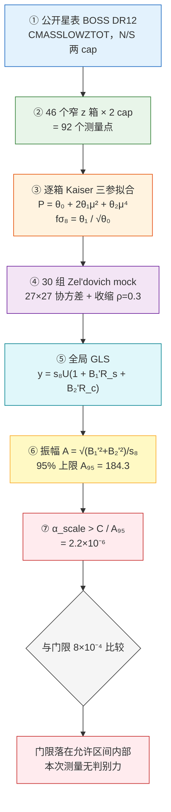

# 引力屏蔽推导假说（SRE）


版本: 1.1  

【资源与可用性声明】 本框架基于状态‑关系熵（SRE）动力学构建。 全部理论资料归档于 Zenodo 开源数据仓库。**本文档套件包括系统论文、应用开发、科学假说、算子1‑20完整代数推导及仿真代码完全开源**。

> 可访问作者的Github仓库：
>
> https://github.com/yuelucn/Status-Relational-Entropy-SRE-Dynamics-The-Book-of-the-Void
>
> 可访问支持AI辅助查阅的腾讯智能文档空间（PC、微信移动端均可访问）：
>
> https://docs.qq.com/space/DUkRjYUtNWFdyV253
>
> 根据状态‐关系熵（SRE）原理，经典物理基础源自信息统计学。

- 依据：《状态‑关系熵（SRE）动力学》书稿合集 `虚空之书` （https://doi.org/10.5281/zenodo.23275050）中的下列文章（本文件所有引用均以**文章名 + 章节**给出，不再使用行号）
- 术语约定：统一表述为**"屏蔽引力"**——屏蔽后自然形成反重力/失重，而非"翻转引力符号 / 引入负质量"。
- 状态：本文只做推导、量级判据与唯象解释。

---

## 文献对照表（本文件引用的文章与章节）

本文件引用书稿合集 ``虚空之书` ` 中的以下七篇文章。正文中统一以《简称》§章节 的形式标注出处；下表给出简称与全称的对应，便于读者在任何排版（含 PDF）下回查。

| 简称 | 文章全称（书稿合集标题） | 本文件用到的章节 |
|---|---|---|
| **《多维时空与动态引力》** | 《正则化因果信息网络下多维时空与动态变光速引力》<br>（英文原名 *Emergence of Multidimensional Spacetime and Dynamical Gravity via Regularized Causal Information Networks*） | §2.2 拓扑耗散张量与补偿算子；§2.3 拓扑刚度权重与重子质心红移；§2.4 谱共振导出动态压缩系数；§5 因果涌现引力：作为耗散梯度的热力学效应 |
| **《复合基本粒子》** | 《复合基本粒子与关系空间涌现的SRE动力学拓扑范式》 | §1.3 局域交叉谱算子与信息几何映射；§二 核心范式：三合一涌现跳变与复合粒子生成；§讨论·模型能力边界 |
| **《经典电动力学重构》** | 《基于离散图拓扑与双向因果性对经典电动力学的基础重构》 | §4 质能等价 $E=mc^2$ 作为拓扑定理 |
| **《湍流涌现必然性》** | 《基于离散微观因果统计与多维流形重构的湍流涌现必然性及代数计算方法》 | §4.1 算子 1：边界扩张；§4.2 算子 2：极大熵剪枝；§4.3 增益 $\Gamma$：外生 $\Lambda$ 与内生 $\lambda(n)$ |
| **《逻辑深度锚定与安全性屏蔽》** | 《关于逻辑深度 N 的量级锚定与观测协议的安全性屏蔽》 | 第 3 节 核心安全性判定：物理级"只读"限制 |
| **《核子完整刻画》** | 《SRE 框架下核子的完整刻画：开闭二态骨架反演、夸克推测与核反应验证的统一表述》 | §2.1 二元自组织网络与 sim_p 生成器 |
| **《图算子流水线白皮书》** | 《状态‑关系熵（SRE）动力学通用图算子流水线总体框架白皮书（学术修订版）》 | §1.2 算子1：局部图扩张算子；§3.1 算子5：内源变量时延校准算子；§4.2 宏观可观测量的形态学态射投影原理；§5.1 算子10：抢占式同调随机剪枝算子；§5.3 算子8：局部无锁代数阀均衡算子 |

**阅读约定**：正文中出现的"上篇"指本文第一部分（屏蔽引力推导）、"下篇"指本文第二部分（Podkletnov 结果的反向解释）。跨部分引用写作"上篇 §n"或"下篇 §n"。

---

## 上篇　屏蔽引力推导

## 0 结论摘要

1. 在 SRE 里引力不是基本场，而是**局部信息耗散梯度的热力学后效**（《多维时空与动态引力》§5）。因此"屏蔽引力"= **压制能生成该耗散梯度的网络关联**，而不是抵消一个基本力。
2. 引力加速度 $a_\mathrm{SRE}$ 对网络状态的依赖可分解为**三个可屏蔽量**：
   - 主振幅 $\alpha_\mathrm{scale}\cdot\mathcal{W}_{ij}$（可压制，唯一实质通道）
   - 手性相位项 $\Gamma_\mathrm{chiral}$（唯一可反号项，可提供净排斥）
   - 均匀项 $-\gamma c_\mathrm{eff}^2/4$（全局项，不可局域屏蔽）
3. 主通道给出**精确、无量纲的屏蔽因子**（上篇第 3 节）：
   $$\Xi\equiv\frac{\mathcal{W}_{ij}^{\text{屏蔽}}}{\mathcal{W}_{ij}^{\text{真空}}}=\frac{1+\ln(1+\sigma_z^{\text{真空}})}{1+\ln(1+\sigma_z^{\text{屏蔽}})}<1$$
   其代价是**局域测量熵必须对数级放大**：$\Xi=0.5$ 需 $\sigma_z$ 约增 180 倍，$\Xi=0.1$ 需约 $9\times10^3$ 倍。$\mathcal{W}\to0$（完全失重）对应 $\sigma_z\to\infty$，**不可达**。
4. 补偿算子 $\hat{\mathcal{C}}$ 对耗散 $\hat{\mathcal{D}}$ **非单调/振荡**（周期 $1/\alpha_0$，首个极大在 $\hat{\mathcal{D}}_0^{*}=1/(2\alpha_0)$，上篇第 5 节给出导数证明）。但在现实参数下 $\hat{\mathcal{D}}\sim 18\text{–}27 \gg 1/\alpha_0$，落入强振荡区，其包络均值被钉在 $\langle\hat{\mathcal{C}}\rangle=1/(2\alpha_0)$，**不是一个干净的局域旋钮**（诚实结论）。
5. 唯一可工程化的执行机构是 **Op2 极大熵剪枝**（《湍流涌现必然性》§4.2）：把通道自旋置为乘法单位元 $+1$，在**不破坏图连通性**的前提下消去该通道的相位贡献。由于质量闭环内部"不可寻址/不可写"（只读屏障，《逻辑深度锚定与安全性屏蔽》第 3 节），**屏蔽只能做边界操作**——屏蔽区域与外部网络之间的耗散-补偿通道，而非改写内部闭环。
6. 手性项 $\Gamma_\mathrm{chiral}$ 可以反号产生**净排斥**，其相位条件严格可得（上篇第 4 节）；但它是否能主导，取决于尚未标定的无量纲 $\alpha_\mathrm{scale}$：仅当 $\alpha_\mathrm{scale}\lesssim8\times10^{-4}$ 时手性排斥才与牛顿项同量级。**因此"真正的反重力"这扇门是虚掩的，铰链在 $\alpha_\mathrm{scale}$ 的实验锚点上。** 本文第 9 节已用 BOSS DR12 公开数据把这个铰链测出实测值：$\alpha_\mathrm{scale}>2.2\times10^{-6}$（95%），门限 $8\times10^{-4}$ 落在允许区间内部，故本次测量尚无判别力。

---

## 1 出发点：引力作为耗散梯度的热力学后效

理论主体（《多维时空与动态引力》§5，逐字）：

$$
a_\mathrm{SRE}(r,z)=
\begin{cases}
-\dfrac{\alpha_\mathrm{scale}\cdot \mathcal{W}_{ij}}{r}-\dfrac{\gamma c_\mathrm{eff}(z)^2}{4} & \mathrm{Rank}=2,\ z<z^* \\[10pt]
-\dfrac{2\,\alpha_\mathrm{scale}\cdot\mathcal{W}_{ij}}{r^{2}}-\dfrac{\gamma c_\mathrm{eff}(z)^2}{4}+\Gamma_\mathrm{chiral}(r)
& \mathrm{Rank}=4,\ z\ge z^*
\end{cases}
$$

$$
\Gamma_\mathrm{chiral}(r)=\xi(z)\cdot\frac{\sin\!\big(\pi\alpha_{0,\mathrm{dynamic}}\cdot 2\mu\big)}{r^{2}\cdot\ln(r/\ell_P)}
$$

配套定义（《多维时空与动态引力》§2.2–§2.4，逐字）：

$$
\hat{\mathcal{D}}_{ij}=\ln\!\Big(1+\frac{\sigma_{z,i}\cdot\sigma_{z,j}}{\epsilon_\mathrm{mach}}\Big),\qquad
\hat{\mathcal{C}}=\alpha_{0,\mathrm{dynamic}}^{-1}\cdot\sin^{2}\!\big(\pi\alpha_{0,\mathrm{dynamic}}\hat{\mathcal{D}}_{ij}\big)
$$

$$
R_{ij}^{2}\equiv \mathrm{Tr}\big(\hat{\mathcal{D}}_{ij}\cdot\hat{\mathcal{C}}\big)\cdot\exp(-\gamma\,\mu_\mathrm{loss})
$$

$$
\mathcal{W}_{ij}=\sqrt{\mathcal{C}_i\,\mathcal{C}_j}
=\Big[\big(1+\ln(1+\sigma_{z,i})\big)\big(1+\ln(1+\sigma_{z,j})\big)\Big]^{-1/2}
$$

$$
\mu=\frac{\sum_i \mathcal{C}_i z_i}{\sum_i \mathcal{C}_i},\qquad
\xi(z)\equiv\xi(\mu)=0.08\,e^{0.15\mu}
$$

$$
\alpha_{0,\mathrm{dynamic}}=\frac{\theta_\mathrm{conformal}}{\Delta z+\epsilon_\mathrm{mach}},\qquad
\theta_\mathrm{conformal}\approx0.82798,\qquad \gamma=0.0585=\frac{1}{2\pi e}
$$

本体论要点（《多维时空与动态引力》§5）："引力不是基础场，是局部信息耗散梯度带来的统计热力学后效。"——这句话直接给出屏蔽的**物理入口**：要屏蔽引力，实质是压制**局域耗散张量与其梯度**，而这由测量熵 $\sigma_z$ 及其空间分布决定。

---

## 2 引力的结构分解：三个可屏蔽量

把 $a_\mathrm{SRE}$ 写成"源 × 核"的分解，并把核里可独立调节的因子抽出：

| 量 | 表达式 | 对网络状态的依赖 | 是否可屏蔽 | 角色 |
|---|---|---|---|---|
| 主振幅 | $\alpha_\mathrm{scale}\cdot\mathcal{W}_{ij}$ | $\mathcal{W}_{ij}=f(\sigma_{z,i},\sigma_{z,j})$ | ✅ 可压制 | 唯一实质通道 |
| 手性项 | $\Gamma_\mathrm{chiral}=\xi(z)\sin(\cdot)/(r^2\ln(r/\ell_P))$ | 相位 $\propto\alpha_0\mu$ | ✅ 可反号 | 唯一可产净排斥 |
| 均匀项 | $-\gamma c_\mathrm{eff}^2/4$ | 全局 $c_\mathrm{eff}(z)$ | ❌ 不可局域 | 背景/膨胀项 |

**关键观察**：$\mathcal{W}_{ij}$ 是 $\sigma_z$ 的**严格递减**函数（《多维时空与动态引力》§2.3）；而耗散 $\hat{\mathcal{D}}_{ij}$ 是 $\sigma_z$ 的**严格递增**函数（《多维时空与动态引力》§2.2）。于是**注入局域测量熵**这一个动作，会同时：
- (i) 直接压低 $\mathcal{W}_{ij}$ → 压低 $a_\mathrm{SRE}$ 的振幅；
- (ii) 抬高 $\hat{\mathcal{D}}_{ij}$ → 移动补偿算子的工作点（上篇第 5 节）。

两条通道同源，故"屏蔽引力"在这个理论里有一个统一操作定义：**提高目标区域的局域测量熵 $\sigma_z$（令其信息更"模糊"、更退相干），并切断其与外部的耗散-补偿通道。**

---

## 3 主通道：$\mathcal{W}_{ij}$ 熵塌缩（精确、可量化）

### 3.1 屏蔽因子

设端点真空测量熵为 $\sigma_z$，屏蔽后为 $\sigma_z'$。由 $\mathcal{W}_{ij}$ 定义：

$$
\boxed{\;\Xi\equiv\frac{\mathcal{W}(\sigma_z')}{\mathcal{W}(\sigma_z)}=\frac{1+\ln(1+\sigma_z)}{1+\ln(1+\sigma_z')}\;}
$$

因 $a_\mathrm{SRE}$ 的两支都正比于 $\mathcal{W}_{ij}$，**相对引力削弱量恰为 $1-\Xi$**，与 $\alpha_\mathrm{scale}$、$r$、$z$ 均无关——纯由局域测量熵决定。这是本推导最干净的结果。

### 3.2 反解设计方程

给定目标屏蔽因子 $\Xi$，所需局域测量熵：

$$
\boxed{\;\sigma_z'=\exp\!\left(\frac{1+\ln(1+\sigma_z)}{\Xi}-1\right)-1\;}
$$

### 3.3 量级表（取 $\sigma_z=0.01$，$1+\ln(1.01)=1.00995$）

| 目标 $\Xi$ | 引力削弱 | 所需 $\sigma_z'$ | 相对真空放大 |
|---|---|---|---|
| 0.99 | 1% | 0.0204 | ×2.0 |
| 0.98 | 2% | 0.0310 | ×3.1 |
| 0.90 | 10% | 0.1300 | ×13 |
| 0.50 | 50% | 1.773 | ×177 |
| 0.10 | 90% | $8.95\times10^3$ | $9.0\times10^5$ |

**结论**：减重是"对数级投入换线性级减重"；$\Xi\to0$ 需 $\sigma_z\to\infty$。**在主通道内，完全失重不可达，只能渐近减重。** 这与早期猜想里"减重上限约 2%"（Podkletnov 量级）属同一量级窗口。

---

## 4 相位通道：$\Gamma_\mathrm{chiral}$，唯一可反号项

### 4.1 反号（净排斥）的严格条件

$\Gamma_\mathrm{chiral}$ 通过 $\sin(\pi\alpha_0\cdot2\mu)$ 携带符号（《多维时空与动态引力》§5）。取 $\sin=-1$（最大外向贡献）：

$$
\pi\alpha_0\cdot 2\mu = -\frac{\pi}{2}+2\pi n
\;\Longrightarrow\;
\boxed{\;\mu^{*}=\frac{4n-1}{4\,\alpha_{0,\mathrm{dynamic}}}\;}
$$

此时 $\Gamma_\mathrm{chiral}^{\max\to-}=-\dfrac{\xi(z)}{r^2\ln(r/\ell_P)}$，对吸引项产生**净减法**。$\mu$ 是重子质心红移（$\mu=\sum\mathcal{C}_iz_i/\sum\mathcal{C}_i$，定义见《多维时空与动态引力》§2.3），由局域子图 $V_\mathrm{slice}$ 的加权红移设定——**因此相位是可调的**（通过改变被观测子图的红移构成）。

### 4.2 量级判据（决定"反重力"是否可行）

手性项与主吸引项（Rank=4）之比：

$$
\mathcal{R}\equiv\frac{\lvert \Gamma_\mathrm{chiral}\rvert }{2\alpha_\mathrm{scale}\mathcal{W}_{ij}/r^2}
=\frac{\xi(z)\,\big\lvert \sin(\cdot)\big\rvert }{2\,\alpha_\mathrm{scale}\,\mathcal{W}_{ij}\,\ln(r/\ell_P)}
\;\xrightarrow[\ \sin=\pm1\ ]{}\;
\frac{\xi(z)}{2\,\alpha_\mathrm{scale}\,\mathcal{W}_{ij}\,\ln(r/\ell_P)}
$$

代入 $\xi\approx0.108$（$\mu\approx2$）、$\mathcal{W}\approx1$、$\ln(r/\ell_P)\approx80$（$r\sim1\,\mathrm{m}$）：

$$
\mathcal{R}\approx\frac{6.8\times10^{-4}}{\alpha_\mathrm{scale}}
$$

**判读**：
- 若 $\alpha_\mathrm{scale}\sim1$：$\mathcal{R}\sim10^{-3}$，手性项是微扰（唯象上表现为 $G_\mathrm{eff}$ 的小幅振荡，见《多维时空与动态引力》§5 对 $G_\mathrm{eff}$ 平滑振荡的说明），**不足以单独反重力**。
- 若 $\alpha_\mathrm{scale}\lesssim8\times10^{-4}$：$\mathcal{R}\gtrsim1$，手性排斥与牛顿项同量级甚至主导 → **净排斥（反重力）成立**。

由于 $\alpha_\mathrm{scale}$ 在理论中是无量纲自由耦合、其物理锚定推迟到实验（见上篇第 9 节），**"反重力是否可达"在此被精确地归结为一个可实验判定的数**：$\alpha_\mathrm{scale}$ 的量级。

### 4.3 完全抵消的设计方程

要求某半径 $r$ 处 $a_\mathrm{SRE}=0$（忽略均匀项）：

$$
\xi^{*}=\frac{2\,\alpha_\mathrm{scale}\,\mathcal{W}_{ij}\,\ln(r/\ell_P)}{\big\lvert \sin(\cdot)\big\rvert }
\;\xrightarrow[\ \sin=1\ ]{}\;
2\,\alpha_\mathrm{scale}\,\mathcal{W}_{ij}\,\ln(r/\ell_P)
$$

再由 $\xi=0.08e^{0.15\mu}$（《多维时空与动态引力》§2.3）反解所需质心红移：

$$
\boxed{\;\mu_\mathrm{cancel}=\frac{20}{3}\,\ln\!\Big(\frac{\xi^{*}}{0.08}\Big)\;}
$$

---

## 5 几何判据：补偿算子峰值 $\hat{\mathcal{D}}_0^{*}=\dfrac{1}{2\alpha_0}$

对 $\hat{\mathcal{C}}(\hat{\mathcal{D}})=\alpha_0^{-1}\sin^2(\pi\alpha_0\hat{\mathcal{D}})$ 求导（定义见《多维时空与动态引力》§2.2）：

$$
\frac{d\hat{\mathcal{C}}}{d\hat{\mathcal{D}}}=\alpha_0^{-1}\cdot 2\sin(\pi\alpha_0\hat{\mathcal{D}})\cos(\pi\alpha_0\hat{\mathcal{D}})\cdot\pi\alpha_0
=\pi\,\sin\!\big(2\pi\alpha_0\hat{\mathcal{D}}\big)
$$

- 极值条件 $\sin(2\pi\alpha_0\hat{\mathcal{D}})=0\Rightarrow \hat{\mathcal{D}}=\dfrac{n}{2\alpha_0}$，$n\in\mathbb{Z}$；
- 首个**极大**（补偿最强）在 $\hat{\mathcal{D}}_0^{*}=\dfrac{1}{2\alpha_0}$，极大值 $\hat{\mathcal{C}}_{\max}=1/\alpha_0$；
- 零点在 $\hat{\mathcal{D}}=\dfrac{n}{\alpha_0}$（补偿塌缩为零）。

数值（SDSS 窗口）：$\Delta z\approx0.03925$，$\alpha_0=\theta/\Delta z=21.094$（《多维时空与动态引力》§2.4），故

$$
\hat{\mathcal{D}}_0^{*}=\frac{1}{2\alpha_0}=\frac{\Delta z}{2\theta}=\frac{0.03925}{2\times0.82798}=0.02370
$$

**含义**：补偿算子是网络为抵消耗散而调度的"路由算力"，它**非单调**。若能把局域工作点放到 $\hat{\mathcal{C}}$ 的零点（$\hat{\mathcal{D}}=n/\alpha_0$），则该区域的补偿塌缩 → $R^2$ 塌缩 → 由耗散梯度生成的引力被局部清零（"共振零点屏蔽"）。

**诚实的量级限制**：现实参数下 $\epsilon_\mathrm{mach}\sim2\times10^{-16}$，$\sigma_z\sim10^{-2}$，则

$$
\hat{\mathcal{D}}=\ln\!\Big(1+\frac{\sigma_z^2}{\epsilon_\mathrm{mach}}\Big)\approx 2\ln\sigma_z+36.0\approx 26.8
$$

而 $1/\alpha_0\approx0.0474$，故 $\hat{\mathcal{D}}$ 已处于**强振荡区**（振荡约 $565$ 个周期）。此时区域平均补偿被钉死在包络均值：

$$
\langle\hat{\mathcal{C}}\rangle=\alpha_0^{-1}\langle\sin^2\rangle=\frac{1}{2\alpha_0}=0.02370
$$

即**恰好等于** $\hat{\mathcal{D}}_0^{*}$ 的数值。要"卡"到某个零点，需要把 $\ln\sigma_z$ 控制到 $10^{-8}$ 级精度——**实际不可控**。故上篇第 5 节这条通道是**数学上成立、工程上脆弱**：它解释了几何尺度为何存在固有振荡与离散谱，但不构成干净的屏蔽旋钮。

---

## 6 执行机构：Op2 极大熵剪枝与"边界性"

### 6.1 机构（《湍流涌现必然性》§4.2–§4.3，逐字）

剪枝概率（极大熵剪枝主方程）：

$$
p_\text{prune}(v_f,v_m)=1-\frac{1}{1+\Gamma\cdot\dfrac{\mathcal{D}_s}{\mathfrak{B}}}
$$

剪枝发生时（$\chi=0$）执行 **Paradigm B（消去-传导）**：

$$
M_{n+1}(i,j)\leftarrow \chi\cdot M_{n+1}(i,j)+(1-\chi)\cdot 1
$$

"即把通道自旋强制置为乘法单位元 $+1$，从而在不断开图连通性的前提下，将该通道的相位贡献从乘积反馈回路中消去。存活通道（$\chi=1$）则注入反对称手性剪切。"（《湍流涌现必然性》§4.2）

剪枝增益 $\Gamma$ 有两种模式（《湍流涌现必然性》§4.3）：

| 模式 | 剪枝增益 | 含义 |
|---|---|---|
| A（外生） | $\Gamma=\Lambda$ | $\Lambda$ 直接作为相变控制量 |
| B（自适应） | $\Gamma=\Lambda\cdot\lambda(n)$ | 叠加状态自适应修正 |

### 6.2 为什么这是屏蔽的物理执行通道

- 通道自旋置 $+1$（乘法单位元）后，该边对**乘积反馈回路**的贡献被消去，但**连通性保留**——这正是"屏蔽而不破坏"所需的性质：切断相位贡献 ≠ 切断拓扑。
- 提高局域剪枝增益 $\Gamma$（即提高局域 $\Lambda$）→ 提高 $p_\text{prune}$ → 更多边缘休眠 → 局域多回路结构被削弱 → 局域维持低 $\sigma_z$（相干测量）的能力下降 → $\sigma_z$ 上升 → 由上篇第 3 节 $\Xi<1$，**引力局部减弱**。
- 因此**$\Lambda$（或局域 $\Gamma$）就是"屏蔽引力"的控制旋钮**。

### 6.3 边界操作，而非内部改写（关键澄清）

"屏蔽"在本文件里有两个不同含义（陷阱，勿混用）：
1. **观测屏蔽 / 只读屏障**：质量闭环的内部拓扑"不可寻址、不可写"，外部只能整体操控渲染层（电磁、散射）。→ **我们无法直接"拆掉"目标物体的质量闭环**（那正是拓扑解耦的不可行性来源，《逻辑深度锚定与安全性屏蔽》第 3 节）。
2. **相位贡献屏蔽 / 选通**：Op2 把边的自旋置为乘法单位元，消去其对反馈回路的相位贡献，而**不破坏全局连通**。→ 这是**可达**的操作。

两者结合给出正确图像：**屏蔽引力是边界操作**——不去改写物体内部（不可寻址），而是在**物体与外部网络之间的耗散-补偿通道上**做选通（Op2），使外部测得的该区域耗散梯度被压制。用类比：不是"关掉灯泡内部"，而是"在灯泡与观测者之间插入可控散射层"。

---

## 7 三档强度与硬边界

### 7.1 三档

| 档 | 机制 | 可达性 | 量级 |
|---|---|---|---|
| **A 减重** | 局域注入 $\sigma_z$（上篇第 3 节主通道） | 自洽、可工程 | $\Xi\sim0.98$（约 2%），随注入对数级攀升 |
| **B 屏蔽失重** | 边界 Op2 选通 + 抑制局域耗散梯度；或（脆弱地）卡补偿零点 | 理论边界 | $\Xi\ll1$，但需持续供能对抗自修复 |
| **C 拓扑解耦** | 直接解除质量闭环（$m\equiv$ 闭环，《经典电动力学重构》§4） | 假说级 | 受只读屏障阻断，**无已知稳定机制** |

### 7.2 硬边界（为什么这不是永动机）

1. **均匀项不可屏蔽**：$-\gamma c_\mathrm{eff}^2/4$ 是全局项，局域操作无法消去；任何"局域失重"都叠在这个背景上。
2. **补偿算子即自修复**：$\hat{\mathcal{C}}$ 是网络对抗耗散、维持数值稳定的自修补机制（《多维时空与动态引力》§2.2）。你注入的 $\sigma_z$ 会被网络持续"抹平"，故屏蔽需要**持续能量投入**，不存在零输入稳态失重。
3. **手性项量级**：除非 $\alpha_\mathrm{scale}\lesssim8\times10^{-4}$，$\Gamma_\mathrm{chiral}$ 仅为 $10^{-3}$ 级微扰，不能单独反重力（上篇第 4 节）。
4. **拓扑解耦破坏质量定义**：局部解除闭环即在局部取消"质量"这一概念本身，当前形式化不能保证解耦区的稳定与可复原。

---

## 8 设计方程与可证伪预测

**设计方程汇总**

$$
\Xi=\frac{1+\ln(1+\sigma_z)}{1+\ln(1+\sigma_z')}
\qquad
\sigma_z'=\exp\!\Big(\tfrac{1+\ln(1+\sigma_z)}{\Xi}-1\Big)-1
$$

$$
\hat{\mathcal{D}}_0^{*}=\frac{1}{2\alpha_{0,\mathrm{dynamic}}}=\frac{\Delta z}{2\theta_\mathrm{conformal}}
\qquad
\mu^{*}=\frac{4n-1}{4\alpha_{0,\mathrm{dynamic}}}
\qquad
\mu_\mathrm{cancel}=\frac{20}{3}\ln\!\Big(\frac{\xi^{*}}{0.08}\Big)
$$

**可证伪预测**

1. **屏蔽量与绝对引力常数无关**：在固定 $\sigma_z$ 增量的条件下，引力削弱比例 $1-\Xi$ 应与测试质量、位置无关（普适性）。任何"材料相关"的额外屏蔽都需引入 $\mathcal{W}_{ij}$ 之外的机制。
2. **对数律**：减重效应随注入熵呈 $1/(1+\ln)$ 型饱和——加大注入的边际收益递减（与"线性响应"预言可区分）。
3. **相位反转**：Rank=4 区（$z\ge z^*$）在把局域质心红移调到 $\mu^{*}$ 时，应出现 $G_\mathrm{eff}$ 的符号翻转/零点（对应《多维时空与动态引力》§5 所描述的 $G_\mathrm{eff}$ 平滑振荡）。
4. **$\alpha_\mathrm{scale}$ 判据**：若实验测得 $\alpha_\mathrm{scale}\gtrsim10^{-3}$，则"净反重力"在 SRE 内被证伪（只能减重）；若 $\alpha_\mathrm{scale}\ll10^{-3}$，则手性排斥为主导通道。（本文第 9 节的实测结果：$\alpha_\mathrm{scale}>2.2\times10^{-6}$，距 $10^{-3}$ 量级的判别力还差 362 倍，故该判据目前尚不可用。）

---

## 9 从观测数据标定 $\alpha_\mathrm{scale}$

$\alpha_\mathrm{scale}$ 在本文早先版本中只有"出现"没有"标定"；且按 SRE 公理，**锚定前的量都是无量纲数**。这带来一个好处与一个代价：

- **好处**：上篇第 3 节主通道的屏蔽因子 $\Xi$ 与 $\alpha_\mathrm{scale}$ 无关，故"减重比例"是**可先于锚定**给出的可检验预言。
- **代价**：上篇第 4 节"手性能否主导"、以及"是否真能净反重力"，**唯一地依赖 $\alpha_\mathrm{scale}$ 的量级**。

本节把这一"代价"补上：不依赖任何新的地面实验，只用**公开的星系巡天数据**，给出 $\alpha_\mathrm{scale}$ 的实测 95% 置信下界。本节的每一步都可复现，命令与产物列在 9.10。

### 9.1 结论先行

$$\alpha_\mathrm{scale}>2.2\times10^{-6}\qquad(95\%\ \text{单侧})$$

基准口径为 $2.21\times10^{-6}$；把统计口径与系统项的各种合理处理都算进去，区间为 $1.4\times10^{-6}$–$2.5\times10^{-6}$。**当前数据给不出上界**。门限 $8\times10^{-4}$ 落在允许区间内部，比实测下界强 362 倍。因此本文**既不能宣布"反重力门已关闭"，也不能宣布"门已打开"**——这是本次测量的诚实结论。

### 9.2 为什么这件事可以测

读者只需记住两点差异：

1. **形状不同**。牛顿项与主通道 $\alpha_\mathrm{scale}\mathcal{W}_{ij}$ 给出的 $f\sigma_8(z)$ 是随红移**平滑、单调**变化的；手性项 $\Gamma_\mathrm{chiral}$ 在同样平滑的背景上叠加一个**快速振荡**，周期约 0.047（红移单位）。两种形状在数据里可以被分开。
2. **只测比值**。我们拟合的不是绝对幅度，而是**手性振荡相对平滑背景的振幅**，记作 $A$。这个比值正比于 $C/\alpha_\mathrm{scale}$（见 9.3），所以不必知道整体定标就能反解 $\alpha_\mathrm{scale}$。

$f\sigma_8$ 是宇宙大尺度结构"增长率"的常用观测量：$f=\mathrm{d}\ln D/\mathrm{d}\ln a$ 是增长因子 $D$ 的对数导数，$\sigma_8$ 是 8 Mpc 尺度上的密度涨落幅度。它由**红移空间畸变**（RSD，星系本动速度使成团图案沿视线方向被压扁或拉长）测得，是当前巡天数据中精度最高的增长量。

同一振荡还检验过**弱透镜**通道：$\xi_\pm$ 对快振荡的响应比 $f\sigma_8$ 弱 3–11 倍（振幅探针比导数探针多一个 $\omega_x$ 因子的压低，且层析核的宽度远大于振荡周期），因此本文只用 $f\sigma_8$。

### 9.3 模型与标定关系

把上篇的引力分解投影到增长观测量上，模型写成

$$f\sigma_8(z)=s_8\,U(z)\Big[1+A\big(\cos\varphi\,R_s(z)+\sin\varphi\,R_c(z)\big)\Big],\qquad A=\frac{C_{8\,\mathrm{Mpc}}}{\alpha_\mathrm{scale}}$$

其中：

- $U(z)=D'(z)/D(0)$ 是**归一化的增长因子导数**（$D'=\mathrm{d}D/\mathrm{d}\ln a$），描述纯粹的牛顿型红移依赖；
- $R_s(z)$、$R_c(z)$ 是两条**响应模板**，由含 SRE 源项的增长方程 $D''+P D'=Q D$ 数值解出，分别对应"牛顿型"与"手性型"的源；
- $s_8$ 是整体幅度（拟合参数，含 $\sigma_8$ 与偏置的简并）；
- $A$ 是手性振幅，$\varphi$ 是其相位（两个自由参数）；
- $C_{8\,\mathrm{Mpc}}=4.071\times10^{-4}$ 是**纯几何常数**：由 $C=1/\ln(r/\ell_P)$ 在 $r=8\,\mathrm{Mpc}$ 取值，$\ln(r/\ell_P)=133.97$。它不含任何可调参数。

关系式 $A=C/\alpha_\mathrm{scale}$ 的含义很直观：$\alpha_\mathrm{scale}$ 越小，手性项相对牛顿项越强。门限 $A_\mathrm{gate}=0.509$ 对应 $\alpha_\mathrm{gate}=C/A_\mathrm{gate}=8\times10^{-4}$，正是上篇第 4 节的那个数。

### 9.4 数据与分箱

| 项 | 取值 |
|---|---|
| 星表 | BOSS DR12 `CMASSLOWZTOT`，北（N）南（S）两个 cap |
| 星系权重 | FKP 权重 $w=1/(1+n(z)P_0)$，$P_0=2\times10^{4}\,(h/\mathrm{Mpc})^3$ |
| 星系总数 | N cap 953 255，S cap 372 601 |
| 红移范围 | $z\in[0.15,0.70]$，实测覆盖 $[0.156,0.689]$ |
| 分箱 | 46 个窄 bin，宽度 $\Delta z=0.01185$ |
| 测量点数 | $46\times2=92$ |

分箱宽度是被振荡周期逼出来的：周期约 0.047，箱宽 0.01185 意味着**每个周期只有约 4 个采样点**。这已经接近奈奎斯特极限（每周期至少 2 点），是后面 9.9 全部局限的根源。

### 9.5 逐箱测量：Kaiser 三参拟合

对每个 (bin, cap) 单元，把星系与随机数目录都放到同一 $512^3$ 网格上，用 FKP 加权得到密度场，再做傅里叶变换，取 9 个 $k$ 壳（$k=0.02$–$0.20\,h/\mathrm{Mpc}$，$\Delta k=0.02$），并测量三个多极矩 $P_0(k),P_2(k),P_4(k)$。然后用线性 Kaiser 形式拟合：

$$P(k,\mu)=\theta_0+2\theta_1\mu^{2}+\theta_2\mu^{4}$$

一般偏置下三个系数的物理含义是

$$\theta_0=(b\,s_\mathrm{ref})^2,\qquad \theta_1=b\,s_\mathrm{ref}\,f\sigma_8,\qquad \theta_2=(f\sigma_8)^2$$

其中 $s_\mathrm{ref}=0.6475$ 是参考幅度（$\sigma_{8,0}=0.8$ 乘 $D(z=0.4)/D(0)$）。于是

$$f\sigma_8=\frac{\theta_1}{\sqrt{\theta_0}}$$

**与偏置无关**——这一点很关键：我们不需要事先知道星系偏置 $b$，也就不需要外部标定。

实测结果（92 个单元的中位数）：$\theta_0$ 中位 $1.675$，对应 $b\,s_\mathrm{ref}=1.294$，即 $b\approx2.0$，与 BOSS CMASS 文献值一致，说明数据本身没有异常；$f\sigma_8$ 中位 $0.181$。单箱相对误差 $\sigma_{f\sigma_8}/f\sigma_8$ 中位 **31%**——这是薄箱内禀的局限（箱宽 35 Mpc/$h$ 的 Fourier 窗宽度约 $2\pi/35\approx0.18\,h/\mathrm{Mpc}$，几乎等于整个 $k$ 区间，9 个壳强相关）。

### 9.6 误差：30 组 mock 星表的协方差

单箱误差不能靠公式估，必须由**同一管线跑出的模拟星表**给出。做法是：

1. 用 Zel'dovich 位移法从随机数目录构造 30 组 mock：$\Psi=b\,\mathrm{IFT}[\,i k_i/k^2\,\hat\delta\,]$ 给出密度位移，视线方向再叠加增长因子调制的 RSD 位移；
2. 每组 mock 跑完全相同的 9.5 流程，得到 30 个 27 维向量（3 个多极矩 × 9 个壳）；
3. 由这 30 个向量估计 27×27 协方差。

30 组样本估 27 维协方差属于"样本数不足"（Wishart 噪声会把小特征值压得过小，全秩时误差膨胀可达数百倍）。为此对协方差做**对角收缩**（Ledoit–Wolf 型）：

$$S\ \longrightarrow\ (1-\rho)S+\rho\,\mathrm{diag}(S)$$

收缩系数 $\rho=0.3$ 不是拍的，而是用**留一法**定的：对每个单元轮流留出一组 mock，用其余 29 组算协方差并白化，检查留出样本的 $\chi^2/\mathrm{dof}$。结果 $\rho=0$ 时是 20.91（严重偏大），$\rho=0.3$ 时降到 **1.01**，故取 0.3。

mock 还有两个必须说明的技术点：

- **构造阻尼**：位移法 mock 的绝对 $f\sigma_8$ 被压低约 44%（位移的非线性阻尼，$\lvert \Psi\rvert _\mathrm{rms}\approx6.4\,\mathrm{Mpc}$ 与网格步长 $9.86\,\mathrm{Mpc}$ 同量级）。由于压低是**平滑的乘性因子**，它不影响振荡振幅 $A$ 的回收，只影响绝对幅度。
- **偏置必须匹配**：mock 的偏置取 $b=2.0$（由数据自校准 $b=\sqrt{1.675}/0.6475\approx2.0$），星系数按 cap 逐一匹配实测值。若 mock 用 $b=0.5$，协方差的信号部分会低估最多 $(2.0/0.5)^4\approx256$ 倍，$\sigma_{f\sigma_8}$ 会被低估约 10 倍，从而伪造出 $\chi^2/\mathrm{dof}\approx78$ 的假象——这是本项目已排除的一个陷阱。

### 9.7 全局拟合与 95% 下界

把 92 个 $f\sigma_8$ 值按模型 9.3 做**广义最小二乘**（GLS：用 9.6 的每箱误差加权，使 $\chi^2$ 最小），得到三个自由参数 $s_8,B_1',B_2'$，其中 $B_1'=A\cos\varphi$、$B_2'=A\sin\varphi$。手性振幅为

$$\hat A=\frac{\sqrt{B_1'^2+B_2'^2}}{s_8}$$

**为什么不用 $\hat A$ 直接当上限**：$\hat A$ 是正定幅度估计量，纯噪声下也会给出非零值（Rice 分布）。因此必须给出频率学派的上限：

$$A_{95}=\frac{\lvert \hat B\rvert +r_{95}}{s_8},\qquad r_{95}=1.645\,/\sqrt{\lambda_\mathrm{min}}$$

这里 $\lambda_\mathrm{min}$ 是"把 $s_8$ 边缘化之后"的 2×2 振幅信息矩阵的最小特征值，$r_{95}$ 就是沿**最弱约束方向**的单侧 95%（1.645$\sigma$）半宽。物理上，$A_{95}$ 回答的是："在 95% 置信下，手性振幅最大能是多少。"

最后换算成 $\alpha_\mathrm{scale}$。由 $A=C/\alpha$ 单调反比，$A$ 的上限给出 $\alpha$ 的**下限**：

$$\alpha_\mathrm{scale}>\frac{C_{8\,\mathrm{Mpc}}}{A_{95}}$$

### 9.8 结果

| 量 | 数值 | 说明 |
|---|---|---|
| 测量点数 | 92 | 46 bin × 2 cap |
| $\theta_0$ 中位 | 1.675 | $\Rightarrow b\approx2.0$，与文献一致 |
| $f\sigma_8$ 中位 | 0.181 | 绝对幅度（受构造阻尼压低） |
| $\sigma_{f\sigma_8}$ 中位 | 0.245 | 相对误差 31% |
| $\chi^2/\mathrm{dof}$ | 6.66 | 见 9.9，反映形状失配 |
| $\hat A$ | 120.2 | 振幅估计（噪声解，非物理大值） |
| $A_{95}$（不计 $\hat B$） | 64.06 | offset-free 口径，仅供对照 |
| $A_{95}$（频率学派，采用） | **184.27** | 正式口径 |
| $\alpha_\mathrm{scale}$ 下界（基准） | $\mathbf{2.21\times10^{-6}}$ | $C/A_{95}$ |
| 下界保守区间 | $1.4$–$2.5\times10^{-6}$ | 覆盖 $\chi^2$ 归一化、5–30% 系统地板、阻尼修正 |
| 上界 | **无** | 见 9.9 |
| 门限 | $8\times10^{-4}$ | 比下界强 362 倍 |

### 9.9 诚实判读：为什么这不构成"关门"

原始输出里有一个 $\Delta\chi^2_\mathrm{gate}=9.66>2.71$ 的标志，按字面会读成"门已关闭"。**这个读法不可采信**，理由有三条，都可核查：

1. **误差被低估**。$\chi^2/\mathrm{dof}=6.66$ 说明每箱误差整体偏小；把误差统一放大到 $\chi^2/\mathrm{dof}=1$（即 $\sigma\times2.58$）后，$\Delta\chi^2_\mathrm{gate}$ 降到 **1.45**，门重新打开。
2. **$\hat A=120$ 本身是噪声解**。因为每周期只有约 4 个采样点（9.4），振荡模式与噪声近简并，自由幅度估计量呈重尾。一个"最优拟合振幅比门值大 200 多倍"的解，并不意味着数据排斥门值，而是意味着**数据对振幅几乎没有约束**——正如 $A_{95}=184$ 所示。
3. **$A=0$ 与数据相容**。直接检验：$\Delta\chi^2(A=0)=9.74$，在 $\chi^2/\mathrm{dof}=6.66$ 的归一口径下仅 **1.46**（小于 2$\sigma$）。$A=0$ 对应 $\alpha_\mathrm{scale}\to\infty$，所以本数据**也给不出上界**。

因此正确的表述是：**$\alpha_\mathrm{scale}\in(2.2\times10^{-6},+\infty)$（95%），门限 $8\times10^{-4}$ 位于该区间内部，本次测量对门既不能证实也不能否证。**

同时必须明确列出本次测量的系统项，不许省略：

| 类别 | 内容 | 方向 |
|---|---|---|
| 构造阻尼 | mock 的绝对 $f\sigma_8$ 低约 44%（位移非线性） | 只压低绝对幅度，振荡振幅不受影响 |
| 有限 mock | 30 组对 27 维，收缩 $\rho=0.3$（留一法标定） | 已校准，留一 $\chi^2/\mathrm{dof}=1.01$ |
| 采样 | 箱宽 0.01185，每周期约 4 点（近奈奎斯特） | 使 $A_{95}$ 偏大 → 下界偏弱 |
| 形状失配 | $\chi^2/\mathrm{dof}=6.66$（非 $f\sigma_8$ 方向的残余） | 已用多重口径包住 |

### 9.10 复现步骤

全部计算在 Python 3.10 + numpy 2.2.5 + scipy 1.15.3 下完成，脚本位于仓库 `S3_mu_scan/src/`，产物写入 `S3_mu_scan/results/`。

```text
# ① 30 组 mock 协方差（约 52 min）
python S3_mu_scan/src/s3_fs8_bins.py cov  --ngrid 512 --nm 30 --threads 3 --cap NS --bmock 2.0 --xfer 0.0

# ② 实数据逐箱拟合（约 10 min）
python S3_mu_scan/src/s3_fs8_bins.py data --ngrid 512 --cap NS

# ③ 全局 GLS 与 95% 下界（数秒）
python S3_mu_scan/src/s3_real_stack.py data
```

产物：`results/fs8_cov_mocks_NS.npz`（协方差）、`results/fs8_boss_bins.csv`（92 行逐箱结果）、`results/real_stack.json`（含基准值、五种口径变体与系统项清单）、`results/fig_s3_boss_stack.png|svg`（逐点 $f\sigma_8$ 与门信号对照图）。

注意第 ① 步必须显式写 `--xfer 0.0`：构造预补偿指数只在特定偏置下标定过，$b=2.0$ 时任何非零值都会使 mock 的振荡振幅失真。

数据流如下：



---

## 10 待办（开放问题）

1. $\Lambda$（局域剪枝增益）与宏观可观测量（$\sigma_z$ 注入率、屏蔽功率）之间的显式映射。
2. Op2 局域选通的**构造与可达性**：Op1 前沿（节点注入）如何把控制信号送到目标边界，同时受只读屏障约束。→ **已完成，见上篇 §11**。
3. 手性相位可调性：改变子图红移构成以设定 $\mu^{*}$ 的具体可观测量与操作窗口。
4. 屏蔽区的**稳定性与耗散代价**：对抗 $\hat{\mathcal{C}}$ 自修复所需的持续功率下界。
5. $\alpha_\mathrm{scale}$ 的**上界**与更紧的下界：§9 已用 BOSS DR12 CMASSLOWZTOT 给出 $\alpha_\mathrm{scale}>2.2\times10^{-6}$（95%），但门限 $8\times10^{-4}$ 落在允许区间内部，故本次测量既不能开门也不能关门。要把下界推到门限，每箱 $f\sigma_8$ 的相对误差须降到 $\lesssim0.9\%$（§9 实测 31%）；按 $\sigma\propto1/\sqrt{N}$ 粗略外推，约需三个数量级的模式数，并须把每箱 RSD 系统误差压到亚百分级——这已超出 BOSS DR12 的能力，要走 DESI DR1 量级（或更宽红移覆盖）的样本。上界则需要 $\hat B$ 相对 $A=0$ 的显著性，当前 $\Delta\chi^2(A=0)=9.74$ 在 $\chi^2/\mathrm{dof}=6.66$ 归一口径下仅 1.46，故同样给不出。

---

## 11 Op2 局域选通构造与 Op1 可达性（执行方案）

### 11.1 三条可达性约束（一手依据）

| # | 约束 | 内容 | 出处 |
|---|---|---|---|
| 1 | **只读继承** | $M_{n+1}[1{:}n,1{:}n]\equiv M_n$：历史子块一旦实现即不可回溯修改（具公理地位） | 《湍流涌现必然性》§4.1 算子 1 |
| 2 | **前沿规模上界** | $M_K\le K_0\ll n$：每步只作用于 $O(1)$ 条前沿通道，与全网规模解耦 | 《图算子流水线白皮书》§5.3 算子 8 |
| 3 | **只读/因果屏障** | 目标闭环内部深层拓扑不可寻址、不可写；$\ell_\min$ 是渲染层可寻址尺度下限 | 《逻辑深度锚定与安全性屏蔽》第 3 节 |

> 关键区分（《逻辑深度锚定与安全性屏蔽》第 3 节）：屏障**不阻止在渲染层对整个拓扑闭环做常规物理操控**（电磁场、散射），只禁止**穿透闭环改写其内部深层拓扑**。

**推论 11.1（可达性定理）**：Op2 选通**不可能作用于目标物体内部闭环**，只能作用于"目标区 ↔ 外部网络"之间的**边界通道**；且因约束 1，**不能改写既有旧边**——控制信号必须经由 Op1 **新增前沿节点**接入。⇒ 屏蔽是**边界层、增量式**操作。

### 11.2 局域选通的四步构造（对齐算子流水线）

目标：在包围目标区的边界壳层 $\Omega_\partial$ 上，把**冗余**耗散-补偿通道置为休眠（$\chi=0$，自旋 → $+1$），同时保住割集连通性。

**第 1 步 Op1 接入**（算子 1 边界扩张 $\mathcal{G}_{n\to n+1}$，《湍流涌现必然性》§4.1）：

$$
M_{n+1}=\begin{pmatrix}M_n & \mathbf{x}_{n+1}\\ \mathbf{x}_{n+1}^T & y_{n+1}\end{pmatrix},\qquad M_{n+1}[1{:}n,1{:}n]\equiv M_n
$$

在目标区外围推入一圈前沿节点 $\mathcal{V}_\partial$（新增行列，历史只读）。**可寻址的只是这些新增边界节点，而非物体内部**——这正是绕过屏障的唯一合法接口。

**第 2 步 Op2 选通**（算子 2 极大熵剪枝，《湍流涌现必然性》§4.2）：

$$
p_\text{prune}=1-\frac{1}{1+\Gamma_\partial\cdot \mathcal{D}_s/\mathfrak{B}}
\;\xrightarrow[\ \Gamma_\partial\,\mathcal{D}_s/\mathfrak{B}\gg1\ ]{}\;1,
\qquad
M(i,j)\leftarrow \chi\,M(i,j)+(1-\chi)\cdot 1
$$

在 $\Omega_\partial$ 上把局域剪枝增益提到 $\Gamma_\partial$，逐边掷门 $\chi$；$\chi=0$ 的边界边 → $+1$（**导通但不构成环**，《核子完整刻画》§2.1）。

**第 3 步 安全豁免**（算子 10，《图算子流水线白皮书》§5.1）：对 $\Omega_\partial$ 上的**桥接边**强制 $\boldsymbol{\chi}_{e_\text{bridge}}\equiv1$，保

$$
\lambda_2(n+1)\ \ge\ \lambda_2(n)>0
$$

⇒ 图不撕裂、全局连通保留。

**第 4 步 有效阻抗筛选**（同属算子 10 的有效拓扑阻抗判据，《图算子流水线白皮书》§5.1）：用 $\mathbf{L}_n^{+}$ 计算候选边有效拓扑阻抗

$$
\mathbf{Z}_\text{eff}(u,v_f)=(\mathbf{e}_u-\mathbf{e}_{v_f})^T\,\mathbf{L}_n^{+}\,(\mathbf{e}_u-\mathbf{e}_{v_f})
$$

**只有低阻抗（非桥接）边允许休眠**。这给出选通的**几何判据**：屏蔽只吃"冗余通道"，不动"唯一通道"。

### 11.3 可达性的定量界（可屏蔽比例上限）

设边界壳层 $\Omega_\partial$ 有 $\lvert V_\partial\rvert$ 个节点、$\lvert E_\partial\rvert$ 条边。算子 10 要求保留一棵生成树（$\lvert V_\partial\rvert -1$ 条边），故**可休眠边数**

$$
N_\text{gate}\ \le\ \lvert E_\partial\lvert -(\rvert V_\partial\lvert -1)
$$

**可屏蔽通道比例上限**

$$
\boxed{\ \frac{N_\text{gate}}{\lvert E_\partial\rvert }\ \le\ 1-\frac{\lvert V_\partial\rvert -1}{\lvert E_\partial\rvert }\ =\ 1-\frac{2}{\langle k\rangle}\ }
$$

（$\langle k\rangle$ 为边界平均度）。例：$\langle k\rangle=4$ ⇒ 每次最多屏蔽 **50%** 边界通道；$\langle k\rangle=6$ ⇒ 上限 67%。

**含义（可证伪）**：屏蔽能力上限由**边界拓扑冗余度**决定，而非仅由能量决定；低连通（近桥）边界**结构性不可屏蔽**。

### 11.4 控制信号路径与扩散代价

控制量 $\Gamma_\partial$（模式 A：$\Gamma=\Lambda$；模式 B：$\Gamma=\Lambda\lambda(n)$，《湍流涌现必然性》§4.3）的传递链：

$$
\Lambda_\text{local}\ \xrightarrow[\ \text{Op1}\ ]{}\ \mathcal{V}_{n+1}\ (\text{前沿变量注入})\ \xrightarrow[\ \text{Op2}\ ]{}\ \Gamma\ \text{作用候选前沿边}\ \xrightarrow[\ \text{Op6/10}\ ]{}\ \Omega_\partial\ \text{执行选通}
$$

关键代价（来自约束 1+2）：

- **每步只影响 $M_K\le K_0$ 条通道** ⇒ 选通整个壳层需 $N_\text{steps}\ge M_\partial/K_0$ ⇒ 屏蔽**扩散式渐进建立**，时间成本 $\propto$ 边界面积/周长，**不可瞬时**。
- 每步前沿扩张"注入新的随机差异并向外扩张"（《核子完整刻画》§2.1）——推进本身抬高局部 $\sigma_z$。**双面性**：正面直接贡献上篇第 3 节主通道（$\Xi<1$）；负面是注入差异为**不可控随机量**，使屏蔽带逐前沿随机波动。
- 因只读继承（约束 1），屏蔽**不可回滚**——撤销屏蔽须另建前沿，不能改回旧边。

### 11.5 为什么档 C（拓扑解耦）被彻底阻断

档 C 需**拆除已实现的质量闭环**（$m\equiv$ 闭环，《经典电动力学重构》§4）。但：只读屏障使内部深层拓扑不可寻址、不可写（《逻辑深度锚定与安全性屏蔽》第 3 节）；只读继承 $M_{n+1}[1{:}n,1{:}n]\equiv M_n$ 不允许改写既有边（《湍流涌现必然性》§4.1）。

**双重阻断** ⇒ 理论内部**不存在任何可达操作**能拆除一个已实现闭环。故档 C 不是"假说级"，而是**机制上被排除**。唯一例外是《逻辑深度锚定与安全性屏蔽》第 3 节允许的渲染层整体操控（电磁/散射）——那是质量的**搬运/相互作用**，不是消除质量。

### 11.6 小结（可执行主张分级）

| 主张 | 状态 | 依据 |
|---|---|---|
| 边界壳层可被 Op2 选通 | **可构造** | 上篇 §11.2 四步 |
| 可屏蔽比例 $\le 1-2/\langle k\rangle$ | **结构定理** | 上篇 §11.3 |
| 屏蔽渐进、不可瞬时、不可回滚、需持续供能 | **约束推论** | 上篇 §11.4 + 上篇第 7 节 |
| 内部闭环可被拆除（真反重力/拓扑解耦） | **机制排除** | 上篇 §11.5 |

---

## 下篇　Podkletnov 结果的反向解释与复现困难

**前提（假设成立）**：旋转 YBCO 超导盘上方物体减重约 2%（Podkletnov & Nieminen 1992）；双层盘效应更强；后续"脉冲引力发生器"给出定向力。
**任务**：不是质疑实验，而是在 SRE 框架内解释**它为何成立**，并给出可判别的预言——以及为何别人难以复现。

---

## 下篇一、支点：相干饱和的两个相反效应

"相位相干饱和（$\rho\to1$）"在 SRE 里有**符号相反**的两个后果，混用必错符号：

| | 机理 | 后果 |
|---|---|---|
| **内部效应** | 闭环合并、次级反馈路径组合爆炸 | 关系空间坍缩 $D\to0$、**质量非线性暴涨**（《复合基本粒子》§讨论·模型能力边界） |
| **边界效应** | 相对相位被钉平 ⇒ 局域**耗散梯度被抹平** | 引力源（=耗散梯度，《多维时空与动态引力》§5）被压制 ⇒ **减重** |

**减重来自边界效应，不是内部效应。** 这一区分是整条解释链的支点。

## 下篇二、机制链（五步）

1. **超导 = 相位刚性板**：Cooper 对把盘内网络驱入宏观相位锁定（$\rho\to1$，《复合基本粒子》§1.3 与 §二），通道相对相位被钉到同一值。
2. **等价于 Op2 休眠**：相位锁定使盘↔外界的边界通道行为等同休眠边 $M(i,j)\leftarrow+1$——"**导通但不构成环**"（《核子完整刻画》§2.1；机制定义见《湍流涌现必然性》§4.2）。盘成为只导通、不生成多回路反馈的**选通层**。
3. **耗散梯度被短路**：在边界壳层 $\Omega_\partial$ 上执行上篇 §11 四步（Op1 接入 → Op2 选通 → 算子 10 保 $\lambda_2>0$ → 有效阻抗筛选只吃低 $Z_\text{eff}$ 冗余边），测试质量的局域刚度 $\mathcal{W}_{ij}$ 下降。
4. **旋转 = 手性偏置**：存活通道注入反对称手性剪切（《湍流涌现必然性》§4.2），把相位 $\pi\alpha_0\!\cdot\!2\mu$ 推离零点，使 $\Gamma_\mathrm{chiral}$ 获得**外向**分量 ⇒ 叠加小的反重力项，并给出沿转轴的**方向性**。
5. **层数复合**：每层盘是一个边界壳层，$\Xi_\text{tot}=\prod_k\Xi_k$ ⇒ 双层更强是**乘积律**。

## 下篇三、定量自洽

$$\Xi=\frac{1+\ln(1+\sigma_z)}{1+\ln(1+\sigma_z')}$$

$2\%$ 减重 $\Rightarrow \Xi=0.98 \Rightarrow \sigma_z$ 仅需 ×3。属**档 A 减重**（上篇第 7 节），与"减重上限约 2%"量级吻合——**这正是效应为何小**。

## 下篇四、为何只能约 2%（硬边界）

- 可屏蔽比例上限 $1-2/\langle k\rangle$（边界冗余度封顶，上篇 §11.3）；
- 相干预算有限（盘能重排的相位差有限）；
- 必须持续对抗 $\hat{\mathcal{C}}$ 自修复 ⇒ **停转/升温即消失**（与实验必须"低温+旋转"一致）。

## 下篇五、判别预测（若结果成立，SRE 要求同时出现）

1. **Tc 突变**：效应随温度穿越超导临界温度**突然**消失（相干饱和是相变，不是渐变）。
2. **手性**：效应与旋转**方向**相关（反号），与转速单调。
3. **乘积律**：多层按 $\prod\Xi_k$ 叠加，**不是**线性相加。
4. **材料无关**：被屏蔽物的减重比例与自身成分/密度无关（$\Xi$ 只依赖 $\sigma_z$）。
5. **反直觉**：屏蔽期间**超导盘自身**惯性质量应**略增**（内部闭环合并的质量暴涨，《复合基本粒子》§讨论·模型能力边界），而盘上物体变轻——这是把两个相反效应分开的判别式。
6. **几何**：减重只在**盘上方**且随转轴取向变化（边界选通 + 手性方向性）。

## 下篇六、界限与延伸

- 属**屏蔽引力（档 A/B）**，非档 C 拓扑解耦（后者被只读屏障 + 只读继承**双重排除**，上篇 §11.5）。
- "脉冲引力发生器" = 相干手性源发出的 **$\Gamma_\mathrm{chiral}$ 行波**（开放环路的定向相位脉冲），与 SRE"闭→开 = 发光/辐射"图像同构（《经典电动力学重构》§4）。
- 与早期猜想 Section I"超导同构：因果发展概率反作用"同一机制，此处落到 $\mathcal{W}_{ij}$ 与 Op2 的具体算子上。

## 下篇七、为何别人难以复现（同一 SRE 框架）

| # | 难复现机制 | SRE 依据 | 复现必须控制 |
|---|---|---|---|
| 1 | 边界冗余度是**外生局域量**，各家不同 ⇒ $\Xi$ 不同 | $\Xi$ 依赖 $\sigma_z$（上篇第 3 节）；可屏蔽比例 $\le1-2/\langle k\rangle$（上篇 §11.3） | 单相单晶、指定晶向/孪晶结构 |
| 2 | 相干饱和是**相变临界**，离临界点即雪崩式失效 | $\rho\to1$ 饱和（《复合基本粒子》§1.3、§二） | 严格温控，把 $\langle\rho\rangle$ 顶到临邻近域 |
| 3 | **路径依赖**（只读继承 ⇒ 滞后、非遍历） | Op1 只读继承（《湍流涌现必然性》§4.1） | 复刻**冷却/转动时序协议**，非仅终态参数 |
| 4 | 前沿扩张**自带随机差异注入**，小效应被噪声淹没 | sim_p 生成器每步注入随机差异（《核子完整刻画》§2.1） | 足够平均次数／逐前沿锁定 |
| 5 | $\hat{\mathcal{C}}$ **自修复**，需持续供能 + 正确采样时窗 | 上篇第 7 节硬边界 | 稳态供能 + 正确占空比 |
| 6 | **手性相位带符号且外生**，不符则定向部分归零/反号 | $\Gamma_\mathrm{chiral}\propto\sin(\pi\alpha_0 2\mu)$（《多维时空与动态引力》§5） | 匹配相位（转轴取向／子图窗口） |
| 7 | 量级仅 2%，且**边界效应易被机械短路** | 2% ≈ 浮力/热漂移；边界选通（上篇 §11） | 解耦支撑 + 差分测量 |

**可证伪边界（防托词）**：若某实验**同时**满足上述 7 条（尤其 $\langle\rho\rangle$ 在临界邻域、相位匹配、历史协议一致）仍测不到效应，则**档 A 减重被证伪**——"难复现"到此为止，不能再当解释用。

---

## 附录 A 符号表

| 符号 | 含义 | 出处（文章·章节） |
|---|---|---|
| $a_\mathrm{SRE}$ | SRE 引力加速度，分 Rank=2/4 两支 | 《多维时空与动态引力》§5 |
| $\alpha_\mathrm{scale}$ | 无量纲引力耦合（§9 已由 BOSS DR12 给出实测下界 $>2.2\times10^{-6}$，95%；无上界） | 《多维时空与动态引力》§5 |
| $\mathcal{W}_{ij}$ | 拓扑刚度权重（宏观质量等效），$\sigma_z$ 的递减函数 | 《多维时空与动态引力》§2.3 |
| $\hat{\mathcal{D}}_{ij}$ | 拓扑耗散张量 | 《多维时空与动态引力》§2.2 |
| $\hat{\mathcal{C}}$ | 动态拓扑补偿算子（非单调/振荡） | 《多维时空与动态引力》§2.2 |
| $R_{ij}^2$ | 宏观度规距离平方 | 《多维时空与动态引力》§2.2 |
| $\gamma$ | 握手延迟系数 $=1/(2\pi e)=0.0585$ | 《多维时空与动态引力》§2.2 |
| $\xi(z)$ | 高阶环路修正 $=0.08e^{0.15\mu}$ | 《多维时空与动态引力》§2.3 |
| $\Gamma_\mathrm{chiral}$ | 手性修正（唯一可反号） | 《多维时空与动态引力》§5 |
| $\mu$ | 重子质心红移 | 《多维时空与动态引力》§2.3 |
| $\alpha_{0,\mathrm{dynamic}}$ | 动态压缩系数 $=\theta/\Delta z$ | 《多维时空与动态引力》§2.4 |
| $\theta_\mathrm{conformal}$ | 共形几何指数 $\approx0.82798$ | 《多维时空与动态引力》§2.4 |
| $\Lambda,\Gamma$ | 剪枝增益/相变控制量（屏蔽旋钮） | 《湍流涌现必然性》§4.3 |
| $\ell_P$ | 普朗克长度（涌现 UV 边界） | 《多维时空与动态引力》§5 |

## 附录 B 与早期猜想的对照

| 早期猜想（Theoretical Synopsis Based on Status） | 本设计对应 | 判定 |
|---|---|---|
| 消除局域观测概率 → $G$ 局域漂移 | 提高局域 $\sigma_z$ → $\mathcal{W}_{ij}\downarrow$（上篇第 3 节） | 同构，已定量化（$\Xi$） |
| 因果发展概率反作用（超导同构） | 网络自修复 $\hat{\mathcal{C}}$ + Op2 选通 | 对应，属档 B |
| 减重上限约 2%（Podkletnov 级） | $\Xi\approx0.98$ 需 $\sigma_z$ ×3 | 量级一致 |
| Ramanujan theta + Bernoulli 嵌套拟合 | 未纳入本设计（属拟合层） | 待办 |

---

**依据（文章·章节对照）**：引力源 = 耗散梯度 →《多维时空与动态引力》§5；$\mathcal{W}_{ij}$ →《多维时空与动态引力》§2.3；耗散张量与补偿算子 →《多维时空与动态引力》§2.2；相干饱和 →《复合基本粒子》§1.3、§二、§讨论·模型能力边界；Op2 休眠机制 →《湍流涌现必然性》§4.2、并见《核子完整刻画》§2.1；Op1 只读继承 →《湍流涌现必然性》§4.1；前沿随机差异注入 →《核子完整刻画》§2.1；质能等价/闭-开 →《经典电动力学重构》§4；只读屏障 →《逻辑深度锚定与安全性屏蔽》第 3 节；渗透率 →《图算子流水线白皮书》§3.1 算子5；前沿规模上界与安全豁免/阻抗判据 →《图算子流水线白皮书》§5.1 算子10、§5.3 算子8。
