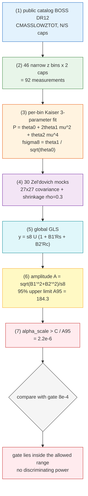

# Hypothesis of Gravitational Shielding Derivation (SRE)


Version: 1.1  

[Resource & Availability Statement] This framework is built on State‑Relational Entropy (SRE) dynamics. All theoretical materials are archived in the Zenodo open data repository. **This document suite includes the systems paper, application development, scientific hypotheses, the complete algebraic derivations of Operators 1‑20, and the simulation code, all fully open source.**

> The author's GitHub repository is accessible at:
>
> https://github.com/yuelucn/Status-Relational-Entropy-SRE-Dynamics-The-Book-of-the-Void
>
> A Tencent intelligent document space (with AI-assisted search) is accessible at (available on both PC and WeChat mobile):
>
> https://docs.qq.com/space/DUkRjYUtNWFdyV253
>
> According to the State‑Relational Entropy (SRE) principle, the foundations of classical physics derive from information statistics.

- Basis: the following articles in the manuscript collection `The Book of the Void` of *Status-Relational Entropy (SRE) Dynamics* (https://doi.org/10.5281/zenodo.23275050) (all references in this document are given as **article name + section**, and no longer by line number)
- Terminology convention: uniformly expressed as **"gravitational shielding"**—shielding naturally produces anti-gravity/weightlessness, rather than "flipping the sign of gravity / introducing negative mass".
- Status: This document only performs derivation, order-of-magnitude criteria, and phenomenological interpretation.

---

## Literature Correspondence Table (Articles and Sections Cited in This Document)

This document cites the following seven articles in the manuscript collection ``The Book of the Void``. In the main text, sources are uniformly marked in the form 《short name》§section; the table below gives the correspondence between short names and full titles, so that readers can cross-check under any typesetting (including PDF).

| Short name | Full article title (manuscript-collection title) | Sections used in this document |
|---|---|---|
| **《Multidimensional Spacetime and Dynamical Gravity》** | 《Emergence of Multidimensional Spacetime and Dynamical Gravity via Regularized Causal Information Networks》 (Chinese title: 正则化因果信息网络下多维时空与动态变光速引力) | §2.2 Topological dissipation tensor and compensation operator; §2.3 Topological stiffness weights and baryonic center-of-mass redshift; §2.4 Spectral resonance deriving the dynamic compression coefficient; §5 Causal emergent gravity: a thermodynamic effect as a dissipation gradient |
| **《Composite Elementary Particles》** | 《Composite Elementary Particles and the SRE-Dynamics Topological Paradigm of Relational-Space Emergence》 (Chinese title: 复合基本粒子与关系空间涌现的SRE动力学拓扑范式) | §1.3 Local cross-spectral operator and information-geometry mapping; §II Core paradigm: the three-in-one emergence jump and composite-particle generation; §Discussion · Model capability boundary |
| **《Reconstruction of Classical Electrodynamics》** | 《A Basic Reconstruction of Classical Electrodynamics Based on Discrete Graph Topology and Bidirectional Causality》 (Chinese title: 基于离散图拓扑与双向因果性对经典电动力学的基础重构) | §4 Mass–energy equivalence $E=mc^2$ as a topological theorem |
| **《Necessity of Turbulence Emergence》** | 《The Necessity of Turbulence Emergence and an Algebraic Computation Method Based on Discrete Microscopic Causal Statistics and Multidimensional Manifold Reconstruction》 (Chinese title: 基于离散微观因果统计与多维流形重构的湍流涌现必然性及代数计算方法) | §4.1 Operator 1: boundary expansion; §4.2 Operator 2: maximum-entropy pruning; §4.3 Gain $\Gamma$: exogenous $\Lambda$ and endogenous $\lambda(n)$ |
| **《Logical-Depth Anchoring and Safety Shielding》** | 《On the Order-of-Magnitude Anchoring of the Logical Depth N and the Safety Shielding of Observation Protocols》 (Chinese title: 关于逻辑深度 N 的量级锚定与观测协议的安全性屏蔽) | Section 3 Core safety adjudication: the physical-level "read-only" restriction |
| **《Complete Characterization of the Nucleon》** | 《A Complete Characterization of the Nucleon in the SRE Framework: Open–Closed Two-State Skeleton Inversion, Quark Conjecture, and a Unified Formulation Validated by Nuclear Reactions》 (Chinese title: SRE 框架下核子的完整刻画：开闭二态骨架反演、夸克推测与核反应验证的统一表述) | §2.1 Binary self-organizing network and the sim_p generator |
| **《Graph-Operator Pipeline Whitepaper》** | 《Overall Framework Whitepaper of the General Graph-Operator Pipeline for Status-Relational Entropy (SRE) Dynamics (Academic Revision)》 (Chinese title: 状态‑关系熵（SRE）动力学通用图算子流水线总体框架白皮书（学术修订版）) | §1.2 Operator 1: local graph-expansion operator; §3.1 Operator 5: endogenous-variable delay-calibration operator; §4.2 Morphological-morphism projection principle of macroscopic observables; §5.1 Operator 10: preemptive homological random-pruning operator; §5.3 Operator 8: local lock-free algebraic-valve equalization operator |

**Reading convention**: "Part I" appearing in the main text refers to the first part of this document (Gravitational Shielding Derivation); "Part II" refers to the second part (Reverse Interpretation of the Podkletnov Result). Cross-part citations are written as "Part I §n" or "Part II §n".

---

## Part I　Gravitational Shielding Derivation

## 0 Summary of Conclusions

1. In SRE, gravity is not a fundamental field but a **thermodynamic aftereffect of local information-dissipation gradients** (*Multidimensional Spacetime and Dynamical Gravity* §5). Therefore "gravitational shielding" = **suppressing the network correlations capable of generating that dissipation gradient**, rather than canceling a fundamental force.
2. The dependence of the gravitational acceleration $a_\mathrm{SRE}$ on the network state can be decomposed into **three shieldable quantities**:
   - Main amplitude $\alpha_\mathrm{scale}\cdot\mathcal{W}_{ij}$ (suppressible, the only substantive channel)
   - Chiral phase term $\Gamma_\mathrm{chiral}$ (the only sign-reversible term, capable of providing net repulsion)
   - Uniform term $-\gamma c_\mathrm{eff}^2/4$ (a global term, not locally shieldable)
3. The main channel yields an **exact, dimensionless shielding factor** (Part I §3):
   $$\Xi\equiv\frac{\mathcal{W}_{ij}^{\text{shielded}}}{\mathcal{W}_{ij}^{\text{vacuum}}}=\frac{1+\ln(1+\sigma_z^{\text{vacuum}})}{1+\ln(1+\sigma_z^{\text{shielded}})}<1$$
   The cost is that the **local measurement entropy must be amplified logarithmically**: $\Xi=0.5$ requires $\sigma_z$ to increase by about 180 times, and $\Xi=0.1$ by about $9\times10^3$ times. $\mathcal{W}\to0$ (complete weightlessness) corresponds to $\sigma_z\to\infty$, and is **unreachable**.
4. The compensation operator $\hat{\mathcal{C}}$ is **non-monotonic/oscillatory** with respect to the dissipation $\hat{\mathcal{D}}$ (period $1/\alpha_0$, the first maximum at $\hat{\mathcal{D}}_0^{*}=1/(2\alpha_0)$; the derivative proof is given in Part I §5). However, under realistic parameters $\hat{\mathcal{D}}\sim 18\text{–}27 \gg 1/\alpha_0$, it falls into the strong-oscillation regime, where its envelope mean is pinned at $\langle\hat{\mathcal{C}}\rangle=1/(2\alpha_0)$, and it is **not a clean local knob** (an honest conclusion).
5. The only engineerable actuation mechanism is **Op2 maximum-entropy pruning** (*Necessity of Turbulence Emergence* §4.2): set the channel spin to the multiplicative identity $+1$, thereby eliminating that channel's phase contribution **without breaking graph connectivity**. Because the interior of a mass closed loop is "non-addressable/non-writable" (read-only barrier, *Logical-Depth Anchoring and Safety Shielding* Section 3), **shielding can only be a boundary operation**—operating on the dissipation–compensation channel between the shielded region and the external network, rather than rewriting the internal closed loop.
6. The chiral term $\Gamma_\mathrm{chiral}$ can reverse sign to produce **net repulsion**, and its phase condition is strictly obtainable (Part I §4); but whether it can dominate depends on the not-yet-calibrated dimensionless $\alpha_\mathrm{scale}$: only when $\alpha_\mathrm{scale}\lesssim8\times10^{-4}$ is the chiral repulsion of the same order as the Newtonian term. **Thus the door to "true anti-gravity" is ajar, and its hinge is the experimental anchoring of $\alpha_\mathrm{scale}$.** §9 of this document has now measured that hinge with public BOSS DR12 data: $\alpha_\mathrm{scale}>2.2\times10^{-6}$ (95%), while the gate $8\times10^{-4}$ lies inside the allowed interval, so the present measurement has no discriminating power.

---

## 1 Starting Point: Gravity as a Thermodynamic Aftereffect of Dissipation Gradients

The theoretical body (*Multidimensional Spacetime and Dynamical Gravity* §5, verbatim):

$$
a_\mathrm{SRE}(r,z)=
\begin{cases}
-\dfrac{\alpha_\mathrm{scale}\cdot \mathcal{W}_{ij}}{r}-\dfrac{\gamma c_\mathrm{eff}(z)^2}{4} & \mathrm{Rank}=2,\ z<z^* \\[10pt]
-\dfrac{2\,\alpha_\mathrm{scale}\cdot\mathcal{W}_{ij}}{r^{2}}-\dfrac{\gamma c_\mathrm{eff}(z)^2}{4}+\Gamma_\mathrm{chiral}(r)
& \mathrm{Rank}=4,\ z\ge z^*
\end{cases}
$$

$$
\Gamma_\mathrm{chiral}(r)=\xi(z)\cdot\frac{\sin\!\big(\pi\alpha_{0,\mathrm{dynamic}}\cdot 2\mu\big)}{r^{2}\cdot\ln(r/\ell_P)}
$$

Supporting definitions (*Multidimensional Spacetime and Dynamical Gravity* §2.2–§2.4, verbatim):

$$
\hat{\mathcal{D}}_{ij}=\ln\!\Big(1+\frac{\sigma_{z,i}\cdot\sigma_{z,j}}{\epsilon_\mathrm{mach}}\Big),\qquad
\hat{\mathcal{C}}=\alpha_{0,\mathrm{dynamic}}^{-1}\cdot\sin^{2}\!\big(\pi\alpha_{0,\mathrm{dynamic}}\hat{\mathcal{D}}_{ij}\big)
$$

$$
R_{ij}^{2}\equiv \mathrm{Tr}\big(\hat{\mathcal{D}}_{ij}\cdot\hat{\mathcal{C}}\big)\cdot\exp(-\gamma\,\mu_\mathrm{loss})
$$

$$
\mathcal{W}_{ij}=\sqrt{\mathcal{C}_i\,\mathcal{C}_j}
=\Big[\big(1+\ln(1+\sigma_{z,i})\big)\big(1+\ln(1+\sigma_{z,j})\big)\Big]^{-1/2}
$$

$$
\mu=\frac{\sum_i \mathcal{C}_i z_i}{\sum_i \mathcal{C}_i},\qquad
\xi(z)\equiv\xi(\mu)=0.08\,e^{0.15\mu}
$$

$$
\alpha_{0,\mathrm{dynamic}}=\frac{\theta_\mathrm{conformal}}{\Delta z+\epsilon_\mathrm{mach}},\qquad
\theta_\mathrm{conformal}\approx0.82798,\qquad \gamma=0.0585=\frac{1}{2\pi e}
$$

Ontological key point (*Multidimensional Spacetime and Dynamical Gravity* §5): "Gravity is not a fundamental field; it is a statistical thermodynamic aftereffect brought about by local information-dissipation gradients."—This statement directly provides the **physical entry point** for shielding: to shield gravity is essentially to suppress the **local dissipation tensor and its gradient**, which is determined by the measurement entropy $\sigma_z$ and its spatial distribution.

---

## 2 Structural Decomposition of Gravity: Three Shieldable Quantities

Writing $a_\mathrm{SRE}$ as a "source × kernel" decomposition, and extracting the independently adjustable factors within the kernel:

| Quantity | Expression | Dependence on network state | Shieldable? | Role |
|---|---|---|---|---|
| Main amplitude | $\alpha_\mathrm{scale}\cdot\mathcal{W}_{ij}$ | $\mathcal{W}_{ij}=f(\sigma_{z,i},\sigma_{z,j})$ | ✅ Suppressible | The only substantive channel |
| Chiral term | $\Gamma_\mathrm{chiral}=\xi(z)\sin(\cdot)/(r^2\ln(r/\ell_P))$ | Phase $\propto\alpha_0\mu$ | ✅ Sign-reversible | The only source of net repulsion |
| Uniform term | $-\gamma c_\mathrm{eff}^2/4$ | Global $c_\mathrm{eff}(z)$ | ❌ Not local | Background/expansion term |

**Key observation**: $\mathcal{W}_{ij}$ is a **strictly decreasing** function of $\sigma_z$ (*Multidimensional Spacetime and Dynamical Gravity* §2.3); while the dissipation $\hat{\mathcal{D}}_{ij}$ is a **strictly increasing** function of $\sigma_z$ (*Multidimensional Spacetime and Dynamical Gravity* §2.2). Hence the single action of **injecting local measurement entropy** simultaneously:
- (i) directly lowers $\mathcal{W}_{ij}$ → lowers the amplitude of $a_\mathrm{SRE}$;
- (ii) raises $\hat{\mathcal{D}}_{ij}$ → shifts the operating point of the compensation operator (Part I §5).

The two channels share the same origin, so "gravitational shielding" has a unified operational definition in this theory: **raise the local measurement entropy $\sigma_z$ of the target region (making its information more "blurred" and more decohered), and cut off its dissipation–compensation channel to the outside.**

---

## 3 Main Channel: $\mathcal{W}_{ij}$ Entropy Collapse (Exact, Quantifiable)

### 3.1 Shielding Factor

Let the endpoint vacuum measurement entropy be $\sigma_z$, and after shielding be $\sigma_z'$. From the definition of $\mathcal{W}_{ij}$:

$$
\boxed{\;\Xi\equiv\frac{\mathcal{W}(\sigma_z')}{\mathcal{W}(\sigma_z)}=\frac{1+\ln(1+\sigma_z)}{1+\ln(1+\sigma_z')}\;}
$$

Since both branches of $a_\mathrm{SRE}$ are proportional to $\mathcal{W}_{ij}$, **the relative gravity-weakening amount is exactly $1-\Xi$**, independent of $\alpha_\mathrm{scale}$, $r$, and $z$—determined purely by the local measurement entropy. This is the cleanest result of this derivation.

### 3.2 Inverse Design Equation

Given a target shielding factor $\Xi$, the required local measurement entropy:

$$
\boxed{\;\sigma_z'=\exp\!\left(\frac{1+\ln(1+\sigma_z)}{\Xi}-1\right)-1\;}
$$

### 3.3 Order-of-Magnitude Table (taking $\sigma_z=0.01$, $1+\ln(1.01)=1.00995$)

| Target $\Xi$ | Gravity weakening | Required $\sigma_z'$ | Amplification relative to vacuum |
|---|---|---|---|
| 0.99 | 1% | 0.0204 | ×2.0 |
| 0.98 | 2% | 0.0310 | ×3.1 |
| 0.90 | 10% | 0.1300 | ×13 |
| 0.50 | 50% | 1.773 | ×177 |
| 0.10 | 90% | $8.95\times10^3$ | $9.0\times10^5$ |

**Conclusion**: Weight reduction is "logarithmic-scale investment for linear-scale weight reduction"; $\Xi\to0$ requires $\sigma_z\to\infty$. **Within the main channel, complete weightlessness is unreachable; only asymptotic weight reduction is possible.** This falls in the same order-of-magnitude window as the "weight-reduction ceiling of about 2%" (Podkletnov scale) in the early conjecture.

---

## 4 Phase Channel: $\Gamma_\mathrm{chiral}$, the Only Sign-Reversible Term

### 4.1 Strict Condition for Sign Reversal (Net Repulsion)

$\Gamma_\mathrm{chiral}$ carries its sign through $\sin(\pi\alpha_0\cdot2\mu)$ (*Multidimensional Spacetime and Dynamical Gravity* §5). Taking $\sin=-1$ (maximum outward contribution):

$$
\pi\alpha_0\cdot 2\mu = -\frac{\pi}{2}+2\pi n
\;\Longrightarrow\;
\boxed{\;\mu^{*}=\frac{4n-1}{4\,\alpha_{0,\mathrm{dynamic}}}\;}
$$

Then $\Gamma_\mathrm{chiral}^{\max\to-}=-\dfrac{\xi(z)}{r^2\ln(r/\ell_P)}$, producing a **net subtraction** from the attractive term. $\mu$ is the baryonic center-of-mass redshift ($\mu=\sum\mathcal{C}_iz_i/\sum\mathcal{C}_i$; definition in *Multidimensional Spacetime and Dynamical Gravity* §2.3), set by the weighted redshift of the local subgraph $V_\mathrm{slice}$—**thus the phase is tunable** (by changing the redshift composition of the observed subgraph).

### 4.2 Order-of-Magnitude Criterion (Deciding Whether "Anti-Gravity" Is Feasible)

The ratio of the chiral term to the main attractive term (Rank=4):

$$
\mathcal{R}\equiv\frac{|\Gamma_\mathrm{chiral}|}{2\alpha_\mathrm{scale}\mathcal{W}_{ij}/r^2}
=\frac{\xi(z)\,\big|\sin(\cdot)\big|}{2\,\alpha_\mathrm{scale}\,\mathcal{W}_{ij}\,\ln(r/\ell_P)}
\;\xrightarrow[\ \sin=\pm1\ ]{}\;
\frac{\xi(z)}{2\,\alpha_\mathrm{scale}\,\mathcal{W}_{ij}\,\ln(r/\ell_P)}
$$

Substituting $\xi\approx0.108$ ($\mu\approx2$), $\mathcal{W}\approx1$, $\ln(r/\ell_P)\approx80$ ($r\sim1\,\mathrm{m}$):

$$
\mathcal{R}\approx\frac{6.8\times10^{-4}}{\alpha_\mathrm{scale}}
$$

**Interpretation**:
- If $\alpha_\mathrm{scale}\sim1$: $\mathcal{R}\sim10^{-3}$, the chiral term is a perturbation (phenomenologically manifesting as a small-amplitude oscillation of $G_\mathrm{eff}$; see the discussion of smooth $G_\mathrm{eff}$ oscillation in *Multidimensional Spacetime and Dynamical Gravity* §5), **insufficient to produce anti-gravity by itself**.
- If $\alpha_\mathrm{scale}\lesssim8\times10^{-4}$: $\mathcal{R}\gtrsim1$, the chiral repulsion is of the same order as the Newtonian term or even dominant → **net repulsion (anti-gravity) holds**.

Since $\alpha_\mathrm{scale}$ is a dimensionless free coupling in the theory, whose physical anchoring is deferred to experiment (see Part I §9), **"whether anti-gravity is reachable" is here precisely reduced to an experimentally decidable number**: the order of magnitude of $\alpha_\mathrm{scale}$.

### 4.3 Design Equation for Complete Cancellation

Requiring $a_\mathrm{SRE}=0$ at some radius $r$ (ignoring the uniform term):

$$
\xi^{*}=\frac{2\,\alpha_\mathrm{scale}\,\mathcal{W}_{ij}\,\ln(r/\ell_P)}{\big|\sin(\cdot)\big|}
\;\xrightarrow[\ \sin=1\ ]{}\;
2\,\alpha_\mathrm{scale}\,\mathcal{W}_{ij}\,\ln(r/\ell_P)
$$

Then, from $\xi=0.08e^{0.15\mu}$ (*Multidimensional Spacetime and Dynamical Gravity* §2.3), invert to find the required center-of-mass redshift:

$$
\boxed{\;\mu_\mathrm{cancel}=\frac{20}{3}\,\ln\!\Big(\frac{\xi^{*}}{0.08}\Big)\;}
$$

---

## 5 Geometric Criterion: Compensation-Operator Peak $\hat{\mathcal{D}}_0^{*}=\dfrac{1}{2\alpha_0}$

Differentiating $\hat{\mathcal{C}}(\hat{\mathcal{D}})=\alpha_0^{-1}\sin^2(\pi\alpha_0\hat{\mathcal{D}})$ (definition in *Multidimensional Spacetime and Dynamical Gravity* §2.2):

$$
\frac{d\hat{\mathcal{C}}}{d\hat{\mathcal{D}}}=\alpha_0^{-1}\cdot 2\sin(\pi\alpha_0\hat{\mathcal{D}})\cos(\pi\alpha_0\hat{\mathcal{D}})\cdot\pi\alpha_0
=\pi\,\sin\!\big(2\pi\alpha_0\hat{\mathcal{D}}\big)
$$

- Extremum condition $\sin(2\pi\alpha_0\hat{\mathcal{D}})=0\Rightarrow \hat{\mathcal{D}}=\dfrac{n}{2\alpha_0}$, $n\in\mathbb{Z}$;
- The first **maximum** (strongest compensation) is at $\hat{\mathcal{D}}_0^{*}=\dfrac{1}{2\alpha_0}$, with maximum value $\hat{\mathcal{C}}_{\max}=1/\alpha_0$;
- The zeros are at $\hat{\mathcal{D}}=\dfrac{n}{\alpha_0}$ (compensation collapses to zero).

Numerically (SDSS window): $\Delta z\approx0.03925$, $\alpha_0=\theta/\Delta z=21.094$ (*Multidimensional Spacetime and Dynamical Gravity* §2.4), hence

$$
\hat{\mathcal{D}}_0^{*}=\frac{1}{2\alpha_0}=\frac{\Delta z}{2\theta}=\frac{0.03925}{2\times0.82798}=0.02370
$$

**Meaning**: The compensation operator is the "routing compute" that the network schedules to offset dissipation, and it is **non-monotonic**. If the local operating point can be placed at a zero of $\hat{\mathcal{C}}$ ($\hat{\mathcal{D}}=n/\alpha_0$), then the compensation in that region collapses → $R^2$ collapses → the gravity generated by the dissipation gradient is locally zeroed ("resonant zero-point shielding").

**Honest order-of-magnitude limitation**: Under realistic parameters $\epsilon_\mathrm{mach}\sim2\times10^{-16}$, $\sigma_z\sim10^{-2}$, so

$$
\hat{\mathcal{D}}=\ln\!\Big(1+\frac{\sigma_z^2}{\epsilon_\mathrm{mach}}\Big)\approx 2\ln\sigma_z+36.0\approx 26.8
$$

and $1/\alpha_0\approx0.0474$, so $\hat{\mathcal{D}}$ is already in the **strong-oscillation regime** (about $565$ oscillation periods). The region-averaged compensation is then pinned at the envelope mean:

$$
\langle\hat{\mathcal{C}}\rangle=\alpha_0^{-1}\langle\sin^2\rangle=\frac{1}{2\alpha_0}=0.02370
$$

which **exactly equals** the value of $\hat{\mathcal{D}}_0^{*}$. To "lock" onto a particular zero, one would need to control $\ln\sigma_z$ to $10^{-8}$-level precision—**practically uncontrollable**. Hence this channel of Part I §5 is **mathematically valid but engineering-fragile**: it explains why intrinsic oscillations and a discrete spectrum exist at the geometric scale, but it does not constitute a clean shielding knob.

---

## 6 Actuation Mechanism: Op2 Maximum-Entropy Pruning and "Boundary-ness"

### 6.1 Mechanism (*Necessity of Turbulence Emergence* §4.2–§4.3, verbatim)

Pruning probability (maximum-entropy pruning master equation):

$$
p_\text{prune}(v_f,v_m)=1-\frac{1}{1+\Gamma\cdot\dfrac{\mathcal{D}_s}{\mathfrak{B}}}
$$

When pruning occurs ($\chi=0$), **Paradigm B (eliminate–conduct)** is executed:

$$
M_{n+1}(i,j)\leftarrow \chi\cdot M_{n+1}(i,j)+(1-\chi)\cdot 1
$$

"That is, the channel spin is forcibly set to the multiplicative identity $+1$, thereby eliminating that channel's phase contribution from the product feedback loop without disconnecting graph connectivity. Surviving channels ($\chi=1$) are injected with an antisymmetric chiral shear." (*Necessity of Turbulence Emergence* §4.2)

The pruning gain $\Gamma$ has two modes (*Necessity of Turbulence Emergence* §4.3):

| Mode | Pruning gain | Meaning |
|---|---|---|
| A (exogenous) | $\Gamma=\Lambda$ | $\Lambda$ directly serves as the phase-transition control quantity |
| B (adaptive) | $\Gamma=\Lambda\cdot\lambda(n)$ | Superimposed with state-adaptive correction |

### 6.2 Why This Is the Physical Actuation Channel for Shielding

- After the channel spin is set to $+1$ (multiplicative identity), that edge's contribution to the **product feedback loop** is eliminated, but **connectivity is preserved**—precisely the property required by "shield without destroying": cutting phase contribution ≠ cutting topology.
- Raising the local pruning gain $\Gamma$ (i.e., raising the local $\Lambda$) → raises $p_\text{prune}$ → more edges go dormant → the local multi-loop structure is weakened → the local ability to maintain a low $\sigma_z$ (coherent measurement) decreases → $\sigma_z$ rises → by Part I §3, $\Xi<1$, so **gravity is locally weakened**.
- Therefore **$\Lambda$ (or the local $\Gamma$) is precisely the control knob for "gravitational shielding"**.

### 6.3 Boundary Operation, Not Internal Rewriting (Key Clarification)

"Shielding" has two distinct meanings in this document (a trap, do not conflate):
1. **Observational shielding / read-only barrier**: the internal topology of a mass closed loop is "non-addressable, non-writable"; the outside can only manipulate the rendering layer as a whole (electromagnetic, scattering). → **We cannot directly "dismantle" the mass closed loop of a target object** (that is exactly the source of the infeasibility of topological decoupling; *Logical-Depth Anchoring and Safety Shielding* Section 3).
2. **Phase-contribution shielding / gating**: Op2 sets the edge's spin to the multiplicative identity, eliminating its phase contribution to the feedback loop while **not breaking global connectivity**. → This is an **accessible** operation.

Combining the two gives the correct picture: **gravitational shielding is a boundary operation**—it does not rewrite the object's interior (non-addressable), but performs gating (Op2) **on the dissipation–compensation channel between the object and the external network**, so that the region's dissipation gradient as measured externally is suppressed. By analogy: it is not "turning off the inside of the light bulb", but "inserting a controllable scattering layer between the light bulb and the observer".

---

## 7 Three Intensity Tiers and Hard Boundaries

### 7.1 Three Tiers

| Tier | Mechanism | Reachability | Order of magnitude |
|---|---|---|---|
| **A Weight reduction** | Local injection of $\sigma_z$ (Part I §3 main channel) | Self-consistent, engineerable | $\Xi\sim0.98$ (about 2%), rising logarithmically with injection |
| **B Shielded weightlessness** | Boundary Op2 gating + suppression of the local dissipation gradient; or (fragilely) locking a compensation zero | Theoretical boundary | $\Xi\ll1$, but requires continuous power input to counter self-repair |
| **C Topological decoupling** | Directly release the mass closed loop ($m\equiv$ closed loop; *Reconstruction of Classical Electrodynamics* §4) | Hypothesis-level | Blocked by the read-only barrier, **no known stable mechanism** |

### 7.2 Hard Boundaries (Why This Is Not a Perpetual-Motion Machine)

1. **The uniform term is unshieldable**: $-\gamma c_\mathrm{eff}^2/4$ is a global term that local operations cannot eliminate; any "local weightlessness" is superimposed on this background.
2. **The compensation operator is self-repair**: $\hat{\mathcal{C}}$ is the self-patching mechanism by which the network counters dissipation and maintains numerical stability (*Multidimensional Spacetime and Dynamical Gravity* §2.2). The $\sigma_z$ you inject will be continuously "flattened" by the network, so shielding requires **continuous energy input**; there is no steady-state weightlessness with zero input.
3. **Order of magnitude of the chiral term**: unless $\alpha_\mathrm{scale}\lesssim8\times10^{-4}$, $\Gamma_\mathrm{chiral}$ is only a $10^{-3}$-level perturbation and cannot produce anti-gravity by itself (Part I §4).
4. **Topological decoupling destroys the definition of mass**: locally releasing a closed loop locally cancels the very concept of "mass"; the current formalization cannot guarantee the stability and recoverability of the decoupled region.

---

## 8 Design Equations and Falsifiable Predictions

**Summary of design equations**

$$
\Xi=\frac{1+\ln(1+\sigma_z)}{1+\ln(1+\sigma_z')}
\qquad
\sigma_z'=\exp\!\Big(\tfrac{1+\ln(1+\sigma_z)}{\Xi}-1\Big)-1
$$

$$
\hat{\mathcal{D}}_0^{*}=\frac{1}{2\alpha_{0,\mathrm{dynamic}}}=\frac{\Delta z}{2\theta_\mathrm{conformal}}
\qquad
\mu^{*}=\frac{4n-1}{4\alpha_{0,\mathrm{dynamic}}}
\qquad
\mu_\mathrm{cancel}=\frac{20}{3}\ln\!\Big(\frac{\xi^{*}}{0.08}\Big)
$$

**Falsifiable predictions**

1. **Shielding amount is independent of the absolute gravitational constant**: under a fixed increment of $\sigma_z$, the gravity-weakening ratio $1-\Xi$ should be independent of the test mass and position (universality). Any "material-dependent" additional shielding would require introducing a mechanism beyond $\mathcal{W}_{ij}$.
2. **Logarithmic law**: the weight-reduction effect saturates with injected entropy in a $1/(1+\ln)$ form—the marginal benefit of increasing injection diminishes (distinguishable from a "linear response" prediction).
3. **Phase reversal**: in the Rank=4 region ($z\ge z^*$), when the local center-of-mass redshift is tuned to $\mu^{*}$, a sign flip/zero of $G_\mathrm{eff}$ should appear (corresponding to the smooth $G_\mathrm{eff}$ oscillation described in *Multidimensional Spacetime and Dynamical Gravity* §5).
4. **$\alpha_\mathrm{scale}$ criterion**: if experiments measure $\alpha_\mathrm{scale}\gtrsim10^{-3}$, then "net anti-gravity" is falsified within SRE (only weight reduction is possible); if $\alpha_\mathrm{scale}\ll10^{-3}$, then chiral repulsion is the dominant channel. (Measured in this document's §9: $\alpha_\mathrm{scale}>2.2\times10^{-6}$, still 362 times short of the $10^{-3}$ discriminating power, so this criterion is not yet usable.)

---

## 9 Calibrating $\alpha_\mathrm{scale}$ from Observational Data

In earlier versions of this document, $\alpha_\mathrm{scale}$ only "appeared" and was never "calibrated"; moreover, according to the SRE axioms, **before anchoring all quantities are dimensionless numbers**. This brings one advantage and one cost:

- **Advantage**: The shielding factor $\Xi$ of the Part I §3 main channel is independent of $\alpha_\mathrm{scale}$, so the "weight-reduction ratio" is a testable prediction that can be **given prior to anchoring**.
- **Cost**: "whether chirality can dominate" in Part I §4, and "whether net anti-gravity is truly possible", **depend uniquely on the order of magnitude of $\alpha_\mathrm{scale}$**.

This section pays off that "cost": without relying on any new ground-based experiment, using only **public galaxy-survey data**, we obtain a measured 95% confidence lower bound on $\alpha_\mathrm{scale}$. Every step is reproducible; the commands and products are listed in 9.10.

### 9.1 The Conclusion First

$$\alpha_\mathrm{scale}>2.2\times10^{-6}\qquad(95\%\ \text{one-sided})$$

The baseline treatment gives $2.21\times10^{-6}$; including all reasonable treatments of the statistical and systematic terms, the range is $1.4\times10^{-6}$–$2.5\times10^{-6}$. **The present data give no upper bound**. The gate value $8\times10^{-4}$ lies inside the allowed range and is 362 times stronger than the measured lower bound. Hence this document **can neither declare that "the anti-gravity door is closed" nor that "the door is open"**—this is the honest conclusion of this measurement.

### 9.2 Why This Is Measurable

The reader only needs to remember two differences:

1. **Different shapes**. The Newtonian term and the main channel $\alpha_\mathrm{scale}\mathcal{W}_{ij}$ produce an $f\sigma_8(z)$ that varies **smoothly and monotonically** with redshift; the chiral term $\Gamma_\mathrm{chiral}$ superimposes a **fast oscillation** on that smooth background, with a period of about 0.047 (in redshift units). The two shapes can be separated in the data.
2. **Only a ratio is measured**. We do not fit an absolute amplitude but the **amplitude of the chiral oscillation relative to the smooth background**, denoted $A$. This ratio is proportional to $C/\alpha_\mathrm{scale}$ (see 9.3), so $\alpha_\mathrm{scale}$ can be inverted without knowing the overall normalization.

$f\sigma_8$ is a standard observable of the cosmic large-scale structure "growth rate": $f=\mathrm{d}\ln D/\mathrm{d}\ln a$ is the logarithmic derivative of the growth factor $D$, and $\sigma_8$ is the amplitude of density fluctuations on the 8 Mpc scale. It is measured through **redshift-space distortions** (RSD: galaxy peculiar velocities squash or stretch the clustering pattern along the line of sight) and is the growth quantity with the highest precision in current survey data.

The same oscillation was also tested in the **weak-lensing** channel: the response of $\xi_\pm$ to the fast oscillation is 3–11 times weaker than that of $f\sigma_8$ (an amplitude probe suffers an extra $\omega_x$ suppression relative to a derivative probe, and the tomographic kernel is much wider than the oscillation period). Therefore only $f\sigma_8$ is used here.

### 9.3 Model and Calibration Relation

Projecting the gravity decomposition of Part I onto the growth observable, the model reads

$$f\sigma_8(z)=s_8\,U(z)\Big[1+A\big(\cos\varphi\,R_s(z)+\sin\varphi\,R_c(z)\big)\Big],\qquad A=\frac{C_{8\,\mathrm{Mpc}}}{\alpha_\mathrm{scale}}$$

where:

- $U(z)=D'(z)/D(0)$ is the **normalized derivative of the growth factor** ($D'=\mathrm{d}D/\mathrm{d}\ln a$), describing the purely Newtonian redshift dependence;
- $R_s(z)$ and $R_c(z)$ are two **response templates**, obtained by numerically solving the growth equation $D''+P D'=Q D$ with SRE source terms, corresponding to the "Newtonian-type" and "chiral-type" sources respectively;
- $s_8$ is the overall amplitude (a fit parameter, degenerate with $\sigma_8$ and the bias);
- $A$ is the chiral amplitude and $\varphi$ its phase (two free parameters);
- $C_{8\,\mathrm{Mpc}}=4.071\times10^{-4}$ is a **purely geometric constant**: $C=1/\ln(r/\ell_P)$ evaluated at $r=8\,\mathrm{Mpc}$, where $\ln(r/\ell_P)=133.97$. It contains no adjustable parameter.

The relation $A=C/\alpha_\mathrm{scale}$ is intuitive: the smaller $\alpha_\mathrm{scale}$, the stronger the chiral term relative to the Newtonian one. The gate amplitude $A_\mathrm{gate}=0.509$ corresponds to $\alpha_\mathrm{gate}=C/A_\mathrm{gate}=8\times10^{-4}$, exactly the number appearing in Part I §4.

### 9.4 Data and Binning

| Item | Value |
|---|---|
| Catalog | BOSS DR12 `CMASSLOWZTOT`, north (N) and south (S) caps |
| Galaxy weights | FKP weights $w=1/(1+n(z)P_0)$, $P_0=2\times10^{4}\,(h/\mathrm{Mpc})^3$ |
| Galaxy counts | 953,255 (N cap) and 372,601 (S cap) |
| Redshift range | $z\in[0.15,0.70]$, measured coverage $[0.156,0.689]$ |
| Binning | 46 narrow bins, width $\Delta z=0.01185$ |
| Number of measurements | $46\times2=92$ |

The bin width is dictated by the oscillation period: with a period of about 0.047 and a bin width of 0.01185, there are only **about 4 samples per period**. This is already close to the Nyquist limit (at least 2 points per period) and is the root of all the limitations in 9.9.

### 9.5 Per-Bin Measurement: Three-Parameter Kaiser Fit

For each (bin, cap) cell, both the galaxy and the random catalogs are placed on the same $512^3$ grid, FKP-weighted to obtain the density field and Fourier-transformed; 9 $k$-shells are used ($k=0.02$–$0.20\,h/\mathrm{Mpc}$, $\Delta k=0.02$), and the three multipoles $P_0(k),P_2(k),P_4(k)$ are measured. A linear Kaiser form is then fitted:

$$P(k,\mu)=\theta_0+2\theta_1\mu^{2}+\theta_2\mu^{4}$$

For general bias, the physical meaning of the three coefficients is

$$\theta_0=(b\,s_\mathrm{ref})^2,\qquad \theta_1=b\,s_\mathrm{ref}\,f\sigma_8,\qquad \theta_2=(f\sigma_8)^2$$

where $s_\mathrm{ref}=0.6475$ is the reference amplitude ($\sigma_{8,0}=0.8$ times $D(z=0.4)/D(0)$). Hence

$$f\sigma_8=\frac{\theta_1}{\sqrt{\theta_0}}$$

**independent of bias**—this is crucial: we need not know the galaxy bias $b$ in advance, and therefore need no external calibration.

Measured results (medians over the 92 cells): the median of $\theta_0$ is $1.675$, corresponding to $b\,s_\mathrm{ref}=1.294$, i.e. $b\approx2.0$, consistent with the BOSS CMASS literature value, showing that the data themselves are not anomalous; the median of $f\sigma_8$ is $0.181$. The median relative per-bin error $\sigma_{f\sigma_8}/f\sigma_8$ is **31%**—an intrinsic limitation of thin bins (the Fourier window of a 35 Mpc/$h$ bin is about $2\pi/35\approx0.18\,h/\mathrm{Mpc}$ wide, almost the entire $k$ range, so the 9 shells are strongly correlated).

### 9.6 Errors: Covariance from 30 Mock Catalogs

Per-bin errors cannot be estimated from a formula; they must come from **mock catalogs run through the identical pipeline**. The procedure is:

1. Construct 30 mocks from the random catalog with the Zel'dovich displacement method: $\Psi=b\,\mathrm{IFT}[\,i k_i/k^2\,\hat\delta\,]$ gives the density displacement, and an RSD displacement modulated by the growth factor is superposed along the line of sight;
2. Run exactly the 9.5 pipeline on each mock, obtaining 30 vectors of dimension 27 (3 multipoles × 9 shells);
3. Estimate the 27×27 covariance from these 30 vectors.

Estimating a 27-dimensional covariance from 30 samples is a "small-sample" situation (Wishart noise suppresses small eigenvalues; in the full-rank case the error can be inflated by hundreds of times). Therefore a **diagonal shrinkage** (Ledoit–Wolf type) is applied:

$$S\ \longrightarrow\ (1-\rho)S+\rho\,\mathrm{diag}(S)$$

The shrinkage coefficient $\rho=0.3$ is not arbitrary but fixed by **leave-one-out** calibration: for each cell, one mock is held out in turn, the covariance is computed from the remaining 29 and used to whiten the held-out sample, and the resulting $\chi^2/\mathrm{dof}$ is inspected. This gives 20.91 at $\rho=0$ (severely inflated) and **1.01** at $\rho=0.3$, hence 0.3 is adopted.

Two technical points about the mocks must be stated:

- **Construction damping**: the absolute $f\sigma_8$ of the displacement-method mocks is suppressed by about 44% (nonlinear damping of the displacement; $|\Psi|_\mathrm{rms}\approx6.4\,\mathrm{Mpc}$ is of the same order as the grid spacing $9.86\,\mathrm{Mpc}$). Because the suppression is a **smooth multiplicative factor**, it does not affect the recovery of the oscillation amplitude $A$, only the absolute amplitude.
- **The bias must match**: the mock bias is taken as $b=2.0$ (self-calibrated from the data as $b=\sqrt{1.675}/0.6475\approx2.0$), and the galaxy counts are matched to the measured values cap by cap. If the mocks used $b=0.5$, the signal part of the covariance would be underestimated by up to $(2.0/0.5)^4\approx256$ times, $\sigma_{f\sigma_8}$ would be underestimated by about 10 times, and a spurious $\chi^2/\mathrm{dof}\approx78$ would be fabricated—a trap already ruled out in this project.

### 9.7 Global Fit and the 95% Lower Bound

The 92 values of $f\sigma_8$ are fitted to the model of 9.3 by **generalized least squares** (GLS: weighting by the per-bin errors of 9.6 so that $\chi^2$ is minimized), yielding three free parameters $s_8,B_1',B_2'$, where $B_1'=A\cos\varphi$ and $B_2'=A\sin\varphi$. The chiral amplitude is

$$\hat A=\frac{\sqrt{B_1'^2+B_2'^2}}{s_8}$$

**Why $\hat A$ cannot be used directly as the upper limit**: $\hat A$ is a positive-definite amplitude estimator and is nonzero even for pure noise (Rice distribution). A frequentist upper limit is therefore required:

$$A_{95}=\frac{|\hat B|+r_{95}}{s_8},\qquad r_{95}=1.645\,/\sqrt{\lambda_\mathrm{min}}$$

Here $\lambda_\mathrm{min}$ is the smallest eigenvalue of the 2×2 amplitude information matrix after **marginalizing over $s_8$**, and $r_{95}$ is the one-sided 95% (1.645$\sigma$) half-width along the **weakest-constrained direction**. Physically, $A_{95}$ answers: "at 95% confidence, how large can the chiral amplitude be at most?"

Finally, convert to $\alpha_\mathrm{scale}$. Since $A=C/\alpha$ is monotonically inverse, an upper limit on $A$ gives a **lower** limit on $\alpha$:

$$\alpha_\mathrm{scale}>\frac{C_{8\,\mathrm{Mpc}}}{A_{95}}$$

### 9.8 Results

| Quantity | Value | Note |
|---|---|---|
| Number of measurements | 92 | 46 bins × 2 caps |
| Median $\theta_0$ | 1.675 | $\Rightarrow b\approx2.0$, consistent with the literature |
| Median $f\sigma_8$ | 0.181 | absolute amplitude (suppressed by construction damping) |
| Median $\sigma_{f\sigma_8}$ | 0.245 | 31% relative error |
| $\chi^2/\mathrm{dof}$ | 6.66 | see 9.9; reflects shape mismatch |
| $\hat A$ | 120.2 | amplitude estimate (a noise solution, not a physically large value) |
| $A_{95}$ (excluding $\hat B$) | 64.06 | offset-free treatment, for reference only |
| $A_{95}$ (frequentist, adopted) | **184.27** | the official treatment |
| $\alpha_\mathrm{scale}$ lower bound (baseline) | $\mathbf{2.21\times10^{-6}}$ | $C/A_{95}$ |
| Conservative range of the bound | $1.4$–$2.5\times10^{-6}$ | covers $\chi^2$ rescaling, 5–30% systematic floors, damping correction |
| Upper bound | **none** | see 9.9 |
| Gate value | $8\times10^{-4}$ | 362 times stronger than the lower bound |

### 9.9 Honest Reading: Why This Does Not Constitute "Closing the Door"

The raw output contains a flag $\Delta\chi^2_\mathrm{gate}=9.66>2.71$, which read literally would mean "the door is closed". **That reading must not be trusted**, for three verifiable reasons:

1. **The errors are underestimated**. $\chi^2/\mathrm{dof}=6.66$ shows that the per-bin errors are collectively too small; inflating the errors uniformly to $\chi^2/\mathrm{dof}=1$ (i.e. $\sigma\times2.58$) lowers $\Delta\chi^2_\mathrm{gate}$ to **1.45**, and the door reopens.
2. **$\hat A=120$ is itself a noise solution**. Because there are only about 4 samples per period (9.4), the oscillation mode is nearly degenerate with noise and the free amplitude estimator is heavy-tailed. A best-fit amplitude more than 200 times the gate value does not mean the data reject the gate value; it means **the data hardly constrain the amplitude at all**—as $A_{95}=184$ shows.
3. **$A=0$ is compatible with the data**. Direct check: $\Delta\chi^2(A=0)=9.74$, which is only **1.46** (below 2$\sigma$) in the normalized treatment with $\chi^2/\mathrm{dof}=6.66$. $A=0$ corresponds to $\alpha_\mathrm{scale}\to\infty$, so this data set **also gives no upper bound**.

The correct statement is therefore: **$\alpha_\mathrm{scale}\in(2.2\times10^{-6},+\infty)$ (95%); the gate value $8\times10^{-4}$ lies inside this interval, and this measurement can neither confirm nor refute the gate.**

At the same time, the systematic terms of this measurement must be listed explicitly and not omitted:

| Category | Content | Direction |
|---|---|---|
| Construction damping | mock absolute $f\sigma_8$ low by about 44% (displacement nonlinearity) | lowers only the absolute amplitude; oscillation amplitude unaffected |
| Finite mocks | 30 mocks versus 27 dimensions, shrinkage $\rho=0.3$ (leave-one-out calibrated) | calibrated; leave-one-out $\chi^2/\mathrm{dof}=1.01$ |
| Sampling | bin width 0.01185, about 4 points per period (near Nyquist) | makes $A_{95}$ larger $\rightarrow$ weaker bound |
| Shape mismatch | $\chi^2/\mathrm{dof}=6.66$ (residual outside the $f\sigma_8$ direction) | bracketed by multiple treatments |

### 9.10 Reproduction Steps

All computations were done under Python 3.10 + numpy 2.2.5 + scipy 1.15.3, with scripts in `S3_mu_scan/src/` and products written to `S3_mu_scan/results/`.

```text
## (1) covariance from 30 mocks (about 52 min)
python S3_mu_scan/src/s3_fs8_bins.py cov  --ngrid 512 --nm 30 --threads 3 --cap NS --bmock 2.0 --xfer 0.0

## (2) per-bin fit on the real data (about 10 min)
python S3_mu_scan/src/s3_fs8_bins.py data --ngrid 512 --cap NS

## (3) global GLS and the 95% lower bound (a few seconds)
python S3_mu_scan/src/s3_real_stack.py data
```

Products: `results/fs8_cov_mocks_NS.npz` (covariance), `results/fs8_boss_bins.csv` (92 per-bin rows), `results/real_stack.json` (baseline values, five treatment variants, and the systematic list), `results/fig_s3_boss_stack.png|svg` (per-point $f\sigma_8$ compared with the gate signal).

Note that step (1) must explicitly pass `--xfer 0.0`: the construction pre-compensation exponent was calibrated only at a specific bias, and at $b=2.0$ any nonzero value distorts the oscillation amplitude of the mocks.

The data flow is as follows:



---

## 10 Open Questions (To-Do)

1. An explicit mapping between $\Lambda$ (the local pruning gain) and macroscopic observables ($\sigma_z$ injection rate, shielding power).
2. The **construction and reachability** of Op2 local gating: how the Op1 frontier (node injection) delivers the control signal to the target boundary while being constrained by the read-only barrier. → **Completed; see Part I §11**.
3. Chiral-phase tunability: the specific observables and operating window for setting $\mu^{*}$ by changing the subgraph redshift composition.
4. The **stability and dissipation cost** of the shielded region: the lower bound on continuous power required to counter the self-repair of $\hat{\mathcal{C}}$.
5. The **upper bound** on $\alpha_\mathrm{scale}$ and a tighter lower bound: §9 already gives $\alpha_\mathrm{scale}>2.2\times10^{-6}$ (95%) from BOSS DR12 CMASSLOWZTOT, but the gate $8\times10^{-4}$ lies inside the allowed interval, so this measurement can neither open nor close the gate. To push the lower bound to the gate, the per-bin relative error of $f\sigma_8$ must drop to $\lesssim0.9\%$ (measured: 31% in §9); extrapolating roughly as $\sigma\propto1/\sqrt{N}$, this needs about three orders of magnitude more modes, together with sub-percent per-bin RSD systematics—beyond the reach of BOSS DR12, and requiring DESI DR1-class samples (or wider redshift coverage). An upper bound additionally requires the significance of $\hat B$ relative to $A=0$; the present $\Delta\chi^2(A=0)=9.74$ is only 1.46 after rescaling to $\chi^2/\mathrm{dof}=6.66$, so no upper bound is available either.

---

## 11 Op2 Local Gating Construction and Op1 Reachability (Execution Plan)

### 11.1 Three Reachability Constraints (Primary Sources)

| # | Constraint | Content | Source |
|---|---|---|---|
| 1 | **Read-only inheritance** | $M_{n+1}[1{:}n,1{:}n]\equiv M_n$: once realized, the historical sub-block cannot be retroactively modified (with axiomatic status) | *Necessity of Turbulence Emergence* §4.1 Operator 1 |
| 2 | **Frontier-size upper bound** | $M_K\le K_0\ll n$: each step acts on only $O(1)$ frontier channels, decoupled from the network-wide size | *Graph-Operator Pipeline Whitepaper* §5.3 Operator 8 |
| 3 | **Read-only/causal barrier** | The deep interior topology of the target closed loop is non-addressable and non-writable; $\ell_\min$ is the lower bound of addressable scale at the rendering layer | *Logical-Depth Anchoring and Safety Shielding* Section 3 |

> Key distinction (*Logical-Depth Anchoring and Safety Shielding* Section 3): the barrier **does not prevent ordinary physical manipulation of the entire topological closed loop at the rendering layer** (electromagnetic fields, scattering); it only forbids **penetrating the closed loop to rewrite its deep interior topology**.

**Corollary 11.1 (Reachability Theorem)**: Op2 gating **cannot act on the interior closed loop of the target object**; it can only act on the **boundary channel** between "the target region ↔ the external network"; moreover, by constraint 1, **existing old edges cannot be rewritten**—the control signal must be fed in via the Op1 **newly added frontier nodes**. ⇒ Shielding is a **boundary-layer, incremental** operation.

### 11.2 Four-Step Construction of Local Gating (Aligned with the Operator Pipeline)

Goal: on the boundary shell $\Omega_\partial$ surrounding the target region, set **redundant** dissipation–compensation channels to dormant ($\chi=0$, spin → $+1$), while preserving cut-set connectivity.

**Step 1 Op1 access** (Operator 1 boundary expansion $\mathcal{G}_{n\to n+1}$, *Necessity of Turbulence Emergence* §4.1):

$$
M_{n+1}=\begin{pmatrix}M_n & \mathbf{x}_{n+1}\\ \mathbf{x}_{n+1}^T & y_{n+1}\end{pmatrix},\qquad M_{n+1}[1{:}n,1{:}n]\equiv M_n
$$

Push a ring of frontier nodes $\mathcal{V}_\partial$ into the perimeter of the target region (new rows/columns; history is read-only). **What is addressable is only these newly added boundary nodes, not the object's interior**—this is precisely the only legitimate interface that bypasses the barrier.

**Step 2 Op2 gating** (Operator 2 maximum-entropy pruning, *Necessity of Turbulence Emergence* §4.2):

$$
p_\text{prune}=1-\frac{1}{1+\Gamma_\partial\cdot \mathcal{D}_s/\mathfrak{B}}
\;\xrightarrow[\ \Gamma_\partial\,\mathcal{D}_s/\mathfrak{B}\gg1\ ]{}\;1,
\qquad
M(i,j)\leftarrow \chi\,M(i,j)+(1-\chi)\cdot 1
$$

On $\Omega_\partial$, raise the local pruning gain to $\Gamma_\partial$, and roll the gate $\chi$ edge by edge; boundary edges with $\chi=0$ → $+1$ (**conducting but forming no loop**; *Complete Characterization of the Nucleon* §2.1).

**Step 3 Safety exemption** (Operator 10, *Graph-Operator Pipeline Whitepaper* §5.1): for the **bridge edges** on $\Omega_\partial$, enforce $\boldsymbol{\chi}_{e_\text{bridge}}\equiv1$, preserving

$$
\lambda_2(n+1)\ \ge\ \lambda_2(n)>0
$$

⇒ The graph does not tear, and global connectivity is preserved.

**Step 4 Effective-impedance screening** (also belonging to the effective topological-impedance criterion of Operator 10, *Graph-Operator Pipeline Whitepaper* §5.1): use $\mathbf{L}_n^{+}$ to compute the effective topological impedance of candidate edges

$$
\mathbf{Z}_\text{eff}(u,v_f)=(\mathbf{e}_u-\mathbf{e}_{v_f})^T\,\mathbf{L}_n^{+}\,(\mathbf{e}_u-\mathbf{e}_{v_f})
$$

**Only low-impedance (non-bridge) edges are allowed to go dormant.** This gives the **geometric criterion** for gating: shielding only consumes "redundant channels" and does not touch "unique channels".

### 11.3 Quantitative Reachability Bound (Upper Limit of Shieldable Fraction)

Let the boundary shell $\Omega_\partial$ have $|V_\partial|$ nodes and $|E_\partial|$ edges. Operator 10 requires retaining a spanning tree ($|V_\partial|-1$ edges), so the **number of dormable edges** is

$$
N_\text{gate}\ \le\ |E_\partial|-(|V_\partial|-1)
$$

**Upper limit of the shieldable channel fraction**

$$
\boxed{\ \frac{N_\text{gate}}{|E_\partial|}\ \le\ 1-\frac{|V_\partial|-1}{|E_\partial|}\ =\ 1-\frac{2}{\langle k\rangle}\ }
$$

($\langle k\rangle$ is the boundary average degree.) Example: $\langle k\rangle=4$ ⇒ at most **50%** of boundary channels can be shielded per operation; $\langle k\rangle=6$ ⇒ upper limit 67%.

**Meaning (falsifiable)**: The upper limit of shielding capability is determined by the **boundary topological redundancy**, not by energy alone; low-connectivity (near-bridge) boundaries are **structurally unshieldable**.

### 11.4 Control-Signal Path and Diffusion Cost

The transfer chain of the control quantity $\Gamma_\partial$ (Mode A: $\Gamma=\Lambda$; Mode B: $\Gamma=\Lambda\lambda(n)$, *Necessity of Turbulence Emergence* §4.3):

$$
\Lambda_\text{local}\ \xrightarrow[\ \text{Op1}\ ]{}\ \mathcal{V}_{n+1}\ (\text{frontier-variable injection})\ \xrightarrow[\ \text{Op2}\ ]{}\ \Gamma\ \text{acts on candidate frontier edges}\ \xrightarrow[\ \text{Op6/10}\ ]{}\ \Omega_\partial\ \text{executes gating}
$$

Key costs (from constraints 1+2):

- **Each step affects only $M_K\le K_0$ channels** ⇒ gating the entire shell requires $N_\text{steps}\ge M_\partial/K_0$ ⇒ shielding is **established diffusively and gradually**, with a time cost $\propto$ boundary area/perimeter, and **cannot be instantaneous**.
- Each step of frontier expansion "injects new random differences and expands outward" (*Complete Characterization of the Nucleon* §2.1)—the advance itself raises the local $\sigma_z$. **Two-sidedness**: on the positive side, it directly contributes to the Part I §3 main channel ($\Xi<1$); on the negative side, the injected differences are **uncontrollable random quantities**, making the shielding band fluctuate randomly frontier by frontier.
- Because of read-only inheritance (constraint 1), shielding is **non-rollbackable**—to undo shielding, a new frontier must be built; old edges cannot be reverted.

### 11.5 Why Tier C (Topological Decoupling) Is Thoroughly Blocked

Tier C requires **dismantling an already-realized mass closed loop** ($m\equiv$ closed loop; *Reconstruction of Classical Electrodynamics* §4). But: the read-only barrier makes the deep interior topology non-addressable and non-writable (*Logical-Depth Anchoring and Safety Shielding* Section 3); and read-only inheritance $M_{n+1}[1{:}n,1{:}n]\equiv M_n$ does not permit rewriting existing edges (*Necessity of Turbulence Emergence* §4.1).

**Double blocking** ⇒ within the theory there **exists no accessible operation** capable of dismantling an already-realized closed loop. Hence Tier C is not "hypothesis-level" but **mechanically excluded**. The only exception is the rendering-layer holistic manipulation permitted by *Logical-Depth Anchoring and Safety Shielding* Section 3 (electromagnetic/scattering)—that is the **transport/interaction** of mass, not the elimination of mass.

### 11.6 Summary (Grading of Executable Claims)

| Claim | Status | Basis |
|---|---|---|
| Boundary shell can be gated by Op2 | **Constructible** | Part I §11.2 four steps |
| Shieldable fraction $\le 1-2/\langle k\rangle$ | **Structural theorem** | Part I §11.3 |
| Shielding is gradual, non-instantaneous, non-rollbackable, and requires continuous power | **Constraint corollary** | Part I §11.4 + Part I §7 |
| Interior closed loop can be dismantled (true anti-gravity/topological decoupling) | **Mechanically excluded** | Part I §11.5 |

---

## Part II　Reverse Interpretation of the Podkletnov Result and the Difficulty of Reproduction

**Premise (assuming the result holds)**: an object above a rotating YBCO superconducting disk loses about 2% of its weight (Podkletnov & Nieminen 1992); a double-layer disk produces a stronger effect; a later "impulse gravity generator" gives a directed force.
**Task**: not to question the experiment, but to explain **why it holds** within the SRE framework, and to give discriminable predictions—as well as why others find it hard to reproduce.

---

## Part II-1 Pivot: Two Opposite Effects of Coherent Saturation

"Phase-coherent saturation ($\rho\to1$)" has **two oppositely-signed** consequences in SRE; conflating them necessarily yields the wrong sign:

| | Mechanism | Consequence |
|---|---|---|
| **Interior effect** | Closed-loop merging, combinatorial explosion of secondary feedback paths | Relational space collapses $D\to0$, **mass rises nonlinearly** (*Composite Elementary Particles* §Discussion · Model capability boundary) |
| **Boundary effect** | Relative phases are pinned flat ⇒ the local **dissipation gradient is flattened** | The gravity source (= dissipation gradient, *Multidimensional Spacetime and Dynamical Gravity* §5) is suppressed ⇒ **weight reduction** |

**Weight reduction comes from the boundary effect, not the interior effect.** This distinction is the pivot of the entire explanation chain.

## Part II-2 Mechanism Chain (Five Steps)

1. **Superconductor = phase-rigid plate**: Cooper pairs drive the in-disk network into macroscopic phase locking ($\rho\to1$; *Composite Elementary Particles* §1.3 and §II), pinning the channel relative phases to the same value.
2. **Equivalent to Op2 dormancy**: phase locking makes the disk↔outside boundary channels behave equivalently to dormant edges $M(i,j)\leftarrow+1$—"**conducting but forming no loop**" (*Complete Characterization of the Nucleon* §2.1; mechanism definition in *Necessity of Turbulence Emergence* §4.2). The disk becomes a **gating layer** that only conducts and does not generate multi-loop feedback.
3. **Dissipation gradient is short-circuited**: on the boundary shell $\Omega_\partial$, execute the four steps of Part I §11 (Op1 access → Op2 gating → Operator 10 preserving $\lambda_2>0$ → effective-impedance screening consuming only low-$Z_\text{eff}$ redundant edges), reducing the local stiffness $\mathcal{W}_{ij}$ of the test mass.
4. **Rotation = chiral bias**: surviving channels are injected with an antisymmetric chiral shear (*Necessity of Turbulence Emergence* §4.2), pushing the phase $\pi\alpha_0\!\cdot\!2\mu$ away from zero, so that $\Gamma_\mathrm{chiral}$ acquires an **outward** component ⇒ a small anti-gravity term is superimposed, and a **directionality** along the rotation axis is given.
5. **Layer compounding**: each disk layer is a boundary shell, $\Xi_\text{tot}=\prod_k\Xi_k$ ⇒ the stronger double-layer effect is a **product law**.

## Part II-3 Quantitative Self-Consistency

$$\Xi=\frac{1+\ln(1+\sigma_z)}{1+\ln(1+\sigma_z')}$$

$2\%$ weight reduction $\Rightarrow \Xi=0.98 \Rightarrow$ $\sigma_z$ need only be ×3. This belongs to **Tier A weight reduction** (Part I §7), matching the order of magnitude of the "weight-reduction ceiling of about 2%"—**this is precisely why the effect is small**.

## Part II-4 Why Only About 2% (Hard Boundaries)

- Upper limit of the shieldable fraction $1-2/\langle k\rangle$ (capped by boundary redundancy; Part I §11.3);
- Limited coherence budget (the phase difference the disk can rearrange is finite);
- Must continuously counter the self-repair of $\hat{\mathcal{C}}$ ⇒ **it disappears upon stopping rotation/heating** (consistent with the experiment's requirement of "low temperature + rotation").

## Part II-5 Discriminable Predictions (If the Result Holds, SRE Requires These to Co-occur)

1. **Tc discontinuity**: the effect vanishes **abruptly** as the temperature crosses the superconducting critical temperature (coherent saturation is a phase transition, not a gradual change).
2. **Chirality**: the effect depends on the **direction** of rotation (sign reversal), and is monotonic with rotation speed.
3. **Product law**: multiple layers superimpose as $\prod\Xi_k$, **not** linear addition.
4. **Material independence**: the weight-reduction ratio of the shielded object is independent of its own composition/density ($\Xi$ depends only on $\sigma_z$).
5. **Counterintuitive**: during shielding, the **superconducting disk itself** should have its inertial mass **slightly increased** (the mass surge from interior closed-loop merging; *Composite Elementary Particles* §Discussion · Model capability boundary), while the object above the disk becomes lighter—this is the discriminant that separates the two opposite effects.
6. **Geometry**: weight reduction occurs only **above the disk** and varies with the rotation-axis orientation (boundary gating + chiral directionality).

## Part II-6 Bounds and Extensions

- Belongs to **gravitational shielding (Tier A/B)**, not Tier C topological decoupling (the latter is **doubly excluded** by the read-only barrier + read-only inheritance; Part I §11.5).
- The "impulse gravity generator" = the **$\Gamma_\mathrm{chiral}$ traveling wave** emitted by a coherent chiral source (a directed phase pulse of an open loop), isomorphic to the SRE picture "closed→open = luminescence/radiation" (*Reconstruction of Classical Electrodynamics* §4).
- The same mechanism as Section I of the early conjecture, "superconductivity isomorphism: back-reaction of causal developmental probability"; here it lands on the concrete operators $\mathcal{W}_{ij}$ and Op2.

## Part II-7 Why Others Find It Hard to Reproduce (Same SRE Framework)

| # | Irreproducibility mechanism | SRE basis | What reproduction must control |
|---|---|---|---|
| 1 | Boundary redundancy is an **exogenous local quantity**, differing across samples ⇒ different $\Xi$ | $\Xi$ depends on $\sigma_z$ (Part I §3); shieldable fraction $\le1-2/\langle k\rangle$ (Part I §11.3) | Single-phase single crystal, specified crystallographic orientation/twin structure |
| 2 | Coherent saturation is a **phase-transition criticality**; off the critical point it fails avalanche-like | $\rho\to1$ saturation (*Composite Elementary Particles* §1.3, §II) | Strict temperature control, pushing $\langle\rho\rangle$ to the critical neighborhood |
| 3 | **Path dependence** (read-only inheritance ⇒ hysteresis, non-ergodicity) | Op1 read-only inheritance (*Necessity of Turbulence Emergence* §4.1) | Reproduce the **cooling/rotation time-sequence protocol**, not just the final-state parameters |
| 4 | Frontier expansion **carries its own random-difference injection**; the small effect is buried by noise | The sim_p generator injects random differences at each step (*Complete Characterization of the Nucleon* §2.1) | Sufficient averaging / per-frontier locking |
| 5 | $\hat{\mathcal{C}}$ **self-repairs**; requires continuous power + the correct sampling time window | Part I §7 hard boundaries | Steady-state power + correct duty cycle |
| 6 | **The chiral phase is signed and exogenous**; if unmatched, the directional part vanishes or reverses | $\Gamma_\mathrm{chiral}\propto\sin(\pi\alpha_0 2\mu)$ (*Multidimensional Spacetime and Dynamical Gravity* §5) | Phase matching (rotation-axis orientation / subgraph window) |
| 7 | The order of magnitude is only 2%, and **boundary effects are easily mechanically short-circuited** | 2% ≈ buoyancy/thermal drift; boundary gating (Part I §11) | Decoupled support + differential measurement |

**Falsifiability boundary (against excuse-making)**: if some experiment **simultaneously** satisfies the above 7 conditions (especially $\langle\rho\rangle$ in the critical neighborhood, phase matching, and consistent historical protocol) and still measures no effect, then **Tier A weight reduction is falsified**—"hard to reproduce" ends here and can no longer serve as an explanation.

---

## Appendix A Symbol Table

| Symbol | Meaning | Source (article · section) |
|---|---|---|
| $a_\mathrm{SRE}$ | SRE gravitational acceleration, in two branches Rank=2/4 | *Multidimensional Spacetime and Dynamical Gravity* §5 |
| $\alpha_\mathrm{scale}$ | Dimensionless gravitational coupling (§9 gives a measured lower bound $>2.2\times10^{-6}$, 95%; no upper bound) | *Multidimensional Spacetime and Dynamical Gravity* §5 |
| $\mathcal{W}_{ij}$ | Topological stiffness weight (macroscopic mass equivalent), a decreasing function of $\sigma_z$ | *Multidimensional Spacetime and Dynamical Gravity* §2.3 |
| $\hat{\mathcal{D}}_{ij}$ | Topological dissipation tensor | *Multidimensional Spacetime and Dynamical Gravity* §2.2 |
| $\hat{\mathcal{C}}$ | Dynamic topological compensation operator (non-monotonic/oscillatory) | *Multidimensional Spacetime and Dynamical Gravity* §2.2 |
| $R_{ij}^2$ | Squared macroscopic metric distance | *Multidimensional Spacetime and Dynamical Gravity* §2.2 |
| $\gamma$ | Handshake-latency coefficient $=1/(2\pi e)=0.0585$ | *Multidimensional Spacetime and Dynamical Gravity* §2.2 |
| $\xi(z)$ | Higher-order loop correction $=0.08e^{0.15\mu}$ | *Multidimensional Spacetime and Dynamical Gravity* §2.3 |
| $\Gamma_\mathrm{chiral}$ | Chiral correction (the only sign-reversible term) | *Multidimensional Spacetime and Dynamical Gravity* §5 |
| $\mu$ | Baryonic center-of-mass redshift | *Multidimensional Spacetime and Dynamical Gravity* §2.3 |
| $\alpha_{0,\mathrm{dynamic}}$ | Dynamic compression coefficient $=\theta/\Delta z$ | *Multidimensional Spacetime and Dynamical Gravity* §2.4 |
| $\theta_\mathrm{conformal}$ | Conformal geometric exponent $\approx0.82798$ | *Multidimensional Spacetime and Dynamical Gravity* §2.4 |
| $\Lambda,\Gamma$ | Pruning gain / phase-transition control quantity (shielding knob) | *Necessity of Turbulence Emergence* §4.3 |
| $\ell_P$ | Planck length (emergent UV boundary) | *Multidimensional Spacetime and Dynamical Gravity* §5 |

## Appendix B Comparison with the Early Conjecture

| Early conjecture (Theoretical Synopsis Based on Status) | Corresponding item in this design | Verdict |
|---|---|---|
| Eliminating local observation probability → local $G$ drift | Raising local $\sigma_z$ → $\mathcal{W}_{ij}\downarrow$ (Part I §3) | Isomorphic, now quantified ($\Xi$) |
| Back-reaction of causal developmental probability (superconductivity isomorphism) | Network self-repair $\hat{\mathcal{C}}$ + Op2 gating | Corresponding, belongs to Tier B |
| Weight-reduction ceiling of about 2% (Podkletnov level) | $\Xi\approx0.98$ requires $\sigma_z$ ×3 | Order of magnitude consistent |
| Ramanujan theta + Bernoulli nested fitting | Not incorporated into this design (belongs to the fitting layer) | To-do |

---

**Basis (article · section correspondence)**: gravity source = dissipation gradient → *Multidimensional Spacetime and Dynamical Gravity* §5; $\mathcal{W}_{ij}$ → *Multidimensional Spacetime and Dynamical Gravity* §2.3; dissipation tensor and compensation operator → *Multidimensional Spacetime and Dynamical Gravity* §2.2; coherent saturation → *Composite Elementary Particles* §1.3, §II, §Discussion · Model capability boundary; Op2 dormancy mechanism → *Necessity of Turbulence Emergence* §4.2, and see *Complete Characterization of the Nucleon* §2.1; Op1 read-only inheritance → *Necessity of Turbulence Emergence* §4.1; frontier random-difference injection → *Complete Characterization of the Nucleon* §2.1; mass–energy equivalence / closed–open → *Reconstruction of Classical Electrodynamics* §4; read-only barrier → *Logical-Depth Anchoring and Safety Shielding* Section 3; permeability → *Graph-Operator Pipeline Whitepaper* §3.1 Operator 5; frontier-size upper bound and safety exemption/impedance criterion → *Graph-Operator Pipeline Whitepaper* §5.1 Operator 10, §5.3 Operator 8.
