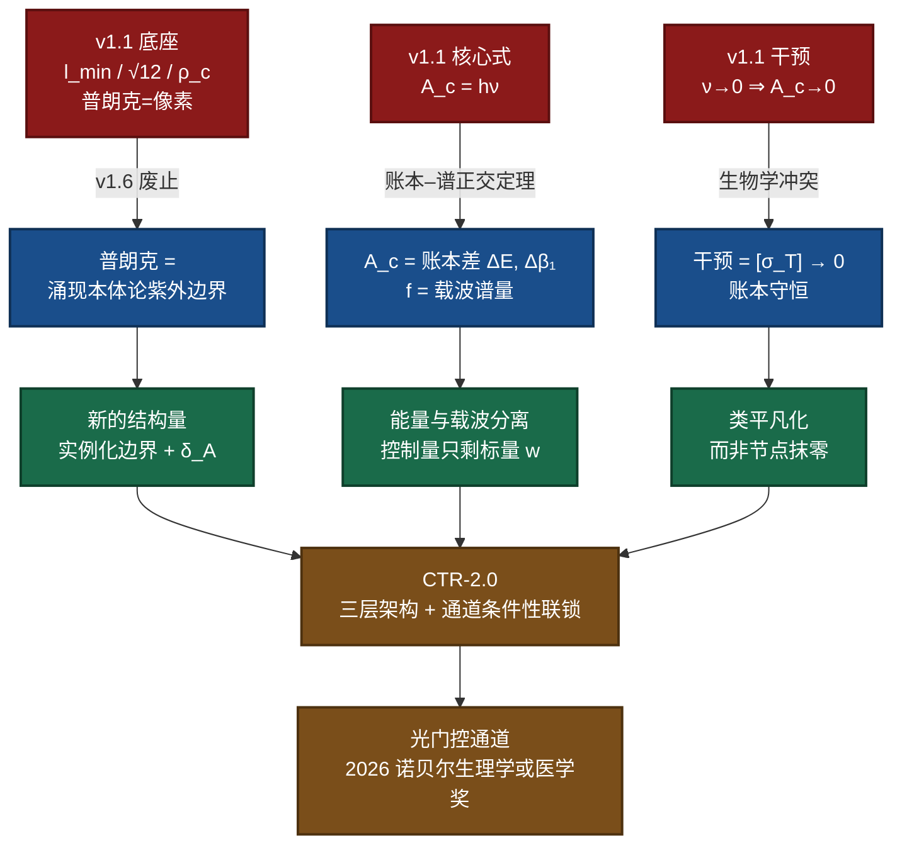
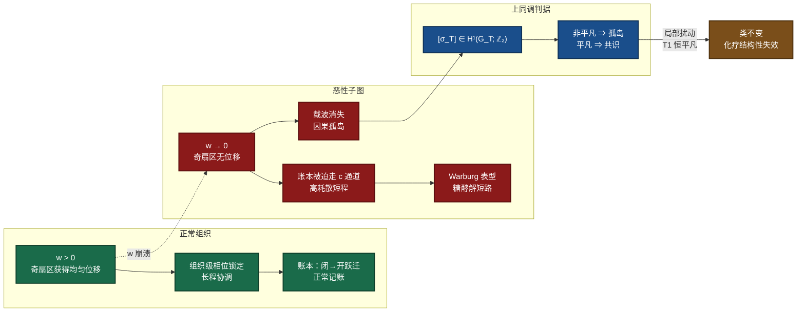
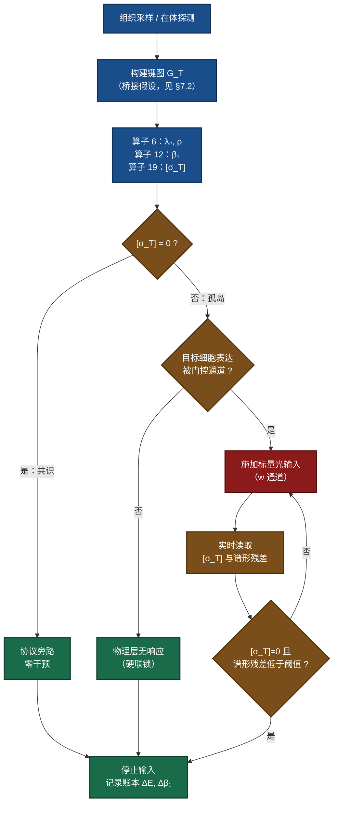

# 共识协议 v2.0：基于 SRE v1.6 公理套件与光门控生物学的因果消解肿瘤框架

**版本**：2.0（严格分层标注版 · 2026-10-21）
**分类**：理论物理 / 信息生物学 / 数字医学
**理论基准**：SRE-v1.6 公理套件（DOI: 10.5281/zenodo.22077475）；算子 1–19 全部开源
**相对版本**：v1.1（Human-Centric）——本次为结构性重写，非文字修订
【资源与可用性声明】 本框架基于状态‑关系熵（SRE）动力学构建。 全部理论资料归档于 Zenodo 开源数据仓库。**本文档套件包括系统论文、应用开发、科学假说、算子1‑20完整代数推导及仿真代码完全开源**。

> 可访问作者的Github仓库：
>
> https://github.com/yuelucn/Status-Relational-Entropy-SRE-Dynamics-The-Book-of-the-Void
>
> 可访问支持AI辅助查阅的腾讯智能文档空间（PC、微信移动端均可访问）：
>
> https://docs.qq.com/space/DUkRjYUtNWFdyV253
>
> 根据状态‐关系熵（SRE）原理，经典物理基础源自信息统计学。
---

## 摘要

v1.1 把癌症描述为"因果孤岛"，并提出用"逆因果脉冲"把局部代谢开销 $A_c$ 压到零（$\nu\to0\Rightarrow A_c\to0$）。这个方案在当时的启发式框架内自洽，但在 SRE v1.6 公理套件与算子 1–19 完成之后，它存在三处结构性断点：普朗克尺度不再是网络像素（故 $l_{\min}$、$\kappa=\sqrt{12}$、$\rho_c$ 三个几何常数在新体系中不存在）；能量被重新定位为**账本量**而非**谱量**（故 $A_c=h\nu$ 属于被 G12 律禁止的"离散→连续"混用）；"把节点抹零"在生物学上等价于坏死，且与"账本守恒"直接冲突。

本文据此重写。新的核心命题是：**肿瘤不是局部符号错误的细胞集合，而是组织子图上一个非平凡的 $\mathbb{Z}_2$ 上同调类 $[\sigma_T]\in H^{1}(G_T;\mathbb{Z}_2)$。** 由算子 19 的定理 T1，任何顶点势型（逐点、局部、化学式）的重标号恒有平凡 holonomy，因此**"逐个杀死癌细胞"在结构上不可能改变这个类**——这是化学耐药性的上同调表述。相应地，干预目标从"吊销存在"改为"**类平凡化**"：注入唯一的 $\mathbb{Z}_2$ holonomy 通道（单一标量、只作用于奇扇区、均匀位移、保形），使 $[\sigma_T]\to0$ 而账本守恒。该控制量的物理形态，已由 **2026 年诺贝尔生理学或医学奖**（Deisseroth、Hegemann、Nagel，光门控离子通道与光遗传学）给出实验先例：单一标量光输入 → 确定性、可逆、毫秒级的闭→开跃迁；且**通道不表达即无响应**，这正是 v1.1 所设想的"协议旁路"安全联锁的实验版本。

全文按 G12 离散闭合律分三层标注：**A 层（模型内可算/可证）**、**B 层（结构性猜想）**、**C 层（需外部输入）**。第 7 节逐条列出未解决缺口，包括最大的一个：把渐变耦合的生物网络映射到 SRE 的二元 $\pm1$ 键图，本身是一个未经证明的桥接假设。

**关键词**：状态-关系熵；$\mathbb{Z}_2$ 上同调；因果孤岛；Warburg 效应；光门控离子通道；光遗传学；离散闭合律

---

## 0. 如何阅读本文

本文面向具有本科物理与化学基础、但未接触过 SRE 的读者。建议路径：

1. 先读 §1（v1.1 为何必须改）与 §2（最小必要底座，不含证明，只给结论与直觉）；
2. 再读 §3（病理学重构）——这是本文真正的新内容；
3. 若只关心工程与安全，读 §4 与 §6；
4. 若关心证据等级，直接跳到 §7 的三层标注总表与缺口清单；
5. 附录 A 给出 v1.1 三个公式（Eq. 26/27/28）的逐条处置，附录 B 给出可复现的计算步骤。

全文约定：标 **[A]** 者为模型内可复算或可证的结论；标 **[B]** 者为结构化猜想（方向自洽但未证）；标 **[C]** 者为必须由外部实验/数据付费输入的连续量。

---

## 1. v1.1 的三处结构性断点

v1.1 不是"写错了"，而是"底座换了"。以下三条必须逐字对照，否则 v2.0 会看起来像无理由的改写。

### 1.1 断点一：普朗克尺度不再是"网络像素"

v1.1 的骨架依赖三个几何常数：刚性格点阈值 $l_{\min}$、球密堆常数 $\kappa=l_{\min}/l_{p}=\sqrt{12}$、以及耦合临界阈值 $\rho_{c}=(l_{p}/l_{\min})^{2}$。

v1.6 明确废止了这一读法：普朗克长度与普朗克时间**不再是底层因果节点的像素粒度或原子时钟周期**，而是"**涌现本体论紫外边界**"——即一个相互作用能否从"待实例化态"被渲染为可观测物理事件的**费用门槛**。相应地，$l_{\min}$、$\sqrt{12}$、$\rho_{c}$ 在 v1.6 体系中**没有对应物**。保留它们会使全文悬空。

**处置**：三个常数全部撤销（附录 A 第 1–3 行）。原本由"刚性阈值"承担的角色，改由两个真实存在的结构量承担：

- **瞬时化边界**（决定"能不能发生"）；
- **$\mathbb{Z}_2$ holonomy 耦合强度 $\delta_A=w^{*}-1=4.347\times10^{-5}$**（决定"发生得多强"）[A]。

### 1.2 断点二：能量在账本，载波在谱

v1.1 的核心方程是

$$A_c = h\nu \qquad \text{(Eq. 26)}$$

其中 $h$ 被称作"关系熵变的最小几何系数"，$\nu$ 是细胞网络的相位锁定频率。**这把"能量"与"频率"直接等同了。**

v1.6 之后的 SRE 用一条定理禁止了这种等同。在核子骨架 $Y_3$ 上做"闭→开"跃迁（剪断一条环边）的签名向量如下 [A]：

| 量 | 闭态 | 开态 | 差值 | 归类 |
|---|---|---|---|---|
| $V$ | 12 | 12 | $+0$ | **账本** |
| $E$ | 18 | 17 | $-1$ | **账本** |
| $\beta_1$ | 7 | 6 | $-1$ | **账本** |
| $\rho=\lambda_{\max}$ | 5.302775637732 | 5.302775637732 | $-4.4\times10^{-15}$ | **谱（不动）** |
| $\lambda_2$ | 1.000000000000 | 1.000000000000 | $1.3\times10^{-15}$ | **谱（不动）** |

由此得到**账本–谱正交定理**：**"释放多少能量"住在账本里（$E$、$\beta_1$ 的差值），"光以什么形态传播"住在谱不变量里（$\rho$、$\lambda_2$、扇区结构），二者正交。**

于是 $A_c=h\nu$ 的错误性质就清楚了：它把**载波的频率**当成了**账本的能量**。正确的写法是

$$A_c \equiv \Delta\mathcal{L}=\big(\Delta E,\ \Delta\beta_1\big)\quad\text{（一次闭→开跃迁的账本差）}\tag{1}$$

而频率的合法定义是载波的拓扑压缩密度 [A]：

$$f \propto \Delta\lambda=\sqrt{\operatorname{Tr}(M)^{2}-4\det M}=\alpha\cdot\frac{\lambda_1}{\lambda_2+\lambda_3}\tag{2}$$

式 (2) 与式 (1) 描述的是**两件不同的事**。v1.1 用一个符号 $h\nu$ 把它们焊在一起，这是 G12 律所指的"离散→连续"越界。

### 1.3 断点三："抹零"在生物学上等于坏死

v1.1 的干预式是 $\nu\to0\Rightarrow A_c\to0$，即让恶性节点的整合因果作用"归零"。问题有二：

1. 由式 (1)，$A_c\to0$ 意味着账本差为零，即**该处不再发生任何闭→开跃迁**。对活体组织而言这不是"治愈"，而是**该区域退出物理渲染**——坏死。
2. 它与 v1.1 自己的安全承诺矛盾：v1.1 要求"对健康高代谢组织绝对安全"，但"抹零"这个动作本身没有区分度，区分度全靠前端的"同步验证"。一旦验证有误，后果不可逆。

**处置**：干预目标从"抹零"改为"**类平凡化**"，见 §4。

下图是三个断点的整体因果链。

---

## 2. 最小必要底座

本节只给结论与直觉，不重复证明。凡 **[A]** 者均可在算子套件中一键复算（附录 B）。

### 2.1 光不是波包，是拓扑残差

SRE 的残余性公理：设边界节点 A 演化到逻辑深度步 $t$，节点 B 演化到 $t'$，光就是二者联合执行链在因果交集处的**互不湮灭的拓扑残差**：

$$\Psi_{\text{light}}(\phi,w)\equiv\ker\!\big(\partial_{\text{mutual}}(A_t,B_{t'})\big)\tag{3}$$

该残差由一个不可定向、单边界的莫比乌斯带参数化，只有两个内禀自由度：绕行相位 $\phi\in[0,2\pi]$ 与横向微阻抗带宽 $w$：

$$\mathbf{X}(\phi,w)=\Big(\big(1+w\cos\tfrac{\phi}{2}\big)\cos\phi,\ \big(1+w\cos\tfrac{\phi}{2}\big)\sin\phi,\ w\sin\tfrac{\phi}{2}\Big)\tag{4}$$

当 $\phi\to\phi+2\pi$ 时 $w\to-w$，必须走满 $\Delta\phi=4\pi$ 才能闭合。**"转一圈回到对面那一层"这一步，就是 $\mathbb{Z}_2$ 双覆盖的几何内容。**

### 2.2 光的载波是一个对合算子，谱只有两个值

把上述结构离散到 $n$ 个等距节点（$n$ 为偶数），得**加权莫比乌斯梯 $M_n$**：环向边 $(i,i\pm1)$ 权重 $c$（片内刷新），识别边 $(i,i+n/2)$ 权重 $w$（莫比乌斯扭转通道）。光载波定义为对合

$$P=S^{n/2},\qquad P^{2}=I,\qquad Pv_k=(-1)^{k}v_k\tag{5}$$

$P$ 的谱恒为 $\{+1,-1\}$，与图拉普拉斯交换，因此拉普拉斯谱按扇区劈成两半 [A]：

$$\mu_k=2c\Big(1-\cos\frac{2\pi k}{n}\Big)+2w\cdot\mathbb{1}[k\ \text{odd}],\qquad k=0,1,\dots,n-1\tag{6}$$

- $k$ **偶** → **电子扇区**（软模）；
- $k$ **奇** → **光子扇区**。

**关键读数一**：$\lambda_2=2c\,(1-\cos\frac{4\pi}{n})$ **与 $w$ 无关** [A]。电子扇区是纯拓扑的，对扭转通道的强度完全不敏感。

**关键读数二**：$P$ 由**一个整数 $n$ 完全决定，零个连续自由参数** [A]。这意味着**光的载波上没有地方放"源"**。

### 2.3 两个通道的脾气完全不同

由式 (6) 可以立刻读出两条通道的行为差异，这是全文最重要的工程依据 [A]：

| 通道 | 作用扇区 | 每个模的位移 | 谱形 |
|---|---|---|---|
| $c$（环向权重，片内刷新） | **两个扇区同时动** | $\propto\left(1-\cos\frac{2\pi k}{n}\right)$，**不均匀** | **变形** |
| $w$（识别权重，holonomy） | **只动奇扇区** | 恒等于 $2\delta$，**完全均匀** | **保形** |

在保持 $P$ 对称的线性扰动族内，**同时满足"只动奇扇区"与"均匀位移"两个条件的通道唯一，就是 $w$**——$c$ 两条全不满足 [A]。这不是"选出来的"，是被筛出来的。

由此得到一条非常实用的工程性质：**只拧 $w$ 这一个旋钮，频率响应的形状不变，只整体升降。** 数值上，位移的均匀性误差在 $10^{-15}$ 量级，去掉整体平移后的谱形残差为 $8.9\times10^{-16}$ [A]。

### 2.4 离散闭合律（G12）

> **G12**：凡"离散结构 ⇒ 离散目标"的推理，在 SRE 内**闭合**；凡从"离散"跨到"连续"的推理，**必须由外部输入付费**。

这条律规定了分工：任何结论都要能说清哪一半是 SRE 给的（离散侧），哪一半是外部付的（连续侧）。本文第 7 节的三层标注就是它的执行形式。

典型的外部付费项：质量的绝对标度 $c_0$、$\delta_A$ 的定标（需 $\alpha^{*}$ 输入）、光能量的 eV/MeV 量级。

---

## 3. 病理学重构

### 3.1 组织的 SRE 描述

**定义 1（组织图）**　一个组织样本 $T$ 映射为二元自组织键图 $G_T=(V,E)$，边极性 $s_e\in\{+1,-1\}$，并带两条权重通道 $(c,w)$。$V$ 为细胞/信号单元，$E$ 为可执行的因果联络。

> 这一步是一个**桥接假设**，不是 SRE 的推论。SRE 公理 1 要求边极性严格取值 $\pm1$（无零元），而真实生物耦合是渐变的。见 §7.2 缺口 1。

**定义 2（代谢账本）**　组织在其生命周期内累积的闭→开跃迁记录 $\mathcal{L}=\sum(\Delta E,\Delta\beta_1)$。由账本–谱正交定理，**能量记在这里，载波特征不记在这里**。

**定义 3（因果孤岛）**　子图 $G_T$ 称为因果孤岛，当且仅当其电荷符号通道

$$\sigma_T\in H^{1}(G_T;\mathbb{Z}_2),\qquad Q(K)=\sigma(K)\cdot\deg(K)\cdot e,\quad \deg(K)=\beta_1(K)\bmod 2\tag{7}$$

所在的类**非平凡**，即 $[\sigma_T]\neq0$。

式 (7) 就是算子 19 的规范形式。它原本用于解释电子与质子的电荷符号差异，本文把它搬到了组织层。

### 3.2 为什么"因果孤岛"必须是上同调类，而不能是"局部出错"

这是本文的第一个实质性推进。

v1.1 说癌细胞"与全局同步协议脱钩"。这句话在数学上可以有三种实现：局部参数错了、局部符号错了、全局类非平凡。前两种都可以靠"逐个修正"处理；第三种不能。算子 19 的定理 T1 给出了判决：

> **T1**：顶点势型极性 $s_e=t_it_j$ 的 holonomy **恒平凡**。

也就是说，**任何形如"给每个节点各自定一个势、再由相邻势的乘积定义边极性"的做法，都不可能在任何一个环上产生非平凡 holonomy。**

由此得到本文的核心命题：

**命题 1（局部干预的结构不可能性）**　若 $[\sigma_T]\neq0$，则任何顶点势型（逐细胞、局部、化学式）的扰动都落在上同调群的平凡类 $B^{1}$ 内，**不改变 $[\sigma_T]$**；因此"逐个杀死异常细胞"在结构上不可能消除该孤岛。 **[A，条件为 $[\sigma_T]\neq0$]**

这个命题给出了一个此前只能用"耐药性"经验描述的临床现象的结构性解释：**化学治疗在类层面是恒等变换。** 它并不否认化疗能杀死细胞，而是指出：杀死细胞不改变类，因此未被清除的残余子图仍带着同一个 $[\sigma_T]$ 重新生长。

与之配套的是**判定唯一性**：

> **T3**：平凡性判据**与环基的选取无关**。

所以"这个子图是不是孤岛"这个问题有唯一答案，不会因为换了算法、换了探针、换了采样窗口而翻转。这是"同步验证"可以成为一个**可审计判据**（而非启发式指标）的唯一理由。

### 3.3 Warburg 效应 = 通道倒置

v1.1 把 Warburg 效应解释为"为了维持私有高频环路的逻辑一致性，细胞被迫放弃长程大分子网络路径，改走相邻低密度节点的短步路由"。方向对，但缺少可算的载体。

在新底座上，这个解释可以精确化为一次**通道倒置**：

| | 成熟分化组织 | 恶性子图 |
|---|---|---|
| 主导通道 | $w$（识别通道，跨片、长程） | $c$（环向通道，片内、局域） |
| 作用扇区 | 只动奇扇区（光子扇区） | 双扇区同时动 |
| 位移形态 | 均匀（整体平移 $2\delta$） | 不均匀（$\propto 1-\cos$） |
| 谱形 | **保形** | **变形** |
| 宏观表型 | 组织级相位锁定、长程协调 | 局域高耗散、短程短路 |

**命题 2（Warburg 的通道表述）**　恶性子图的特征是 $w\to0$ 而 $c$ 保留或升高。后果有二：

1. 奇扇区得不到位移 ⇒ 组织级相位锁定的载波消失 ⇒ 表现为"脱钩"（因果孤岛的可观测面）；
2. 账本仍须记账 ⇒ 全部记到 $c$ 上 ⇒ 高耗散、短程、非均匀 ⇒ 表现为糖酵解短路、异常电磁签名。

**[B，结构性猜想]**　这里的每一步都可算，但"长程氧化磷酸化 ↔ $w$ 通道""糖酵解短路 ↔ $c$ 通道"这两条对应是**结构性类比**，不是推导。它给出了一个可证伪方向（见 §7.3 的判决实验 P2），但尚无可执行的定量映射。

### 3.4 病理映射总图

---

## 4. 干预原理：从"逆因果脉冲"到"类平凡化"

### 4.1 旧方案的两个不自洽

v1.1 §2.1 提出"逆因果脉冲"：提取恶性节点的"逻辑指纹"（精确的 N 步递归相位锁定频率），构造其数学镜像注入，使 $\nu\to0\Rightarrow A_c\to0$。不自洽之处：

1. **没有对应算子。** 算子 1–19 中不存在"相位共轭注入"或"逻辑取反"这种操作。$\sigma$ 通道能做的是**判定类**，不是**取反类**。
2. **目标本身错。** 由式 (1)，$A_c\to0$ 意味着该处不再有闭→开跃迁，即退出渲染——不是治疗，是坏死（见 §1.3）。

### 4.2 新方案：类平凡化

**命题 3（干预目标）**　干预的靶不是能量，而是类：

$$[\sigma_T]\neq0\ \longrightarrow\ [\sigma_T]=0,\qquad \text{同时}\ \ \mathcal{L}\ \text{守恒}\tag{8}$$

即：**让这个子图重新获得闭→开跃迁能力，而不是让它停止存在。**

这与 v1.1 的伦理表述完全一致（"吊销其存在的协议"改为"恢复其记账的资格"），但物理含义完全不同：前者是不可逆的抹除，后者是可逆的重连。

### 4.3 为什么只能拧一个旋钮

由 §2.3 的通道唯一性定理，在保持 $P$ 对称的线性扰动族内：

- $c$ 通道：双扇区同时动、非均匀、变形 ⇒ **会破坏该子图原有的载波结构** ⇒ 不安全；
- $w$ 通道：只动奇扇区、均匀、保形 ⇒ **只改变幅度，不改变形状** ⇒ 安全性的结构来源。

**命题 4（控制量唯一性）**　在本文框架内，可用的干预控制量只有一个标量，即 $w$（等价地：注入奇扇区的均匀位移 $2\delta$）。任何同时改变谱形的操作都越出了"保形"边界，因而原则上不可用于治疗。 **[A 的前提是"线性扰动族 + 保持 P 对称"，两者均为模型内假设]**

这条命题把 v1.1 里散落的"相共轭反馈""锁相维持"等工程描述，收敛成了一个单变量控制问题。它也是本文能给出**明确安全论证**而非"经验上应该安全"的原因。

### 4.4 安全联锁的两个层级

| 层级 | 判据 | 依据 | 失效模式 |
|---|---|---|---|
| **类层** | $[\sigma_T]$ 是否平凡 | 算子 19；T3 保证与环基无关 | 判为非平凡而实为平凡 ⇒ 误伤 |
| **通道层** | 目标细胞是否表达被门控的通道 | 通道条件性（§5.3） | 通道脱靶表达 ⇒ 误伤 |

第二层是新增的，且是**硬件层**的：没有通道蛋白，就没有可被光打开的孔。它不依赖任何算法判断，因此不受第一层误判的影响。v1.1 的"协议旁路"只是一个软件模式；v2.0 把它变成了物理事实。

---

## 5. 光门控（光化学）先例：2026 年诺贝尔生理学或医学奖

### 5.1 获奖内容

2026 年诺贝尔生理学或医学奖授予 **Karl Deisseroth、Peter Hegemann、Georg Nagel**，理由是"**关于光门控离子通道与光遗传学的发现**"。要点：Hegemann 与 Nagel 从单细胞绿藻中找到并表征了光门控离子通道（channelrhodopsin 等），Deisseroth 于 2005 年将其转入哺乳动物神经元，用蓝光使细胞发放冲动。此后该技术成为神经科学的标准工具。

本文不讨论其在神经科学中的地位。**本文只取它作为一个物理事实：光可以作为一个标量输入，确定性地门控一个活细胞里的离子通道。**

### 5.2 为什么它正好是本文需要的桥

把 §2 的形式结构与光门控通道逐项对齐：

| SRE 侧 | 光门控通道侧 | 对应性质 |
|---|---|---|
| 对合 $P$，$P^{2}=I$，谱 $\{+1,-1\}$ | 通道二态：开 / 关（导通 / 不导通） | 二值状态空间，恰好 $\mathbb{Z}_2$ |
| 单一标量通道 $w$ | 单一标量输入：特定波长的光子通量 | **一个旋钮**，无形状参数 |
| 只动奇扇区、均匀位移 | 全体受照通道同步、等幅开启 | 均匀性 |
| 保形（Cor. 2） | 通道的电导-电压关系不因光强改变而变形 | 只改幅度不改形状 |
| 闭→开跃迁记入账本 $(\Delta E,\Delta\beta_1)$ | 孔打开：离子流建立，跨膜电荷记账 | **账本记录** |
| 跃迁可逆 | 撤光即关，毫秒级 | 可逆性 |

**命题 5（光门控通道是 $P$ 的一个物理实现）**　光门控离子通道在"状态空间、输入维度、均匀性、保形性、账本性、可逆性"六项上与 SRE 光载波的结构一致。 **[B]**　这是结构同型，不是"通道就是 $P$"。二者定义在不同对象上（一个是图上的对合算子，一个是膜蛋白的构象自由度），**不得混为一谈**。

### 5.3 最有价值的一条：寻址由通道决定，不由场聚焦决定

v1.1 §3 Step 2 用"表面修饰金纳米天线"充当"宏观非电离电磁场 → 细胞膜最小观测步"的几何换能器。这个设计的隐含前提是：**选择性来自场的聚焦或天线的几何匹配**。这在实际组织中是极难成立的——电磁场在含水量高的组织中会弥散，纳米天线的局域增强区远小于细胞尺度且难以均匀布点。

光遗传学提供了一条完全不同的路径，而且已经被实验证实：**选择性来自"目标细胞是否表达该通道"。**

- 表达通道的细胞：光一照，确定性响应；
- 不表达通道的细胞：同样光照，**无响应**。

这就是 v1.1 所设想的"Protocol Bypass"，但它是**物理层**的，不依赖任何实时判决算法。它把"绝对零干扰"从一句承诺变成了一个可验证的实验事实。

**命题 6（通道条件性寻址）**　在给定光照下，响应集合 = 通道表达集合。因此治疗窗口由"通道表达的差异度"决定，而非由场的空间分辨率决定。 **[B：这是对既有实验事实的 SRE 式重述，不是新预测]**

### 5.4 证据等级：必须说清它证明了什么、没证明什么

| 已由诺奖工作证明 | 尚未证明 |
|---|---|
| 光可门控活细胞的离子通道 | 光可门控**肿瘤**的因果类 |
| 门控是确定性、可逆、毫秒级的 | 门控能改变 $[\sigma_T]$ |
| 无通道则无响应（体外与在体神经组织） | 该性质在**人体实体瘤**中成立 |
| 通道可由基因递送植入神经元 | 通道可安全、均匀地递送至肿瘤 |
| 该技术可用于动物行为操控 | 该技术可用于**任何**肿瘤治疗 |

**这是本文最重要的诚实边界**：诺奖工作为本文提供了"物理→逻辑桥"的**存在性证明**，但没有提供"这座桥能架到肿瘤上"的证明。§7.2 会把这个缺口写清楚。

---

## 6. 工程架构：CTR-2.0

v1.1 的 CTR（Causal Topology Remapping）保留三层骨架，但每层的输入输出全部重写。

### 6.1 指纹层：从"频谱估算"到"上同调判定"

v1.1 用 SQUID 与超高频生物阻抗谱"提取逻辑步长偏置与相位失配"。v2.0 改为输出一个**可审计的结构签名**：

$$\mathcal{F}(G_T)=\Big(\lambda_2,\ \rho,\ \beta_1,\ [\sigma_T],\ \text{奇扇区谱形},\ \delta_A\Big)\tag{9}$$

各项的算子来源 [A]：

| 分量 | 算子 | 含义 |
|---|---|---|
| $\lambda_2,\ \rho$ | 算子 6（局部谱筛 + 拼接） | 代数连通度与谱半径，$\alpha=\lambda_2/\rho$ |
| $\beta_1$ | 算子 12（拓扑闭环审计） | 独立环数 = 闭环失锁的计数 |
| $[\sigma_T]$ | 算子 19（$\mathbb{Z}_2$ holonomy） | **孤岛判据**，T3 保证唯一 |
| 奇扇区谱形 | 算子 6 + 式 (6) | 保形性检验的基线 |
| $\delta_A$ | 外部标定 | holonomy 耦合强度 $=4.347\times10^{-5}$ **[C]** |

### 6.2 桥接层：从"金纳米天线"到"光门控通道"

| 项 | v1.1 | v2.0 | 变更理由 |
|---|---|---|---|
| 换能器 | 表面修饰金纳米天线 | 光门控离子通道 | 前者无 SRE 依据且选择性机制不可行；后者有实验先例 |
| 输入 | 非电离电磁场 | 特定波长光子通量（标量） | 对齐"唯一通道"定理 |
| 选择性来源 | 场聚焦 / 几何匹配 | 通道表达 | 命题 6 |
| 尺度匹配 | 依赖 $\kappa=\sqrt{12}$ | 不需要该常数 | §1.1 |

### 6.3 控制层：从"相位共轭反馈"到"标量强度闭环"

v1.1 用 FPGA 在纳秒内返回"精确相位共轭反馈信号"以维持刚性锁相。v2.0 保留实时闭环，但控制变量与目标都变了：

- **控制变量**：光强（标量），而非相位共轭波形；
- **反馈量**：$\mathcal{F}(G_T)$ 中 $[\sigma_T]$ 与奇扇区谱形的漂移，而非"逻辑残差"；
- **终止条件**：$[\sigma_T]=0$ **且** 谱形残差低于阈值（即"类已平凡化且未破坏载波"），而非 $\nu\to0$。

### 6.4 整体数据流

---

## 7. 可证伪性、误差与缺口

### 7.1 三层标注总表

| 编号 | 命题 | 层级 | 依据 / 缺口 |
|---|---|---|---|
| A-1 | $\mu_k=2c(1-\cos\frac{2\pi k}{n})+2w\mathbb{1}[k\ \text{odd}]$ | **A** | 式 (6)，直接对角化验证，偏差 $\le6.2\times10^{-15}$ |
| A-2 | $\lambda_2$ 与 $w$ 无关 | **A** | $w\in[0.05,10]$ 下恒为 $0.043704798532$，展宽 $4.3\times10^{-15}$ |
| A-3 | 只动奇扇区且均匀位移的通道唯一（$w$） | **A** | 定理 4 + 数值反例（$c$ 通道两条件全失败） |
| A-4 | $w$ 通道保形，残差 $8.9\times10^{-16}$ | **A** | 推论 2 |
| A-5 | 账本–谱正交（$E,\beta_1$ 变，$\rho,\lambda_2$ 不变） | **A** | $Y_3$ 签名向量，差值 $\sim10^{-15}$ |
| A-6 | 顶点势型极性的 holonomy 恒平凡 | **A** | 算子 19 定理 T1 |
| A-7 | 平凡性判据与环基选取无关 | **A** | 算子 19 定理 T3 |
| A-8 | 符号通道与幅值通道正交 | **A** | 算子 19 定理 T5 |
| A-9 | $\alpha=\lambda_2/\rho(M_{60})=7.297458502\times10^{-3}$ | **A** | 与 CODATA 相对偏差 $1.45\times10^{-5}$ |
| B-1 | 肿瘤 = $[\sigma_T]\neq0$ 的子图 | **B** | 结构性猜想；缺 §7.2 缺口 1 的桥接证明 |
| B-2 | 局部（逐细胞）扰动不改变 $[\sigma_T]$ | **B**（A-6 的推论） | 逻辑上由 T1 直接给出，但"化疗=顶点势型扰动"是额外前提 |
| B-3 | Warburg = $w\to0$ 且 $c$ 保留/升高的通道倒置 | **B** | 结构性类比；缺定量映射 |
| B-4 | 长程氧化磷酸化 ↔ $w$；糖酵解 ↔ $c$ | **B** | 同上 |
| B-5 | 光门控通道与 $P$ 六项同型 | **B** | 结构同型，非同一性 |
| B-6 | 响应集合 = 通道表达集合 | **B** | 对既有实验事实的 SRE 式重述 |
| B-7 | 干预目标应为 $[\sigma_T]\to0$ 而非 $A_c\to0$ | **B** | 由 A-5 与伦理一致性推出，非实验结论 |
| C-1 | $\delta_A=4.347\times10^{-5}$ 的定标 | **C** | 需 $\alpha^{*}$ 外部输入 |
| C-2 | 任何跃迁的能量标度（eV 量级） | **C** | G12：SRE 只给比值不给绝对标度 |
| C-3 | 所需光通量与照射时长 | **C** | 无 SRE 输出，需实验标定 |
| C-4 | 真实肿瘤的 $[\sigma_T]$ 数值 | **C** | 需实测图数据 |
| C-5 | 通道表达水平与治疗窗口 | **C** | 需分子生物学数据 |

### 7.2 未解决缺口（按严重性排序）

| # | 缺口 | 性质 | 影响 |
|---|---|---|---|
| 1 | **二元化桥接**：SRE 公理 1 要求边极性严格 $\pm1$、无零元；真实细胞间耦合是渐变的、含沉默态的 | **根本性** | 若此桥不成立，§3 全部结论只能作为类比。这是本文最大的单点风险 |
| 2 | 组织尺度的图不可得：$10^{9}$ 量级细胞、多尺度（分子/细胞/组织/器官）耦合，采样与重建均无成熟方法 | 工程性 | $\mathcal{F}(G_T)$ 目前只在可枚举的小图上可算 |
| 3 | 光穿透深度：可见光在组织中约毫米量级，深部实体瘤不可达；植入式光源或近红外上转换均未验证 | 工程性 | 限制适用部位 |
| 4 | 通道递送：光遗传学依赖基因递送（AAV / 脂质），存在表达异质性、免疫原性、脱靶表达；**目前无任何肿瘤光遗传学的临床或大型动物先例** | 临床性 | 安全性结论尚无在体证据 |
| 5 | 剂量–响应：SRE 不提供能量标度（C-2），因此本框架**不能**预测所需光强、时长或分次方案 | 理论性 | 无法给出可执行处方 |
| 6 | 数据缺口：本文**没有任何临床、动物或体外实验数据**支持 B 层任一命题 | 证据性 | B 层全部为待检验猜想 |
| 7 | $\delta_A$ 在生物尺度上无标定 | 理论性 | 无法判断"位移 $2\delta$"在细胞电生理上对应多大的量 |

### 7.3 四条判决性实验（若 B 层为真，应观察到）

以下实验设计的目的不是"证明本文对"，而是**给本文一个能被推翻的机会**。

**P1（类判据的存在性）**
在类器官或二维培养体系中，比较"癌变前后"的组织图 $[\sigma_T]$。若 B-1 成立，应观察到：癌变后 $[\sigma_T]$ 由平凡变为非平凡，而良性增生保持平凡。
**推翻条件**：癌变样本的 $[\sigma_T]$ 与对照无系统性差异。

**P2（通道倒置）**
在控制总 ATP 通量的前提下，测量糖酵解份额与 $w$（及其代理量）的关系。若 B-3/B-4 成立，糖酵解份额应与 $w$ 的下降单调相关。
**推翻条件**：$w$ 与糖酵解份额无相关，或被 $c$ 完全解释。

**P3（保形性）**
对 $[\sigma_T]\neq0$ 的子图施加标量 $w$ 型扰动，测量奇扇区谱。若 A-4 可迁移到生物图，谱应整体平移而形状不变。
**推翻条件**：谱形随扰动强度系统性变形。

**P4（局部扰动无效）**
施加顶点势型（逐点、局部）扰动，测量 $[\sigma_T]$。若 B-2 成立，$[\sigma_T]$ 应保持不变。
**推翻条件**：局部扰动即可使 $[\sigma_T]$ 平凡化——若如此，则 T1 与"化疗结构性失效"的论断同时被推翻，这将是本文最有价值的反例。

---

## 8. 伦理

v1.1 第 V 节的伦理表述（利他、去中心化、普惠）本文全部保留，但需要补一条 v1.1 没有的约束：**"通道条件性"既是安全的来源，也是新的不平等来源。**

光遗传学路径要求先对患者组织做通道表达。这意味着：

1. **可治疗性依赖于分子分型**，而非普遍适用。把"普惠"建立在"必须先有一个可表达的靶通道"之上，本身就是一种筛选。
2. **基因递送的不可逆性**与 v1.1 承诺的"可逆、零副作用"存在张力：通道一旦表达，就长期存在于患者体内，其后果不由治疗时长控制。
3. 因此本文认为，任何沿此路径的临床推进，**必须先解决"可清除的通道"**（例如可被第二路信号关闭的表达开关），否则"绝对安全的逻辑修正"这一表述不成立。

这一条是 v2.0 相对 v1.1 在伦理层面的实质变化：从"技术天然普惠"改为"技术自带筛选，须显式设计补偿"。

---

## 9. 结论

v1.1 的直觉是对的：癌症的物理破坏剖面，可能只是一个更深层"逻辑路由错误"的渲染报告。v1.1 的错处在于它用错了底座——把能量当频率、把抹零当治疗、把局部当成全局。

v2.0 给出的是同一直觉的严格化版本：

1. **孤岛是类，不是细胞。** 肿瘤对应组织子图上非平凡的 $[\sigma_T]\in H^{1}(G_T;\mathbb{Z}_2)$；由 T1，局部扰动恒不改变类——这解释了为什么"逐个杀死"在结构上无效。
2. **Warburg 是通道倒置。** $w\to0$、$c$ 保留，账本被迫走局域非均匀通道，宏观表现为糖酵解短路。
3. **干预是恢复，不是吊销。** 目标为 $[\sigma_T]\to0$ 且账本守恒；控制量由唯一通道定理收敛为一个标量 $w$；保形性给出安全性的结构来源。
4. **桥已经存在。** 2026 年诺贝尔生理学或医学奖（光门控离子通道与光遗传学）提供了"单标量光输入 → 确定性、可逆、毫秒级闭→开跃迁"以及"无通道即无响应"的实验先例。但它证明的是桥的存在，不是桥能架到肿瘤上。

最后须直说：本文 B 层命题**没有任何实验数据支持**，最大的风险是把渐变耦合的生物网络二元化这一桥接假设。在 P1–P4 四条判决实验中，任何一条给出推翻结果，本文的核心结构就应被相应修改。这不是一个已完成的医学方案，是一个**可被证伪的结构假设**。

---

## 附录 A：v1.1 三个公式的逐条处置

| v1.1 公式 | 原文 | 处置 | 替代 | 理由 |
|---|---|---|---|---|
| Eq. 26 | $A_c=h\nu$ | **废止** | 式 (1)：$A_c=\Delta\mathcal{L}=(\Delta E,\Delta\beta_1)$ | 账本–谱正交定理：能量在账本，载波在谱 |
| Eq. 27 | $\nu\to0\Rightarrow A_c\to0$ | **废止** | 式 (8)：$[\sigma_T]\to0$ 且 $\mathcal{L}$ 守恒 | $A_c\to0$ 等于退出渲染（坏死）；且与"保形"安全论证冲突 |
| Eq. 28 | $\kappa=l_{\min}/l_{p}=\sqrt{12}$ | **撤销** | 无（该常数在 v1.6 中不存在） | 普朗克尺度不再是网络像素；$l_{\min}$ 无对应物 |
| （v1.1 §1.3 隐含） | $\rho_c=(l_p/l_{\min})^{2}$ | **撤销** | $\delta_A=w^{*}-1=4.347\times10^{-5}$ | 耦合强度改为由 $\mathbb{Z}_2$ holonomy 通道给出 **[C]** |
| （v1.1 Eq. 1–13 引用） | $c=l_{p}/\tau_{p}$ 作为路由上界 | **改写** | $c$ 是耗散–补偿映射产生的涌现因果传播上界 | 普朗克量为实例化边界，非原子周期 |

**说明**：Eq. 26–28 的编号承自 v1.1 所引用的早期基础手稿，在 v1.6 中已无对应物。本文保留编号仅为对照方便，不表示其在新体系中仍然成立。

---

## 附录 B：可复现计算步骤

以下全部使用开源算子 1–19，解释器为本机 `C:\myapp\miniconda3\envs\ai\python.exe`（含 numpy）。目的不是得到新结果，而是让读者能自行复算本文引用的每一个 **[A]** 级读数。

**B.1 复算式 (6) 与 A-1 / A-2**

1. 取偶数 $n$（如 60），构造加权莫比乌斯梯 $M_n$：环向边权重 $c=1$，识别边权重 $w$；
2. 直接对角化图拉普拉斯 $L$，得 $\{\mu_k\}$；
3. 与闭式 $\mu_k=2c(1-\cos\frac{2\pi k}{n})+2w\mathbb{1}[k\ \text{odd}]$ 逐模比对，取最大绝对偏差；
4. 在 $w\in\{0.05,0.1,\dots,10\}$ 上重复，记录 $\lambda_2$ 的展宽。

预期：最大偏差 $\le6.2\times10^{-15}$；$\lambda_2$ 恒为 $0.043704798532$，展宽 $4.3\times10^{-15}$。

**B.2 复算 A-3 / A-4（通道唯一性与保形）**

1. 固定 $n=60$、$c=1$，令 $w:1\to1+\delta$，$\delta\in\{10^{-3},10^{-2},10^{-1},5\times10^{-1}\}$；
2. 分别算奇扇区与偶扇区的 $\Delta\mu$；
3. 检查奇扇区 $\Delta\mu$ 的极差、$\Delta\mu/2\delta$ 是否恒为 1、偶扇区是否恒为 0；
4. 减去整体平移后与基线比对，得谱形残差。

预期：极差 $\sim10^{-15}$；$\Delta\mu/2\delta=1.000000000$；偶扇区 $=0$；谱形残差 $8.9\times10^{-16}$。

**B.3 复算 A-6 / A-7（算子 19）**

1. 取骨架图 $G$（如 $Y_3$ 或任意含奇环的分子键图）；
2. 用算子 19 计算 $\beta_1$、$\deg=\beta_1\bmod2$、$\sigma$-向量与 $\sigma$-类；
3. 以 `polarity="spin"` 注入顶点势型极性，验证其 holonomy 恒平凡（T1）；
4. 换用不同的环基重复第 2 步，验证平凡性判定不变（T3）。

预期：T1 下 trivial 恒为真；T3 下判定与环基无关。

**B.4 复算 A-5（账本–谱正交）**

1. 取 $Y_3$ 闭态（$V=12,E=18$），算 $\rho$、$\lambda_2$；
2. 逐条剪断 18 条边，每次重算 $\rho$、$\lambda_2$、$E$、$\beta_1$；
3. 比对环边类（9 条）与跨链类（9 条）的谱量漂移。

预期：$\rho$ 在 18/18 上不变（$\sim10^{-15}$）；$\lambda_2$ 在同类内不变（环边类 $1.0$、跨链类 $0.527166091$），但跨类不同——即 $\lambda_2$ 是**轨道级**不变量，$\rho$ 是**全局**不变量。

---

## 附录 C：引用

1. Lu, Y. (2026). *Status-Relational Entropy (SRE) Dynamics: Topological Resonance, Edge Emergence, and the Inobservability Under Threshold Cosmology.* Zenodo. <https://doi.org/10.5281/zenodo.20103262>
2. Lu, Y. (2026). *SRE-v1.6 Axiom Suite.* Zenodo. <https://doi.org/10.5281/zenodo.22077475>
3. *Reciprocal Measurement and the Mapping Origin of $c$* (v1.6.0)，本书第一部分第 3 章.
4. *Methodological Revision on Causal Depth and Spatial Indexing* (v1.6.0)，本书第一部分第 4 章.
5. *Positioning of Light and Electromagnetic Waves in the SRE Framework* (v1.0, 2026-09-28)，本书第二部分.
6. *Technical Report: Intrinsic Algebraic Topology of Light and the SRE Axion Matrix* (v1.0)，本书第四部分.
7. *Operator 19: $\mathbb{Z}_2$ Holonomy / $\sigma$ Charge-Sign Channel Operator* (v1.1, 2026-10)，本书第三部分.
8. *Universal Graph Operator Pipeline in SRE Dynamics* (v2.0)，本书第三部分.
9. *SRE Dynamics Reconstruction of Transistor Physics* (v2.0)，本书第四部分 —— 其中以算子 19 检测"电荷湮灭环结构"以定标放大系数 $\beta$，与本文 §3.2 的闭环死锁论证同型.
10. Nobel Prize Outreach (2026). *The Nobel Prize in Physiology or Medicine 2026 — Press release.* <https://www.nobelprize.org/prizes/medicine/2026/press-release/>
11. Boyden, E. S.; Zhang, F.; Bamberg, E.; Nagel, G.; Deisseroth, K. (2005). Millisecond-timescale, genetically targeted optical control of neural activity. *Nature Neuroscience* 8, 1263–1268.

---

## 附录 D：资源与可用性声明

本文所依赖的算子 1–19 全部开源，含完整数学规范、代数推导与仿真代码；其流水线以开源许可发布，供复现、审计与二次开发。仓库：<https://github.com/yuelucn/Status-Relational-Entropy-SRE-Dynamics-The-Book-of-the-Void>。

本文自身不含任何新的实验数据。全部数值读数均为对已公开算子输出的复算，复算步骤见附录 B。
