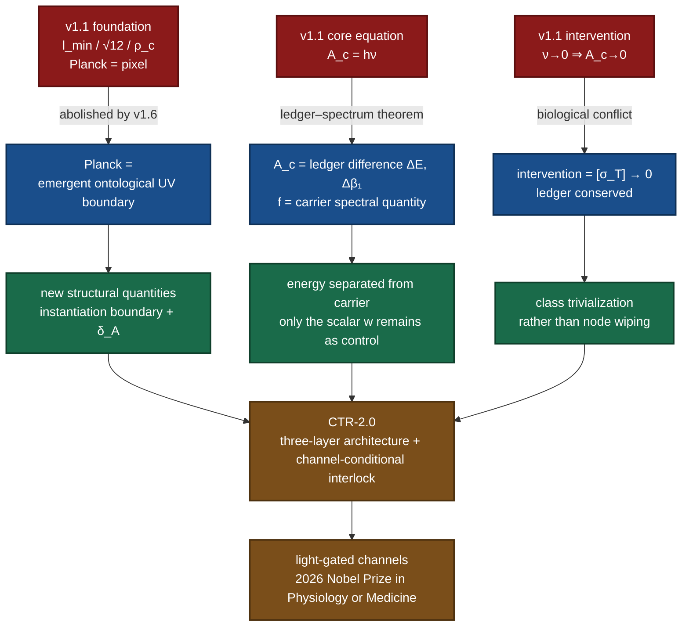
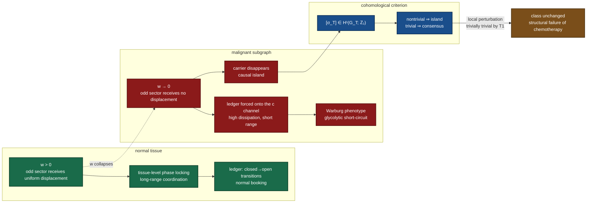
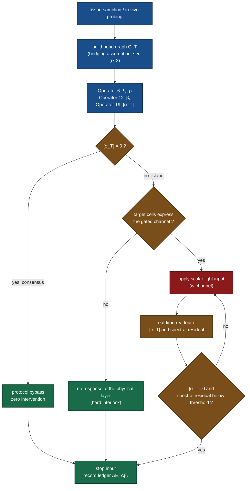

# The Consensus Protocol v2.0: A Causal-Eradication Framework for Cancer Based on the SRE v1.6 Axiom Suite and Light-Gated Biology

**Version**: 2.0 (Strictly Layered Edition · 2026-10-21)
**Classification**: Theoretical Physics / Information Biology / Digital Medicine
**Theoretical baseline**: SRE-v1.6 Axiom Suite (DOI: 10.5281/zenodo.22077475); Operators 1–19 fully open source
**Previous version**: v1.1 (Human-Centric) — this is a structural rewrite, not a textual revision
[Resource and Availability Statement] This framework is built upon State–Relational Entropy (SRE) Dynamics. All theoretical materials are archived in the Zenodo open-access repository. **This document suite — systematic papers, application development, scientific hypotheses, and the complete algebraic derivations and simulation code of Operators 1–19 — is fully open source.**

> The author's GitHub repository:
>
> https://github.com/yuelucn/Status-Relational-Entropy-SRE-Dynamics-The-Book-of-the-Void
>
> AI-assisted reading space on Tencent Docs (accessible on PC and WeChat mobile):
>
> https://docs.qq.com/space/DUkRjYUtNWFdyV253
>
> According to the State–Relational Entropy (SRE) principle, classical physical foundations originate entirely from informational statistics.
---

## Abstract

v1.1 describes cancer as a "causal island" and proposes an "inverse causal pulse" that drives the local metabolic overhead $A_c$ to zero ($\nu\to0\Rightarrow A_c\to0$). That scheme was self-consistent within the heuristic framework of its time, but after the completion of the SRE v1.6 axiom suite and Operators 1–19 it contains three structural breakpoints: the Planck scale is no longer a network pixel (hence $l_{\min}$, $\kappa=\sqrt{12}$ and $\rho_c$ — three geometric constants — do not exist in the new system); energy has been relocated as a **ledger quantity** rather than a **spectral quantity** (hence $A_c=h\nu$ is a "discrete→continuous" conflation prohibited by the G12 law); and "wiping a node to zero" is biologically equivalent to necrosis and directly conflicts with "ledger conservation".

This paper rewrites the framework accordingly. The new core proposition is: **a tumour is not a collection of cells with locally wrong signs, but a nontrivial $\mathbb{Z}_2$ cohomology class $[\sigma_T]\in H^{1}(G_T;\mathbb{Z}_2)$ on a tissue subgraph.** By Theorem T1 of Operator 19, any vertex-potential (pointwise, local, chemical) relabeling always has trivial holonomy, so **"killing cancer cells one by one" is structurally incapable of changing this class** — this is the cohomological statement of chemoresistance. Correspondingly, the intervention target shifts from "revoking existence" to "**class trivialization**": inject the unique $\mathbb{Z}_2$ holonomy channel (a single scalar, acting only on the odd sector, a uniform displacement, shape-preserving), so that $[\sigma_T]\to0$ while the ledger is conserved. The physical form of this control quantity has already been given an experimental precedent by the **2026 Nobel Prize in Physiology or Medicine** (Deisseroth, Hegemann, Nagel — light-gated ion channels and optogenetics): a single scalar light input → a deterministic, reversible, millisecond-scale closed→open transition; and **no channel expression means no response**, which is precisely the experimental version of the "protocol bypass" safety interlock envisaged in v1.1.

The whole text is labelled in three tiers according to the G12 discrete-closure law: **Tier A (computable/provable within the model)**, **Tier B (structural conjecture)**, and **Tier C (requires external input)**. Section 7 lists the unresolved gaps one by one, including the largest: mapping a graded-coupling biological network onto the binary $\pm1$ bond graph of SRE is itself an unproven bridging assumption.

**Keywords**: State–Relational Entropy; $\mathbb{Z}_2$ cohomology; causal island; Warburg effect; light-gated ion channels; optogenetics; discrete-closure law

---

## 0. How to Read This Paper

This paper is addressed to readers with an undergraduate background in physics and chemistry but no prior exposure to SRE. The suggested path is:

1. First read §1 (why v1.1 must change) and §2 (the minimal necessary foundation, which gives only conclusions and intuition, without proofs);
2. Then read §3 (pathological reconstruction) — this is the genuinely new content of the paper;
3. If you care only about engineering and safety, read §4 and §6;
4. If you care about the level of evidence, jump directly to the master three-tier table and the gap list in §7;
5. Appendix A gives the item-by-item disposition of the three v1.1 formulas (Eq. 26/27/28), and Appendix B gives the reproducible computation steps.

Convention throughout: items marked **[A]** are conclusions that can be recomputed or proven within the model; items marked **[B]** are structural conjectures (directionally consistent but unproven); items marked **[C]** are continuous quantities that must be paid for by external experiment/data.

---

## 1. The Three Structural Breakpoints in v1.1

v1.1 was not "written incorrectly"; its foundation was replaced. The following three points must be compared word by word, otherwise v2.0 will look like an unmotivated rewrite.

### 1.1 Breakpoint One: The Planck Scale Is No Longer a "Network Pixel"

The skeleton of v1.1 rests on three geometric constants: the rigid lattice threshold $l_{\min}$, the spherical close-packing constant $\kappa=l_{\min}/l_{p}=\sqrt{12}$, and the critical coupling threshold $\rho_{c}=(l_{p}/l_{\min})^{2}$.

v1.6 explicitly abolishes this reading: the Planck length and Planck time are **no longer the pixel granularity or atomic clock cycle of the underlying causal nodes**, but an "**emergent ontological ultraviolet boundary**" — that is, the **cost threshold** for whether an interaction can be rendered from the "pending-for-instantiation state" into an observable physical event. Correspondingly, $l_{\min}$, $\sqrt{12}$ and $\rho_{c}$ have **no counterpart** in the v1.6 system. Retaining them would leave the whole text suspended in mid-air.

**Disposition**: all three constants are withdrawn (rows 1–3 of Appendix A). The role previously borne by the "rigid threshold" is taken over by two structural quantities that genuinely exist:

- **the instantiation boundary** (which decides "whether it can happen");
- **the $\mathbb{Z}_2$ holonomy coupling strength $\delta_A=w^{*}-1=4.347\times10^{-5}$** (which decides "how strongly it happens") [A].

### 1.2 Breakpoint Two: Energy Lives in the Ledger, the Carrier Lives in the Spectrum

The core equation of v1.1 is

$$A_c = h\nu \qquad \text{(Eq. 26)}$$

where $h$ is called "the minimum geometric coefficient of relational entropy change" and $\nu$ is the phase-locking frequency of the cellular network. **This directly equates "energy" with "frequency".**

SRE after v1.6 forbids this equation by a theorem. The signature vector of a "closed→open" transition (cutting one ring edge) on the nucleon skeleton $Y_3$ is as follows [A]:

| Quantity | Closed state | Open state | Difference | Class |
|---|---|---|---|---|
| $V$ | 12 | 12 | $+0$ | **ledger** |
| $E$ | 18 | 17 | $-1$ | **ledger** |
| $\beta_1$ | 7 | 6 | $-1$ | **ledger** |
| $\rho=\lambda_{\max}$ | 5.302775637732 | 5.302775637732 | $-4.4\times10^{-15}$ | **spectral (unmoved)** |
| $\lambda_2$ | 1.000000000000 | 1.000000000000 | $1.3\times10^{-15}$ | **spectral (unmoved)** |

This yields the **ledger–spectrum orthogonality theorem**: **"how much energy is released" lives in the ledger (the differences of $E$ and $\beta_1$), while "in what form light propagates" lives in the spectral invariants ($\rho$, $\lambda_2$, the sector structure); the two are orthogonal.**

The erroneous nature of $A_c=h\nu$ is therefore clear: it takes the **frequency of the carrier** for the **energy of the ledger**. The correct writing is

$$A_c \equiv \Delta\mathcal{L}=\big(\Delta E,\ \Delta\beta_1\big)\quad\text{(the ledger difference of one closed→open transition)}\qquad(1)$$

and the legitimate definition of frequency is the topological compression density of the carrier [A]:

$$f \propto \Delta\lambda=\sqrt{\operatorname{Tr}(M)^{2}-4\det M}=\alpha\cdot\frac{\lambda_1}{\lambda_2+\lambda_3}\qquad(2)$$

Equation (2) and Equation (1) describe **two different things**. v1.1 welds them together with a single symbol $h\nu$, which is precisely the "discrete→continuous" transgression identified by the G12 law.

### 1.3 Breakpoint Three: "Wiping to Zero" Equals Necrosis in Biology

The intervention formula of v1.1 is $\nu\to0\Rightarrow A_c\to0$, i.e. driving the integrated causal action of the malignant node "to zero". There are two problems:

1. By Equation (1), $A_c\to0$ means the ledger difference is zero, i.e. **no closed→open transition occurs there any more**. For living tissue this is not "cure" but **that region withdrawing from physical rendering** — necrosis.
2. It contradicts v1.1's own safety commitment: v1.1 demands "absolute safety for healthy high-metabolic tissue", yet the act of "wiping to zero" itself has no discrimination; all discrimination rests on the upstream "synchronization verification". Once that verification is wrong, the consequence is irreversible.

**Disposition**: the intervention target changes from "wiping to zero" to "**class trivialization**", see §4.

The figure below is the overall causal chain of the three breakpoints.

---

## 2. Minimal Necessary Foundation

This section gives only conclusions and intuition, and does not repeat proofs. Everything marked **[A]** can be recomputed in one command within the operator suite (Appendix B).

### 2.1 Light Is Not a Wave Packet but a Topological Residual

The residuality axiom of SRE: let boundary node A evolve to logical-depth step $t$ and node B to $t'$; light is the **mutually non-annihilating topological residual** of their jointly executed chains at the causal intersection:

$$\Psi_{\text{light}}(\phi,w)\equiv\ker\!\big(\partial_{\text{mutual}}(A_t,B_{t'})\big)\qquad(3)$$

This residual is parameterised by a non-orientable Möbius band with a single boundary and has only two intrinsic degrees of freedom: the winding phase $\phi\in[0,2\pi]$ and the transverse micro-impedance bandwidth $w$:

$$\mathbf{X}(\phi,w)=\Big(\big(1+w\cos\tfrac{\phi}{2}\big)\cos\phi,\ \big(1+w\cos\tfrac{\phi}{2}\big)\sin\phi,\ w\sin\tfrac{\phi}{2}\Big)\qquad(4)$$

As $\phi\to\phi+2\pi$, $w\to-w$, and one must traverse the full $\Delta\phi=4\pi$ to close. **"Going one lap returns you to the opposite sheet" — this step is exactly the geometric content of the $\mathbb{Z}_2$ double cover.**

### 2.2 The Light Carrier Is an Involution Whose Spectrum Has Only Two Values

Discretising the above structure onto $n$ equally spaced nodes ($n$ even) yields the **weighted Möbius ladder $M_n$**: circumferential edges $(i,i\pm1)$ with weight $c$ (within-sheet refresh), and identification edges $(i,i+n/2)$ with weight $w$ (the Möbius twist channel). The light carrier is defined as the involution

$$P=S^{n/2},\qquad P^{2}=I,\qquad Pv_k=(-1)^{k}v_k\qquad(5)$$

The spectrum of $P$ is identically $\{+1,-1\}$, and it commutes with the graph Laplacian; hence the Laplacian spectrum splits into two halves by sector [A]:

$$\mu_k=2c\Big(1-\cos\frac{2\pi k}{n}\Big)+2w\cdot\mathbb{1}[k\ \text{odd}],\qquad k=0,1,\dots,n-1\qquad(6)$$

- $k$ **even** → **electron sector** (soft mode);
- $k$ **odd** → **photon sector**.

**Key reading one**: $\lambda_2=2c\,(1-\cos\frac{4\pi}{n})$ is **independent of $w$** [A]. The electron sector is purely topological and completely insensitive to the strength of the twist channel.

**Key reading two**: $P$ is **completely determined by a single integer $n$, with zero continuous free parameters** [A]. This means **there is no place on the light carrier to put a "source"**.

### 2.3 The Two Channels Behave Completely Differently

From Equation (6) one reads off immediately the behavioural difference between the two channels; this is the most important engineering basis of the whole paper [A]:

| Channel | Sector acted on | Displacement per mode | Spectral shape |
|---|---|---|---|
| $c$ (circumferential weight, within-sheet refresh) | **both sectors move at once** | $\propto\left(1-\cos\frac{2\pi k}{n}\right)$, **non-uniform** | **deformed** |
| $w$ (identification weight, holonomy) | **only the odd sector** | identically $2\delta$, **perfectly uniform** | **shape-preserving** |

Within the family of linear perturbations preserving $P$ symmetry, **the channel that simultaneously satisfies "acts only on the odd sector" and "uniform displacement" is unique, namely $w$** — $c$ fails both conditions [A]. This is not something "chosen"; it is screened out.

From this follows a very practical engineering property: **turning only the single knob $w$ leaves the shape of the frequency response unchanged and merely raises or lowers it as a whole.** Numerically, the uniformity error of the displacement is of order $10^{-15}$, and the spectral-shape residual after removing the overall shift is $8.9\times10^{-16}$ [A].

### 2.4 The Discrete-Closure Law (G12)

> **G12**: any inference of the form "discrete structure ⇒ discrete target" **closes** within SRE; any inference crossing from "discrete" to "continuous" **must be paid for by external input**.

This law fixes the division of labour: every conclusion must be able to state which half is supplied by SRE (the discrete side) and which half is paid externally (the continuous side). The three-tier labelling in §7 is its execution form.

Typical externally paid items: the absolute scale of mass $c_0$, the calibration of $\delta_A$ (requiring an $\alpha^{*}$ input), and the eV/MeV order of magnitude of light energy.

---

## 3. Pathological Reconstruction

### 3.1 The SRE Description of a Tissue

**Definition 1 (tissue graph)** A tissue sample $T$ is mapped to a binary self-organising bond graph $G_T=(V,E)$, with edge polarity $s_e\in\{+1,-1\}$ and two weight channels $(c,w)$. $V$ are cells/signalling units and $E$ are realisable causal links.

> This step is a **bridging assumption**, not a corollary of SRE. SRE Axiom 1 requires edge polarity to take strictly $\pm1$ (no zero element), whereas real biological coupling is graded. See §7.2, gap 1.

**Definition 2 (metabolic ledger)** The record of closed→open transitions accumulated by a tissue over its lifetime, $\mathcal{L}=\sum(\Delta E,\Delta\beta_1)$. By the ledger–spectrum orthogonality theorem, **energy is recorded here, carrier characteristics are not**.

**Definition 3 (causal island)** A subgraph $G_T$ is called a causal island if and only if the class of its charge-sign channel

$$\sigma_T\in H^{1}(G_T;\mathbb{Z}_2),\qquad Q(K)=\sigma(K)\cdot\deg(K)\cdot e,\quad \deg(K)=\beta_1(K)\bmod 2\qquad(7)$$

is **nontrivial**, i.e. $[\sigma_T]\neq0$.

Equation (7) is the canonical form of Operator 19. It was originally used to explain the charge-sign difference between the electron and the proton; this paper moves it up to the tissue level.

### 3.2 Why the "Causal Island" Must Be a Cohomology Class and Cannot Be a "Local Error"

This is the first substantive advance of the paper.

v1.1 says that cancer cells "decouple from the global synchronization protocol". Mathematically this sentence can be realised in three ways: a local parameter is wrong, a local sign is wrong, or the global class is nontrivial. The first two can be handled by "correcting one by one"; the third cannot. Theorem T1 of Operator 19 delivers the verdict:

> **T1**: the holonomy of a vertex-potential polarity $s_e=t_it_j$ is **always trivial**.

That is, **any construction of the form "assign each node its own potential, then define edge polarity as the product of adjacent potentials" can never produce nontrivial holonomy on any cycle.**

Hence the core proposition of this paper:

**Proposition 1 (structural impossibility of local intervention)** If $[\sigma_T]\neq0$, then any vertex-potential (per-cell, local, chemical) perturbation falls inside the trivial class $B^{1}$ of the cohomology group and **does not change $[\sigma_T]$**; therefore "killing abnormal cells one by one" is structurally incapable of eliminating the island. **[A, conditional on $[\sigma_T]\neq0$]**

This proposition gives a structural explanation for a clinical phenomenon previously describable only empirically as "drug resistance": **chemotherapy is the identity transformation at the class level.** It does not deny that chemotherapy kills cells; it points out that killing cells does not change the class, so the residual subgraph that was not cleared regrows carrying the same $[\sigma_T]$.

Its companion is **uniqueness of the verdict**:

> **T3**: the triviality criterion is **independent of the choice of cycle basis**.

So the question "is this subgraph an island" has a unique answer, and will not flip because the algorithm, the probe or the sampling window changed. This is the sole reason why "synchronization verification" can be an **auditable criterion** rather than a heuristic indicator.

### 3.3 The Warburg Effect = Channel Inversion

v1.1 explains the Warburg effect as: "in order to maintain the logical consistency of its private high-frequency loop, the cell is forced to abandon long-range macromolecular network paths and switch to short-step routing across adjacent low-density nodes." The direction is right, but a computable carrier is missing.

On the new foundation, this explanation can be made precise as a **channel inversion**:

| | Mature differentiated tissue | Malignant subgraph |
|---|---|---|
| Dominant channel | $w$ (identification channel, cross-sheet, long-range) | $c$ (circumferential channel, within-sheet, local) |
| Sector acted on | only the odd sector (photon sector) | both sectors at once |
| Displacement form | uniform (overall shift $2\delta$) | non-uniform ($\propto 1-\cos$) |
| Spectral shape | **shape-preserving** | **deformed** |
| Macroscopic phenotype | tissue-level phase locking, long-range coordination | local high dissipation, short-range short-circuit |

**Proposition 2 (channel formulation of Warburg)** The signature of a malignant subgraph is $w\to0$ while $c$ is retained or raised. There are two consequences:

1. The odd sector receives no displacement ⇒ the carrier of tissue-level phase locking disappears ⇒ manifests as "decoupling" (the observable face of the causal island);
2. The ledger must still be booked ⇒ everything is booked onto $c$ ⇒ high dissipation, short range, non-uniform ⇒ manifests as glycolytic short-circuiting and abnormal electromagnetic signatures.

**[B, structural conjecture]** Every step here is computable, but the two correspondences "long-range oxidative phosphorylation ↔ the $w$ channel" and "glycolytic short-circuit ↔ the $c$ channel" are **structural analogies**, not derivations. This gives a falsifiable direction (see decisive experiment P2 in §7.3), but there is as yet no executable quantitative mapping.

### 3.4 Overall Pathology Map

---

## 4. Intervention Principle: From "Inverse Causal Pulse" to "Class Trivialization"

### 4.1 Two Inconsistencies in the Old Scheme

v1.1 §2.1 proposes an "inverse causal pulse": extract the malignant node's "logical fingerprint" (its exact N-step recursive phase-locking frequency), construct its mathematical mirror and inject it, so that $\nu\to0\Rightarrow A_c\to0$. The inconsistencies are:

1. **There is no corresponding operator.** No operation of "phase-conjugate injection" or "logical negation" exists among Operators 1–19. What the $\sigma$ channel can do is **decide the class**, not **negate the class**.
2. **The target itself is wrong.** By Equation (1), $A_c\to0$ means no closed→open transition remains there, i.e. withdrawal from rendering — not treatment, but necrosis (see §1.3).

### 4.2 The New Scheme: Class Trivialization

**Proposition 3 (intervention target)** The target of intervention is not energy but the class:

$$[\sigma_T]\neq0\ \longrightarrow\ [\sigma_T]=0,\qquad \text{while}\ \ \mathcal{L}\ \text{is conserved}\qquad(8)$$

That is: **let this subgraph regain the capacity for closed→open transitions, rather than let it cease to exist.**

This is entirely consistent with the ethical formulation of v1.1 ("revoking the protocol of its existence" becomes "restoring its eligibility for book-keeping"), yet the physical meaning is completely different: the former is irreversible erasure, the latter reversible reconnection.

### 4.3 Why Only One Knob Can Be Turned

By the channel-uniqueness theorem of §2.3, within the family of linear perturbations preserving $P$ symmetry:

- the $c$ channel: both sectors move, non-uniform, deforming ⇒ **would destroy the subgraph's existing carrier structure** ⇒ unsafe;
- the $w$ channel: odd sector only, uniform, shape-preserving ⇒ **changes only the amplitude, not the shape** ⇒ the structural source of safety.

**Proposition 4 (uniqueness of the control quantity)** Within the framework of this paper, there is only one usable intervention control quantity, the scalar $w$ (equivalently: a uniform displacement $2\delta$ injected into the odd sector). Any operation that simultaneously changes the spectral shape steps outside the "shape-preserving" boundary and is therefore in principle unusable for therapy. **[The premises of A are "linear perturbation family + preservation of P symmetry"; both are in-model assumptions]**

This proposition collapses the scattered engineering descriptions of v1.1 ("phase-conjugate feedback", "phase-lock maintenance") into a single-variable control problem. It is also why this paper can offer a **definite safety argument** rather than "should be safe in practice".

### 4.4 Two Levels of Safety Interlock

| Level | Criterion | Basis | Failure mode |
|---|---|---|---|
| **class level** | whether $[\sigma_T]$ is trivial | Operator 19; T3 guarantees independence of cycle basis | judged nontrivial when actually trivial ⇒ collateral damage |
| **channel level** | whether the target cell expresses the gated channel | channel conditionality (§5.3) | off-target channel expression ⇒ collateral damage |

The second level is new, and it is a **hardware-level** one: without the channel protein there is no pore that light can open. It does not depend on any algorithmic judgement, and therefore is not affected by misjudgement at the first level. The "protocol bypass" of v1.1 was merely a software mode; v2.0 turns it into a physical fact.

---

## 5. Light-Gated (Photochemical) Precedent: The 2026 Nobel Prize in Physiology or Medicine

### 5.1 The Award

The 2026 Nobel Prize in Physiology or Medicine was awarded to **Karl Deisseroth, Peter Hegemann and Georg Nagel** "**for their discoveries concerning light-gated ion channels and optogenetics**". The essentials: Hegemann and Nagel identified and characterised light-gated ion channels (channelrhodopsins and others) from a unicellular green alga, and Deisseroth transferred them into mammalian neurons in 2005, using blue light to make the cells fire. The technique has since become a standard tool of neuroscience.

This paper does not discuss its standing in neuroscience. **This paper takes from it only one physical fact: light can act as a scalar input that deterministically gates an ion channel in a living cell.**

### 5.2 Why It Is Exactly the Bridge This Paper Needs

Aligning the formal structure of §2 with light-gated channels item by item:

| SRE side | Light-gated channel side | Corresponding property |
|---|---|---|
| involution $P$, $P^{2}=I$, spectrum $\{+1,-1\}$ | channel is two-state: open / closed (conducting / non-conducting) | binary state space, exactly $\mathbb{Z}_2$ |
| single scalar channel $w$ | single scalar input: photon flux at a specific wavelength | **one knob**, no shape parameter |
| odd sector only, uniform displacement | all illuminated channels open synchronously, at equal amplitude | uniformity |
| shape-preserving (Cor. 2) | the conductance–voltage relation does not deform with light intensity | amplitude only, shape unchanged |
| closed→open transition booked into the ledger $(\Delta E,\Delta\beta_1)$ | pore opens: ionic current established, transmembrane charge booked | **ledger record** |
| transition is reversible | light off means closed, on a millisecond scale | reversibility |

**Proposition 5 (a light-gated channel is a physical realisation of $P$)** A light-gated ion channel agrees with the SRE light carrier on six items — "state space, input dimensionality, uniformity, shape preservation, ledger character, reversibility". **[B]** This is structural isomorphism, not "the channel is $P$". The two are defined on different objects (one is an involution operator on a graph, the other a conformational degree of freedom of a membrane protein), and **must not be conflated**.

### 5.3 The Most Valuable Point: Addressability Is Determined by the Channel, Not by Field Focusing

v1.1 §3 Step 2 uses "surface-modified gold nano-antennas" as the geometric transducer from "macroscopic non-ionising electromagnetic field → the minimal observational step of the cell membrane". The implicit premise of that design is: **selectivity comes from field focusing or the geometric matching of the antennas.** This is extremely hard to realise in real tissue — the electromagnetic field diffuses in water-rich tissue, and the local enhancement region of a nano-antenna is far smaller than the cellular scale and hard to distribute uniformly.

Optogenetics offers a completely different route, and it has already been experimentally confirmed: **selectivity comes from "whether the target cell expresses the channel".**

- Cells expressing the channel: illuminate, and the response is deterministic;
- Cells not expressing the channel: same illumination, **no response**.

This is the "Protocol Bypass" envisaged in v1.1, but it is **at the physical layer** and depends on no real-time decision algorithm. It turns "absolute zero interference" from a promise into a verifiable experimental fact.

**Proposition 6 (channel-conditional addressability)** Under a given illumination, the response set = the channel-expression set. Hence the therapeutic window is determined by "the degree of difference in channel expression", not by the spatial resolution of the field. **[B: this is an SRE-style restatement of existing experimental facts, not a new prediction]**

### 5.4 Level of Evidence: What It Proves and What It Does Not

| Proven by the Nobel work | Not yet proven |
|---|---|
| light can gate the ion channels of living cells | light can gate the **causal class** of a tumour |
| gating is deterministic, reversible, millisecond-scale | gating can change $[\sigma_T]$ |
| no channel means no response (in vitro and in in-vivo neural tissue) | this property holds in **human solid tumours** |
| channels can be implanted into neurons by gene delivery | channels can be delivered safely and uniformly to tumours |
| the technique can be used to manipulate animal behaviour | the technique can be used to treat **any** tumour |

**This is the most important honesty boundary of the paper**: the Nobel work supplies an **existence proof** of the "physical→logical bridge", but it does not supply a proof that "this bridge can be spanned to tumours". §7.2 states this gap clearly.

---

## 6. Engineering Architecture: CTR-2.0

v1.1's CTR (Causal Topology Remapping) retains its three-layer skeleton, but the inputs and outputs of every layer are completely rewritten.

### 6.1 Fingerprint Layer: From "Spectral Estimation" to "Cohomological Verdict"

v1.1 used SQUID and ultra-high-frequency bio-impedance spectroscopy to "extract the logical step-size bias and phase mismatch". v2.0 instead outputs an **auditable structural signature**:

$$\mathcal{F}(G_T)=\Big(\lambda_2,\ \rho,\ \beta_1,\ [\sigma_T],\ \text{odd-sector spectral shape},\ \delta_A\Big)\qquad(9)$$

Operator provenance of each component [A]:

| Component | Operator | Meaning |
|---|---|---|
| $\lambda_2,\ \rho$ | Operator 6 (local spectral sieve + splicing) | algebraic connectivity and spectral radius, $\alpha=\lambda_2/\rho$ |
| $\beta_1$ | Operator 12 (topological loop audit) | number of independent cycles = count of closed-loop loss of lock |
| $[\sigma_T]$ | Operator 19 ($\mathbb{Z}_2$ holonomy) | **island criterion**, uniqueness guaranteed by T3 |
| odd-sector spectral shape | Operator 6 + Equation (6) | baseline for the shape-preservation test |
| $\delta_A$ | external calibration | holonomy coupling strength $=4.347\times10^{-5}$ **[C]** |

### 6.2 Bridge Layer: From "Gold Nano-Antennas" to "Light-Gated Channels"

| Item | v1.1 | v2.0 | Reason for change |
|---|---|---|---|
| transducer | surface-modified gold nano-antennas | light-gated ion channels | the former has no SRE basis and its selectivity mechanism is infeasible; the latter has an experimental precedent |
| input | non-ionising electromagnetic field | photon flux at a specific wavelength (scalar) | align with the "unique channel" theorem |
| source of selectivity | field focusing / geometric matching | channel expression | Proposition 6 |
| scale matching | relies on $\kappa=\sqrt{12}$ | this constant is not needed | §1.1 |

### 6.3 Control Layer: From "Phase-Conjugate Feedback" to "Scalar-Intensity Closed Loop"

v1.1 used an FPGA to return an "exact phase-conjugate feedback signal" within nanoseconds to maintain rigid phase lock. v2.0 keeps the real-time closed loop, but both the control variable and the target have changed:

- **control variable**: light intensity (scalar), not a phase-conjugate waveform;
- **feedback quantity**: the drift of $[\sigma_T]$ and of the odd-sector spectral shape within $\mathcal{F}(G_T)$, not "logical residual";
- **termination condition**: $[\sigma_T]=0$ **and** the spectral-shape residual below threshold (i.e. "the class has been trivialized and the carrier has not been destroyed"), not $\nu\to0$.

### 6.4 Overall Data Flow

---

## 7. Falsifiability, Errors and Gaps

### 7.1 Master Table of the Three-Tier Labels

| No. | Proposition | Tier | Basis / gap |
|---|---|---|---|
| A-1 | $\mu_k=2c(1-\cos\frac{2\pi k}{n})+2w\mathbb{1}[k\ \text{odd}]$ | **A** | Equation (6), verified by direct diagonalisation, deviation $\le6.2\times10^{-15}$ |
| A-2 | $\lambda_2$ is independent of $w$ | **A** | identically $0.043704798532$ for $w\in[0.05,10]$, spread $4.3\times10^{-15}$ |
| A-3 | the channel acting only on the odd sector with uniform displacement is unique ($w$) | **A** | Theorem 4 + numerical counterexample ($c$ fails both conditions) |
| A-4 | the $w$ channel is shape-preserving, residual $8.9\times10^{-16}$ | **A** | Corollary 2 |
| A-5 | ledger–spectrum orthogonality ($E,\beta_1$ change, $\rho,\lambda_2$ do not) | **A** | $Y_3$ signature vector, difference $\sim10^{-15}$ |
| A-6 | the holonomy of a vertex-potential polarity is always trivial | **A** | Operator 19, Theorem T1 |
| A-7 | the triviality criterion is independent of the cycle basis | **A** | Operator 19, Theorem T3 |
| A-8 | the sign channel and the magnitude channel are orthogonal | **A** | Operator 19, Theorem T5 |
| A-9 | $\alpha=\lambda_2/\rho(M_{60})=7.297458502\times10^{-3}$ | **A** | relative deviation from CODATA $1.45\times10^{-5}$ |
| B-1 | tumour = a subgraph with $[\sigma_T]\neq0$ | **B** | structural conjecture; lacks the bridging proof of gap 1 in §7.2 |
| B-2 | local (per-cell) perturbation does not change $[\sigma_T]$ | **B** (corollary of A-6) | follows logically from T1, but "chemotherapy = vertex-potential perturbation" is an extra premise |
| B-3 | Warburg = channel inversion with $w\to0$ and $c$ retained/raised | **B** | structural analogy; lacks a quantitative mapping |
| B-4 | long-range oxidative phosphorylation ↔ $w$; glycolysis ↔ $c$ | **B** | as above |
| B-5 | light-gated channels are isomorphic to $P$ on six items | **B** | structural isomorphism, not identity |
| B-6 | response set = channel-expression set | **B** | an SRE-style restatement of existing experimental facts |
| B-7 | the intervention target should be $[\sigma_T]\to0$ rather than $A_c\to0$ | **B** | follows from A-5 and ethical consistency, not an experimental conclusion |
| C-1 | calibration of $\delta_A=4.347\times10^{-5}$ | **C** | requires an external $\alpha^{*}$ input |
| C-2 | the energy scale of any transition (eV order) | **C** | G12: SRE gives only ratios, not an absolute scale |
| C-3 | the required photon flux and irradiation duration | **C** | no SRE output; requires experimental calibration |
| C-4 | the value of $[\sigma_T]$ for a real tumour | **C** | requires measured graph data |
| C-5 | channel expression level and therapeutic window | **C** | requires molecular-biology data |

### 7.2 Unresolved Gaps (ordered by severity)

| # | Gap | Nature | Impact |
|---|---|---|---|
| 1 | **binary bridging**: SRE Axiom 1 requires edge polarity strictly $\pm1$ with no zero element; real intercellular coupling is graded and includes silent states | **fundamental** | if this bridge fails, all conclusions of §3 reduce to analogy. This is the largest single-point risk of the paper |
| 2 | tissue-scale graphs are unavailable: $10^{9}$-order cells and multi-scale (molecular/cellular/tissue/organ) coupling; no mature method for sampling and reconstruction | engineering | $\mathcal{F}(G_T)$ is currently computable only on enumerable small graphs |
| 3 | light penetration depth: visible light penetrates tissue only to the millimetre order, so deep solid tumours are unreachable; implantable light sources or near-infrared upconversion are both unvalidated | engineering | restricts the applicable sites |
| 4 | channel delivery: optogenetics relies on gene delivery (AAV / lipid), with expression heterogeneity, immunogenicity and off-target expression; **there is currently no clinical or large-animal precedent for optogenetic tumour therapy** | clinical | safety conclusions have no in-vivo evidence |
| 5 | dose–response: SRE supplies no energy scale (C-2), so this framework **cannot** predict the required light intensity, duration or fractionation scheme | theoretical | no executable prescription can be given |
| 6 | data gap: this paper has **no clinical, animal or in-vitro experimental data** supporting any Tier B proposition | evidential | all Tier B items are conjectures awaiting test |
| 7 | $\delta_A$ is uncalibrated at biological scales | theoretical | cannot judge what magnitude the "displacement $2\delta$" corresponds to in cellular electrophysiology |

### 7.3 Four Decisive Experiments (what should be observed if Tier B holds)

The purpose of the following designs is not "to prove this paper right" but **to give this paper a chance to be refuted**.

**P1 (existence of the class criterion)**
In organoid or two-dimensional culture systems, compare the tissue-graph $[\sigma_T]$ before and after malignant transformation. If B-1 holds, one should observe: after transformation $[\sigma_T]$ changes from trivial to nontrivial, while benign hyperplasia remains trivial.
**Refutation condition**: the $[\sigma_T]$ of transformed samples shows no systematic difference from controls.

**P2 (channel inversion)**
While controlling for total ATP flux, measure the relationship between the glycolytic fraction and $w$ (and its proxies). If B-3/B-4 hold, the glycolytic fraction should correlate monotonically with the decrease of $w$.
**Refutation condition**: $w$ does not correlate with the glycolytic fraction, or is fully explained by $c$.

**P3 (shape preservation)**
Apply a scalar $w$-type perturbation to a subgraph with $[\sigma_T]\neq0$ and measure the odd-sector spectrum. If A-4 transfers to biological graphs, the spectrum should shift as a whole with unchanged shape.
**Refutation condition**: the spectral shape deforms systematically with perturbation strength.

**P4 (ineffectiveness of local perturbation)**
Apply a vertex-potential (pointwise, local) perturbation and measure $[\sigma_T]$. If B-2 holds, $[\sigma_T]$ should remain unchanged.
**Refutation condition**: local perturbation alone can trivialize $[\sigma_T]$ — if so, T1 and the claim of "structural failure of chemotherapy" are refuted together, and this would be the most valuable counterexample to the paper.

---

## 8. Ethics

The ethical formulation of v1.1 §V (altruism, decentralisation, universal benefit) is retained in full here, but one constraint absent from v1.1 must be added: **"channel conditionality" is both the source of safety and a new source of inequality.**

The optogenetic route requires channel expression in the patient's tissue first. This means:

1. **Treatability depends on molecular typing** rather than being universally applicable. Building "universal benefit" on "there must first be an expressible target channel" is itself a form of screening.
2. **The irreversibility of gene delivery** is in tension with v1.1's promise of "reversible, zero side effects": once expressed, the channel persists in the patient's body for a long time, and its consequences are not controlled by the treatment duration.
3. This paper therefore holds that any clinical advance along this route **must first solve the "clearable channel"** (for example an expression switch that can be shut off by a second signal), otherwise the statement "absolutely safe logical correction" does not hold.

This is the substantive ethical change of v2.0 relative to v1.1: from "the technology is inherently universal" to "the technology carries its own screening, and compensation must be designed explicitly".

---

## 9. Conclusion

The intuition of v1.1 was right: the physical destruction profile of cancer may be merely a rendered report of a deeper "logical routing error". v1.1's mistake was to use the wrong foundation — energy taken for frequency, wiping to zero taken for therapy, the local taken for the global.

v2.0 offers a rigorous version of the same intuition:

1. **The island is a class, not a cell.** A tumour corresponds to a nontrivial $[\sigma_T]\in H^{1}(G_T;\mathbb{Z}_2)$ on a tissue subgraph; by T1, local perturbation never changes the class — which explains why "killing one by one" is structurally ineffective.
2. **Warburg is channel inversion.** $w\to0$ with $c$ retained; the ledger is forced onto the local non-uniform channel, macroscopically manifesting as glycolytic short-circuiting.
3. **Intervention is restoration, not revocation.** The target is $[\sigma_T]\to0$ with the ledger conserved; the control quantity converges to a single scalar $w$ by the unique-channel theorem; shape preservation supplies the structural source of safety.
4. **The bridge already exists.** The 2026 Nobel Prize in Physiology or Medicine (light-gated ion channels and optogenetics) provides the experimental precedent of "single scalar light input → deterministic, reversible, millisecond-scale closed→open transition" and of "no channel means no response". But what it proves is the existence of the bridge, not that the bridge can be spanned to tumours.

Finally, it must be said plainly: the Tier B propositions of this paper have **no experimental data support**, and the largest risk is the bridging assumption that binary-ises a graded-coupling biological network. If any one of the four decisive experiments P1–P4 returns a refutation, the core structure of this paper should be modified accordingly. This is not a completed medical scheme; it is a **falsifiable structural hypothesis**.

---

## Appendix A: Item-by-Item Disposition of the Three v1.1 Formulas

| v1.1 formula | Original text | Disposition | Replacement | Reason |
|---|---|---|---|---|
| Eq. 26 | $A_c=h\nu$ | **withdrawn** | Equation (1): $A_c=\Delta\mathcal{L}=(\Delta E,\Delta\beta_1)$ | ledger–spectrum orthogonality theorem: energy in the ledger, carrier in the spectrum |
| Eq. 27 | $\nu\to0\Rightarrow A_c\to0$ | **withdrawn** | Equation (8): $[\sigma_T]\to0$ with $\mathcal{L}$ conserved | $A_c\to0$ equals withdrawal from rendering (necrosis); and conflicts with the "shape-preserving" safety argument |
| Eq. 28 | $\kappa=l_{\min}/l_{p}=\sqrt{12}$ | **revoked** | none (this constant does not exist in v1.6) | the Planck scale is no longer a network pixel; $l_{\min}$ has no counterpart |
| (implicit in v1.1 §1.3) | $\rho_c=(l_p/l_{\min})^{2}$ | **revoked** | $\delta_A=w^{*}-1=4.347\times10^{-5}$ | the coupling strength is now given by the $\mathbb{Z}_2$ holonomy channel **[C]** |
| (v1.1, quoted Eq. 1–13) | $c=l_{p}/\tau_{p}$ as the routing upper bound | **rewritten** | $c$ is the emergent causal propagation upper bound produced by the dissipation–compensation mapping | Planck quantities are instantiation boundaries, not atomic cycles |

**Note**: the numbering of Eq. 26–28 is inherited from the early foundational manuscript cited by v1.1 and has no counterpart in v1.6. The numbering is retained here only for ease of comparison and does not imply that it still holds in the new system.

---

## Appendix B: Reproducible Computation Steps

All of the following uses Operators 1–19, which are open source; the interpreter is the local `C:\myapp\miniconda3\envs\ai\python.exe` (with numpy). The purpose is not to obtain new results, but to let readers recompute every **[A]**-tier reading cited in this paper.

**B.1 Recomputing Equation (6) and A-1 / A-2**

1. Take an even $n$ (e.g. 60) and construct the weighted Möbius ladder $M_n$: circumferential edge weight $c=1$, identification edge weight $w$;
2. Diagonalise the graph Laplacian $L$ directly to obtain $\{\mu_k\}$;
3. Compare mode by mode against the closed form $\mu_k=2c(1-\cos\frac{2\pi k}{n})+2w\mathbb{1}[k\ \text{odd}]$ and take the maximum absolute deviation;
4. Repeat over $w\in\{0.05,0.1,\dots,10\}$ and record the spread of $\lambda_2$.

Expected: maximum deviation $\le6.2\times10^{-15}$; $\lambda_2$ identically $0.043704798532$, spread $4.3\times10^{-15}$.

**B.2 Recomputing A-3 / A-4 (channel uniqueness and shape preservation)**

1. Fix $n=60$, $c=1$, and let $w:1\to1+\delta$ with $\delta\in\{10^{-3},10^{-2},10^{-1},5\times10^{-1}\}$;
2. Compute $\Delta\mu$ for the odd and even sectors separately;
3. Check the range of $\Delta\mu$ in the odd sector, whether $\Delta\mu/2\delta$ is identically 1, and whether the even sector is identically 0;
4. After subtracting the overall shift, compare with the baseline to obtain the spectral-shape residual.

Expected: range $\sim10^{-15}$; $\Delta\mu/2\delta=1.000000000$; even sector $=0$; spectral-shape residual $8.9\times10^{-16}$.

**B.3 Recomputing A-6 / A-7 (Operator 19)**

1. Take a skeleton graph $G$ (e.g. $Y_3$ or any molecular bond graph containing an odd cycle);
2. Use Operator 19 to compute $\beta_1$, $\deg=\beta_1\bmod2$, the $\sigma$-vector and the $\sigma$-class;
3. Inject a vertex-potential polarity via `polarity="spin"` and verify that its holonomy is always trivial (T1);
4. Repeat step 2 with different cycle bases and verify that the triviality verdict is unchanged (T3).

Expected: under T1, trivial is always true; under T3, the verdict is independent of the cycle basis.

**B.4 Recomputing A-5 (ledger–spectrum orthogonality)**

1. Take the closed state of $Y_3$ ($V=12,E=18$) and compute $\rho$ and $\lambda_2$;
2. Cut each of the 18 edges in turn, recomputing $\rho$, $\lambda_2$, $E$ and $\beta_1$ each time;
3. Compare the spectral drift of the ring-edge class (9 edges) and the strand-edge class (9 edges).

Expected: $\rho$ is unchanged on 18/18 ($\sim10^{-15}$); $\lambda_2$ is unchanged within a class (ring-edge class $1.0$, strand-edge class $0.527166091$) but differs across classes — that is, $\lambda_2$ is an **orbit-level** invariant while $\rho$ is a **global** invariant.

---

## Appendix C: References

1. Lu, Y. (2026). *Status-Relational Entropy (SRE) Dynamics: Topological Resonance, Edge Emergence, and the Inobservability Under Threshold Cosmology.* Zenodo. <https://doi.org/10.5281/zenodo.20103262>
2. Lu, Y. (2026). *SRE-v1.6 Axiom Suite.* Zenodo. <https://doi.org/10.5281/zenodo.22077475>
3. *Reciprocal Measurement and the Mapping Origin of $c$* (v1.6.0), Book Part I, Chapter 3.
4. *Methodological Revision on Causal Depth and Spatial Indexing* (v1.6.0), Book Part I, Chapter 4.
5. *Positioning of Light and Electromagnetic Waves in the SRE Framework* (v1.0, 2026-09-28), Book Part II.
6. *Technical Report: Intrinsic Algebraic Topology of Light and the SRE Axion Matrix* (v1.0), Book Part IV.
7. *Operator 19: $\mathbb{Z}_2$ Holonomy / $\sigma$ Charge-Sign Channel Operator* (v1.1, 2026-10), Book Part III.
8. *Universal Graph Operator Pipeline in SRE Dynamics* (v2.0), Book Part III.
9. *SRE Dynamics Reconstruction of Transistor Physics* (v2.0), Book Part IV — where Operator 19 is used to detect "charge-annihilating loop structures" in order to fix the amplification coefficient $\beta$, which is structurally homologous to the closed-loop deadlock argument of §3.2 here.
10. Nobel Prize Outreach (2026). *The Nobel Prize in Physiology or Medicine 2026 — Press release.* <https://www.nobelprize.org/prizes/medicine/2026/press-release/>
11. Boyden, E. S.; Zhang, F.; Bamberg, E.; Nagel, G.; Deisseroth, K. (2005). Millisecond-timescale, genetically targeted optical control of neural activity. *Nature Neuroscience* 8, 1263–1268.

---

## Appendix D: Resource and Availability Statement

Operators 1–19, on which this paper depends, are fully open source, including complete mathematical specifications, algebraic derivations and simulation code; the pipeline is released under an open-source licence for reproduction, audit and secondary development. Repository: <https://github.com/yuelucn/Status-Relational-Entropy-SRE-Dynamics-The-Book-of-the-Void>.

This paper itself contains no new experimental data. All numerical readings are recomputations of published operator outputs; the recomputation steps are given in Appendix B.
